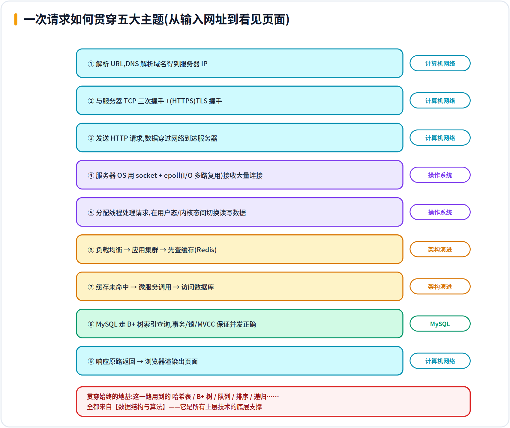
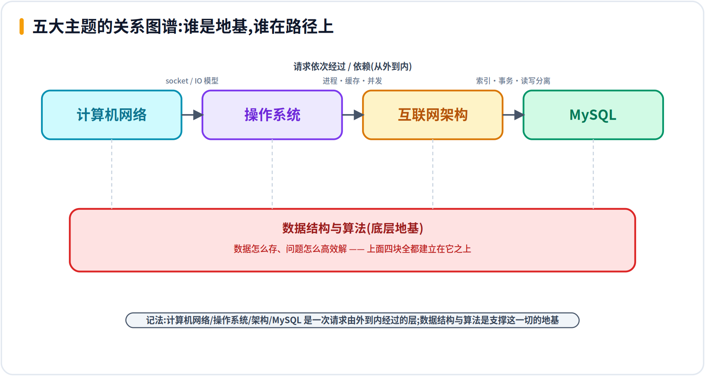

# 导读 · 把九份连成一张网

> 不是为了面试，是为了真懂——每个东西**是什么、为什么这么设计、解决什么问题、怎么用**。懂了这些，vibe coding 时你才压得住模型：知道自己在要什么，判断得出它给的对不对，而不是把垃圾越堆越高。

这套手册由 9 份图文详解组成，每份讲透一个领域。这一页是把它们连成一张网的地图——先说怎么用，再给三块连接它们的「线和面」。

## 怎么用这套手册

- **每份的结构**：每章先「一句话讲透」核心是什么，再展开为什么、配一张图，然后「再往下挖」补延伸、「常见误区」标坑，最后「放到 vibe coding 里」把这个知识连到“怎么判断模型给的方案对不对”。
- **怎么读**：第一遍按顺序通读，重点是每个“为什么”和每张图；之后当手册用，遇到具体问题回来查对应章（右上角可以直接搜索）。
- **真懂的标准**：能对着别人、或对着模型把“是什么 + 为什么”讲清楚，而不是只认得名词。

## 一条请求，串起大半本手册

把领域串起来，最好的线索就是一次最常见的操作：你在浏览器输入网址、按下回车，到看见页面。这短短一瞬，数据几乎穿过了大半本手册。

顺着这条链走一遍：先是【计算机网络】——DNS 把域名解析成 IP，经 TCP 三次握手（HTTPS 再加 TLS）建立连接，发出 HTTP 请求；请求到达服务器后进入【操作系统】——内核用 socket 配合 epoll（I/O 多路复用）接收海量连接，分配线程处理，在用户态/内核态间切换；再进入【互联网架构】——负载均衡分流到应用集群，先查 Redis 缓存，未命中才走微服务调用；最终落到【MySQL】——走 B+ 树索引查询，用事务、锁、MVCC 保证并发下数据正确。而这一路用到的哈希表、B+ 树、队列、排序，全都是【数据结构与算法】提供的底层能力；再往下，这些操作最终落在【计算机组成原理】讲的 CPU、cache、内存上跑。

记牢这条链：它就是你串联一切的主线。无论是和模型讨论一个系统怎么设计，还是排查“为什么慢、为什么崩”，本质都是在这条链的某一环上深入展开。

## 它们的层次关系

不是平级并列，而是有清晰的层次：

- **地基**：计算机组成原理（硬件怎么算）+ 数据结构与算法（数据怎么存、问题怎么高效解）——其余一切的底层支撑。索引为什么快（B+ 树）、缓存为什么用哈希（哈希表）、为什么按 cache 行访问更快，追到底都是它们。
- **运行与连接**：操作系统接收并调度、计算机网络把请求送达。
- **数据与架构**：互联网架构组织服务与缓存、MySQL 存取数据。
- **方法与评判**：软件工程（怎么把事做对）、系统质量属性与架构评估（怎么衡量与权衡一个架构的好坏）。
- **上层与元能力**：LLM 与 Agent 工程——怎么用模型把上面这些落地，也是你正在练的那件事。

## 跨领域的“同一个概念”

很多“看似不同的问题”，其实是同一个底层概念换了场景。认出这种呼应，记忆量直接减半，也更容易在不同领域间自由穿梭。

| 核心概念 | 在哪些领域出现 | 本质是同一件事 |
| --- | --- | --- |
| B+ 树 / 平衡树 | 数据结构 · MySQL 索引 · 架构(DB) | 矮胖多路树，减少磁盘 IO |
| 哈希表 | 数据结构 · MySQL · 架构(Redis、一致性哈希) | 用空间换 O(1) 查找 |
| 队列 | 数据结构 · 操作系统(调度/BFS) · 架构(消息队列) | 先进先出的缓冲与解耦 |
| 栈 / 递归 | 数据结构 · 操作系统(调用栈) · 算法(DFS/回溯/分治) | 后进先出、深入再回退 |
| 缓存与局部性 | 操作系统(CPU/TLB/页) · MySQL(Buffer Pool) · 架构(多级缓存) | 把热数据放更快更近处 |
| 并发控制 | 操作系统(锁) · MySQL(事务/MVCC) · 架构(分布式锁) | 多方同时操作如何不出错 |
| 日志 / WAL | MySQL(redo/undo/binlog) · 架构(可靠性/复制) | 先写日志，保不丢、可恢复 |
| 分而治之 | 算法(分治/归并/二分) · 架构(分库分表/微服务) | 大问题拆成小问题 |
| 复杂度 / 性能度量 | 算法(大 O) · MySQL(慢 SQL) · 架构(可扩展性) | 一切性能优化的统一标尺 |

## 贯穿全栈的五条主线思想

再抽象一层，整个后端技术栈反复在用下面五种思想。把它们当“元知识”记住，遇到没见过的新问题，也能用它们去套、去推——这正是你指挥模型时最该有的判断框架。

- **缓存：用空间换时间** —— 从 CPU 缓存、TLB，到数据库 Buffer Pool，再到 Redis 多级缓存，本质都是“把常用的数据放到更快、更近的地方”，以空间和一致性成本换取速度。
- **并发与一致性** —— 只要有多方同时读写（多线程、多事务、多节点），就要用锁 / MVCC / 分布式事务来保证不出错。隔离性与一致性是从单机到分布式一路贯穿的核心难题。
- **可靠性** —— 数据不能丢、宕机要能恢复：靠先写日志（WAL，如 redo/binlog）、多副本与复制（主从）、以及重试与幂等设计。
- **分而治之与横向扩展** —— 单点扛不住就拆：算法上是分治（归并、二分），工程上是分库分表、微服务拆分、负载均衡——把一个大的拆成很多小的并行处理。
- **复杂度与权衡（没有银弹）** —— 一切都是 trade-off：时间 vs 空间、一致性 vs 可用性（CAP）、性能 vs 复杂度。好的判断会主动说出“我选 A，代价是 B”，而不是假装有完美方案。

> 遇到任何系统 / 性能问题，先用这五把“尺子”问自己（也问模型）：能不能加缓存？并发会不会出错、怎么控？数据怎么保证不丢？扛不住能不能拆开扩展？做了哪些取舍？——答案往往就出来了。

## 结语

九份是一块块砖，这一页是把它们搭起来的图纸。当你能用一条请求把它们串起来、能认出跨领域的同一个概念、能用五条主线思想分析任何新问题——你面对的就不再是一堆零散的知识点，而是一套能举一反三的体系。

带着这套体系，你指挥模型时心里有数，也认得出什么是 vibe 垃圾。点连成线，线织成网。
