# 计算机组成原理

## 把它用在 vibe coding 上

组成原理是“机器到底怎么算”的底层直觉。模型写的代码最终都要落到 CPU、cache、内存、总线上跑，懂这层，你才能解释“为什么这段更快、那段更省”，而不是把性能当玄学。

- **看穿性能差异的根** —— 数组为什么比链表快、随机访问为什么慢，答案在 cache 局部性和存储层次。模型说“优化了性能”时，你能验证它是不是真优化对了地方。
- **识别数值的坑** —— 浮点为什么不能用 == 判等、整数溢出怎么发生，补码与 IEEE 754 决定了模型给的数值代码可不可靠。
- **判断并行与流水** —— 流水线、多核给你“为什么能并行、什么时候反而更慢”的直觉，对应模型写的并发与向量化代码。

## 引言:这份怎么读

计算机组成原理研究的是「计算机硬件的各个部件怎么组织、怎么协同把程序跑起来」。它既是面试和软考里典型的记忆型基础,也是你真正理解「一段代码在机器上到底发生了什么」的根。

全篇的主线是一条数据/指令的旅程:先看整体结构(冯·诺依曼) 数据怎么表示(进制、补码、浮点、校验) 存储怎么分层(金字塔、Cache) 指令怎么编码与寻址 CPU 怎么取指执行 流水线怎么提速 总线怎么把部件连起来 I/O 怎么和外设打交道。

## 第 1 章 · 计算机系统概述(冯·诺依曼)

> **一句话讲透**
> 冯·诺依曼结构的核心是「存储程序」:程序和数据都以二进制形式存进存储器,CPU 自动按地址顺序取出指令并执行。五大部件:运算器、控制器、存储器、输入设备、输出设备;其中运算器 + 控制器合称 CPU。

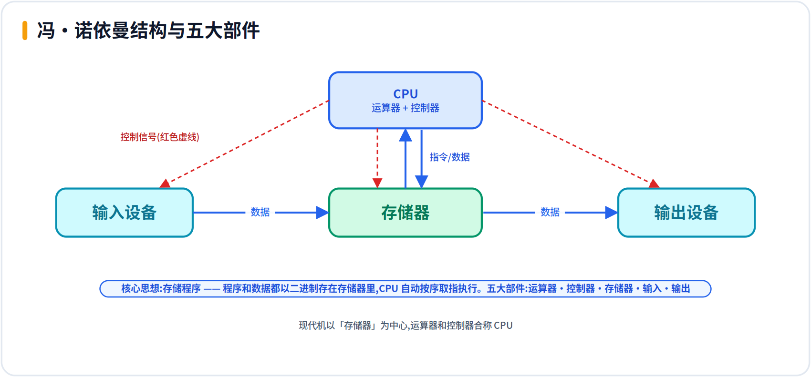

**五大部件的职责**

| 部件 | 职责 |
| --- | --- |
| 运算器(ALU) | 执行算术运算和逻辑运算 |
| 控制器(CU) | 取指、译码,产生控制信号指挥各部件协同 |
| 存储器 | 存放程序和数据(主存 + 辅存) |
| 输入设备 | 把外部信息转成机器能识别的形式(键盘、鼠标) |
| 输出设备 | 把结果转成人能理解的形式(显示器、打印机) |

**再往下挖**

性能指标:主频(时钟频率)、CPI(每条指令平均时钟数)、MIPS(每秒百万条指令)、FLOPS(每秒浮点运算次数)。一条经典公式:程序执行时间 = 指令数 × CPI × 时钟周期。现代计算机以「存储器为中心」(早期是以运算器为中心)。

**常见误区**

主频高 ≠ 一定更快(还要看 CPI、流水线和架构);「存储程序」是冯·诺依曼最本质的思想,不是「有个存储器」这么简单。

## 第 2 章 · 数据在计算机中的表示

> **一句话讲透**
> 计算机内部一切都是二进制。进制上,机内用二进制、书写常用十六进制(简洁,1 位十六进制 = 4 位二进制)。数据分两类:数值数据(定点数、浮点数)和非数值数据(字符 ASCII、汉字编码、逻辑值)。

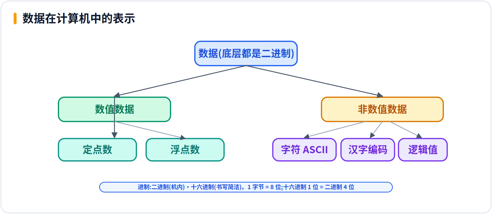

**进制对照(0–15)**

| 十进制 | 二进制 | 十六进制 |
| --- | --- | --- |
| 0 / 1 / 2 / 3 | 0000 / 0001 / 0010 / 0011 | 0 / 1 / 2 / 3 |
| 4 / 5 / 6 / 7 | 0100 / 0101 / 0110 / 0111 | 4 / 5 / 6 / 7 |
| 8 / 9 / 10 / 11 | 1000 / 1001 / 1010 / 1011 | 8 / 9 / A / B |
| 12 / 13 / 14 / 15 | 1100 / 1101 / 1110 / 1111 | C / D / E / F |

**再往下挖**

ASCII 用 7 位表示 128 个字符;1 字节 = 8 位。Unicode/UTF-8 能表示世界上几乎所有字符。BCD 码用 4 位二进制表示 1 位十进制数。

**常见误区**

分清「位 bit」和「字节 Byte」:1 Byte = 8 bit;十六进制只是二进制的简写,本质仍是二进制。

## 第 3 章 · 原码 / 反码 / 补码 / 移码

> **一句话讲透**
> 机器数的符号也用一位二进制表示(0 正、1 负)。原码 = 符号位 + 数值;反码 = 负数时把数值位逐位取反(正数不变);补码 = 反码 + 1;移码 = 补码的符号位取反。正数的原码、反码、补码三者相同。

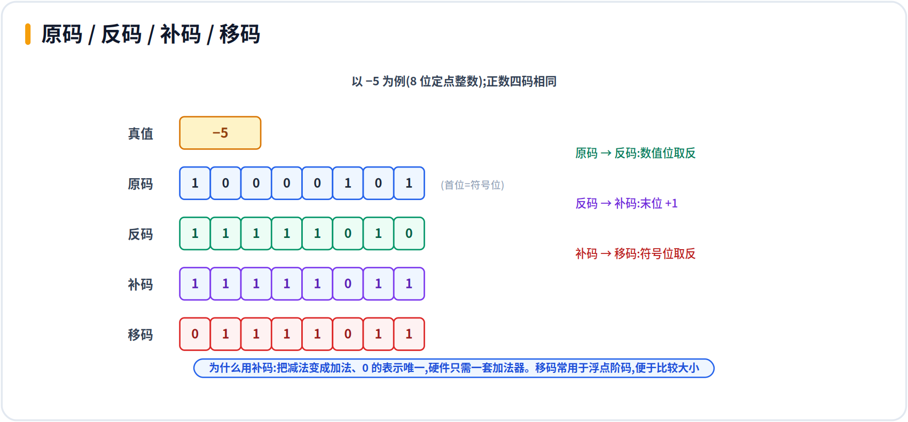

**再往下挖**

为什么用补码:它把减法变成加法(A − B = A + [−B 的补码]),并且 0 的表示唯一,硬件只需一套加法器就能做加减。移码常用于浮点数的阶码,因为它便于直接比较大小。

**常见误区**

0 在原码、反码里有 +0 / −0 两种表示,补码只有一种(这是补码的优点)。8 位补码的表示范围是 −128 ~ +127,比原码多表示一个 −128。

## 第 4 章 · 浮点数(IEEE 754)

> **一句话讲透**
> 浮点数由符号 S + 阶码 E + 尾数 M 三部分组成。单精度 32 位(1 + 8 + 23),双精度 64 位(1 + 11 + 52)。数值 = (−1)^S × 1.M × 2^(E−127)(单精度阶码偏置为 127)。

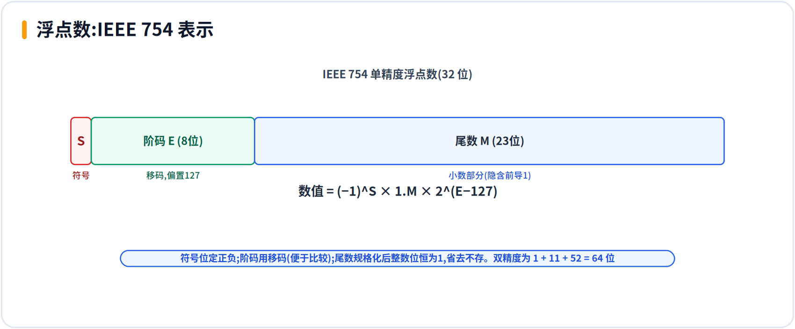

**再往下挖**

规格化:把尾数调整成 1.xxx 的形式,因为整数位恒为 1,所以隐藏起来不存(省 1 位精度)。阶码用移码,便于比较大小。浮点数的特点是表示范围大,但存在精度误差。

**常见误区**

浮点数比较不要用 ==(有精度误差,0.1 都不能精确表示),要判断两数之差在很小的误差范围内。记住:阶码决定范围,尾数决定精度。

> **放到 vibe coding 里**　模型用浮点算金额、或用 == 判等时立刻警觉：0.1+0.2≠0.3 是 IEEE 754 的必然，不是偶发 bug。该用整数分或定点 Decimal，而不是信它“应该没问题”。

## 第 5 章 · 校验码(奇偶 / 海明 / CRC)

> **一句话讲透**
> 校验码靠「加冗余位」来发现甚至纠正错误。奇偶校验:加 1 位使「1 的个数」为奇或偶,只能检出奇数个错、不能纠;海明码:多个校验位分组监督,能定位并纠正 1 位错;CRC 循环冗余:用生成多项式做除法取余,擅长检出突发错误。

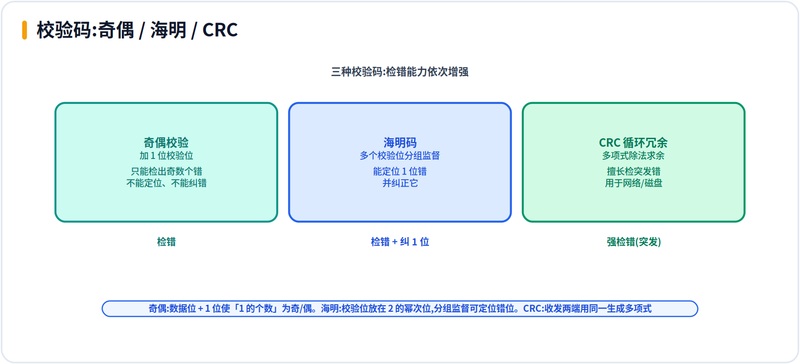

**再往下挖**

海明码校验位个数 k 满足 2^k ≥ n + k + 1(n 为数据位数),校验位放在第 1、2、4、8… 这些 2 的幂次位置。CRC 广泛用于网络帧校验和磁盘存储。

**常见误区**

奇偶校验检不出偶数个错。「检错」和「纠错」是两回事:能纠错的一定能检错,反过来不一定(奇偶能检错但不能纠错)。

## 第 6 章 · 存储系统层次结构

> **一句话讲透**
> 存储器按「速度 / 容量 / 价格」分层成金字塔:寄存器 Cache 主存(内存) 辅存(SSD/HDD) 离线存储。越往上越快、越贵、容量越小。能这样分层加速,根本原因是程序的局部性原理。

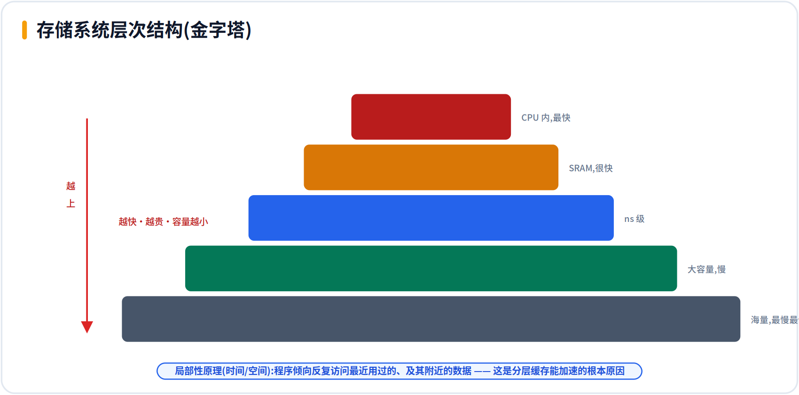

**常见存储器类型**

| 类型 | 特点 | 用途 |
| --- | --- | --- |
| SRAM | 快、贵、不需刷新 | Cache |
| DRAM | 较慢、便宜、需定时刷新 | 主存(内存) |
| ROM | 断电不丢失、只读为主 | 固件/BIOS |
| Flash | 断电不丢、可擦写 | SSD / U 盘 |

**再往下挖**

局部性原理:时间局部性(刚访问过的还会再访问)+ 空间局部性(访问的地址附近也会被访问)。这正是 Cache 能命中、能加速的依据。

**常见误区**

别把 Cache 和虚拟内存搞混:Cache 在「CPU 主存」之间加速,是硬件自动管理;虚拟内存在「主存 辅存」之间扩容,由操作系统管理(见操作系统篇)。

## 第 7 章 · 高速缓存 Cache

> **一句话讲透**
> Cache 用来存放 CPU 最近、最可能用到的主存数据,弥补 CPU 和主存的速度差。主存块到 Cache 行的映射有三种:直接映射(块号 mod 行数,落到固定行,易冲突)、全相联(可放任意行,需全表比较)、组相联(先定组、组内任意,是折中方案,最常用)。

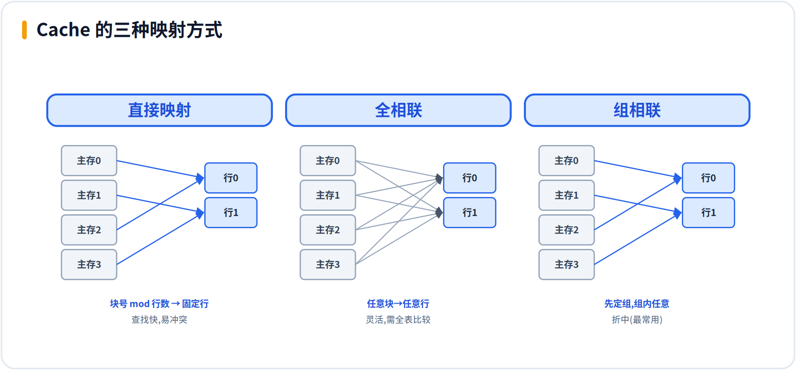

**再往下挖**

替换算法:LRU(最近最少使用,最常用)、FIFO、随机。写策略:写直达(write-through,同时写 Cache 和主存,简单但慢)、写回(write-back,只写 Cache,被换出时再写回主存,快)。命中率是 Cache 的关键指标。

**常见误区**

直接映射查找最快但冲突最多;全相联最灵活但比较代价最大;组相联是两者折中。Cache 对程序员是透明的(由硬件自动管理,不用手动操作)。

> **放到 vibe coding 里**　两段逻辑等价的代码一快一慢，先想 cache 命中：是按行还是按列遍历、数据连不连续。模型很少主动考虑局部性，这正是你能补位的地方。

## 第 8 章 · 指令系统与寻址方式

> **一句话讲透**
> 一条指令 = 操作码(做什么)+ 地址码(操作数在哪)。寻址方式决定「怎么找操作数」:立即寻址(地址码就是操作数本身)、直接寻址(地址码是内存地址,查 1 次内存)、间接寻址(地址码指向的内存里存的才是地址,查 2 次)、寄存器寻址(操作数在寄存器,最快)、变址 / 相对寻址(基址 + 偏移)。

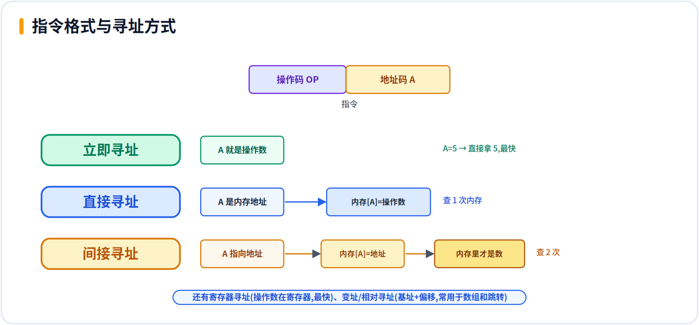

**CISC vs RISC**

| 对比 | CISC | RISC |
| --- | --- | --- |
| 指令 | 多而复杂、长度不定 | 少而规整、定长 |
| 代表 | x86 | ARM / RISC-V |
| 执行 | 一条指令可能多周期 | 多数一周期,适合流水线 |
| 趋势 | 兼容历史包袱重 | 现代主流思想 |

**再往下挖**

寻址方式越多越灵活,但译码越复杂。现代处理器普遍吸收 RISC 思想(指令规整、便于流水线),x86 内部也会把复杂指令拆成类 RISC 的微操作。

**常见误区**

间接寻址访存次数多、速度慢;立即寻址和寄存器寻址最快(不用或几乎不用访存)。

## 第 9 章 · CPU 与指令执行

> **一句话讲透**
> CPU = 控制器(CU,含 PC 程序计数器、IR 指令寄存器)+ 运算器(ALU)+ 寄存器组(通用寄存器、MAR 地址寄存器、MDR 数据寄存器)。一条指令的执行周期是:取指 译码 执行 访存 写回,循环往复直到程序结束。

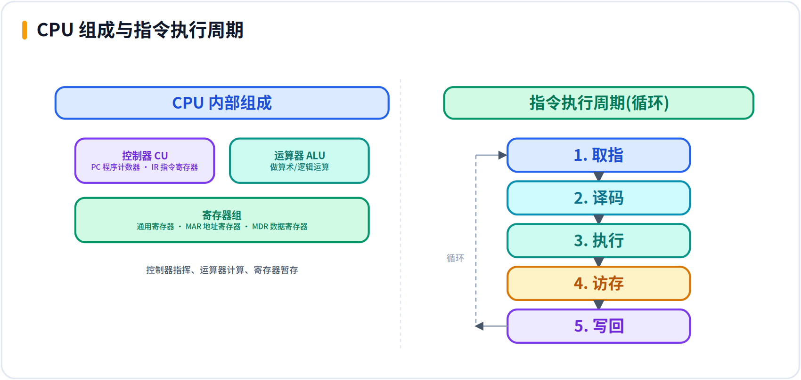

**再往下挖**

PC 程序计数器指向下一条指令的地址(顺序执行时自动 +1,遇跳转则改成目标地址);取指后 PC 更新。控制器产生控制信号指挥各部件;数据在部件间流动的路径叫数据通路。

**常见误区**

PC 里存的是「下一条指令的地址」,不是指令本身;MAR 存地址、MDR 存数据,别记反。

## 第 10 章 · 指令流水线

> **一句话讲透**
> 流水线把一条指令拆成多个阶段(如取指 / 译码 / 执行 / 访存 / 写回),让多条指令在不同阶段上重叠执行,就像工厂流水线。满载时理想吞吐约为「每个时钟周期出 1 条指令」,加速比趋近于流水段数。

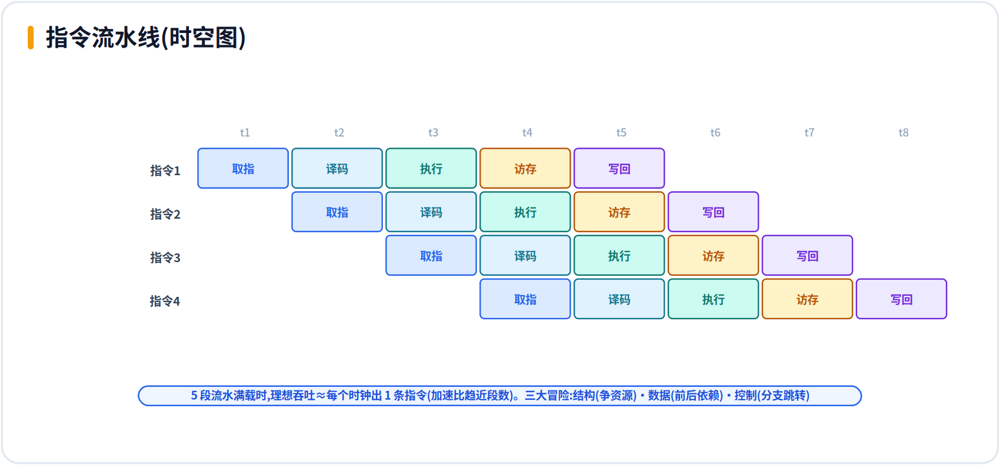

**再往下挖**

三种冒险(冲突):结构冒险(多条指令争用同一硬件资源)、数据冒险(后一条要用前一条还没算完的结果——可用数据转发 forwarding 缓解)、控制冒险(分支跳转使已取的后续指令作废——可用分支预测缓解)。

**常见误区**

流水线加速比达不到理想的「等于段数」(有冒险、还有填充和排空的开销);分支预测一旦错误,要清空流水线,代价较大。

> **放到 vibe coding 里**　流水线靠“猜下一条指令”提速，猜错就清空重来——这就是为什么塞满难预测分支的热点循环会慢。模型写的代码里大量 if 难以预测时，你能指出代价。

## 第 11 章 · 总线

> **一句话讲透**
> 总线是各部件共享的公共数据通路。系统总线分三类:数据总线 DB(双向,传数据,位宽决定一次能传多少位)、地址总线 AB(单向,由 CPU 发出,位数决定可寻址空间大小)、控制总线 CB(传读写、中断、时钟等控制信号)。

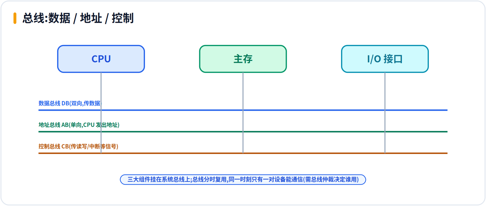

**再往下挖**

总线是分时复用的——同一时刻只有一对设备能通信,多个设备争用时要靠总线仲裁(链式查询、计数器定时查询、独立请求等)决定谁来用。地址总线 n 位 最多寻址 2^n 个单元。

**常见误区**

数据总线宽度和地址总线宽度是两回事(不一定相等);总线是共享资源,所以也是系统的性能瓶颈之一。

## 第 12 章 · 输入输出(I/O)

> **一句话讲透**
> I/O 控制方式按「CPU 参与程度从高到低」分四种:程序查询(CPU 不停轮询设备、忙等,最浪费)、中断(设备就绪时中断通知 CPU,事件驱动)、DMA(DMA 控制器直接在设备和主存之间搬数据,CPU 只在首尾参与)、通道(独立的 I/O 处理器,大型机使用)。

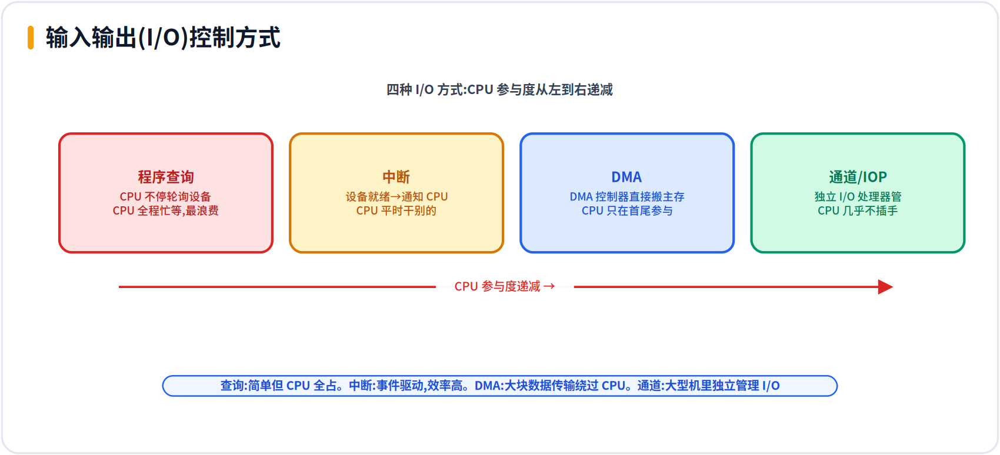

**四种 I/O 方式对比**

| 方式 | CPU 参与 | 适用 |
| --- | --- | --- |
| 程序查询 | 全程忙等,利用率最低 | 简单、低速设备 |
| 中断 | 平时干别的,就绪时响应 | 键盘等随机事件 |
| DMA | 只在传输首尾参与 | 磁盘等大块数据 |
| 通道 | 几乎不插手 | 大型机 I/O 管理 |

**再往下挖**

中断处理流程:保存现场 执行中断服务程序 恢复现场。DMA 传输时若与 CPU 争用主存,DMA 优先占用一个存取周期,这叫「周期窃取」。

**常见误区**

程序查询方式 CPU 利用率最低;DMA 传输期间 CPU 仍可执行不访问主存的指令,并不是完全停下。

## 第 13 章 · 总结与速查

把这门收个尾。主线再走一遍:整体结构(冯·诺依曼) 数据表示(进制 / 补码 / 浮点 / 校验) 存储分层(金字塔 / Cache) 指令与寻址 CPU 取指执行 流水线提速 总线互连 I/O 与外设。

**核心考点速查**

| 概念 | 一句话 |
| --- | --- |
| 冯·诺依曼 | 存储程序 + 五大部件;运算器 + 控制器 = CPU。 |
| 补码 | 减法变加法、0 唯一,硬件只需一套加法器。 |
| 移码 | 补码符号位取反;用于浮点阶码,便于比大小。 |
| IEEE 754 | S + 阶码(移码)+ 尾数;尾数隐含前导 1。 |
| 校验码 | 奇偶(检)< 海明(检+纠1位)< CRC(检突发)。 |
| 存储金字塔 | 寄存器Cache主存辅存;靠局部性加速。 |
| Cache 映射 | 直接(固定行)/ 全相联(任意)/ 组相联(折中)。 |
| 写策略 | 写直达(同步写主存)/ 写回(换出再写)。 |
| 寻址方式 | 立即 / 直接(查1次)/ 间接(查2次)/ 寄存器。 |
| CISC vs RISC | 复杂多周期 vs 精简定长、利于流水线。 |
| CPU | CU(PC/IR)+ ALU + 寄存器(MAR/MDR)。 |
| 指令周期 | 取指译码执行访存写回。 |
| 流水线 | 多指令重叠;冒险:结构 / 数据 / 控制。 |
| 总线 | 数据 DB / 地址 AB / 控制 CB;分时复用需仲裁。 |
| I/O 方式 | 查询 / 中断 / DMA / 通道,CPU 参与递减。 |

> 复习建议 这门偏记忆、考点细碎,选择题占大头。最高效的打法是:先用本篇的图和速答把概念框架立起来,再大量刷历年真题(选择题为主),把「易错点」逐条吃掉。补码、IEEE 754、Cache 映射、流水线冒险、I/O 方式这几块几乎每次都考,优先记牢。

把图记在脑子里,选择题就稳了。
