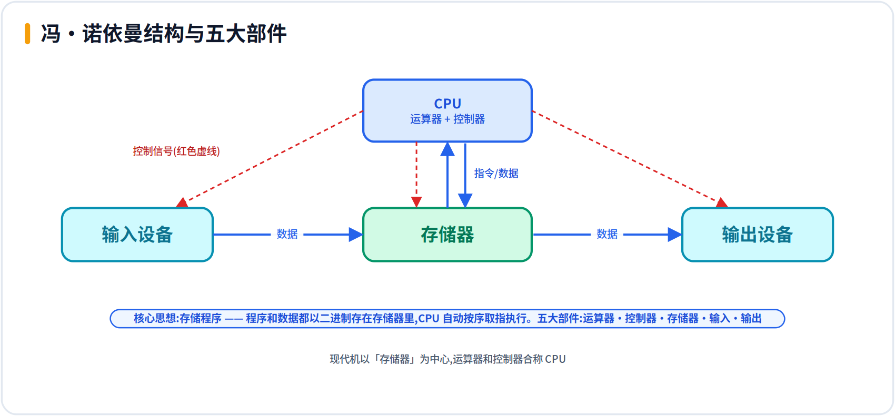

# 第 1 章 · 计算机系统概述(冯·诺依曼)

> **一句话讲透**
> 冯·诺依曼结构的核心是「存储程序」:程序和数据都以二进制形式存进存储器,CPU 自动按地址顺序取出指令并执行。五大部件:运算器、控制器、存储器、输入设备、输出设备;其中运算器 + 控制器合称 CPU。

**五大部件的职责**

| 部件 | 职责 |
| --- | --- |
| 运算器(ALU) | 执行算术运算和逻辑运算 |
| 控制器(CU) | 取指、译码,产生控制信号指挥各部件协同 |
| 存储器 | 存放程序和数据(主存 + 辅存) |
| 输入设备 | 把外部信息转成机器能识别的形式(键盘、鼠标) |
| 输出设备 | 把结果转成人能理解的形式(显示器、打印机) |

**再往下挖**

性能指标:主频(时钟频率)、CPI(每条指令平均时钟数)、MIPS(每秒百万条指令)、FLOPS(每秒浮点运算次数)。一条经典公式:程序执行时间 = 指令数 × CPI × 时钟周期。现代计算机以「存储器为中心」(早期是以运算器为中心)。

**常见误区**

主频高 ≠ 一定更快(还要看 CPI、流水线和架构);「存储程序」是冯·诺依曼最本质的思想,不是「有个存储器」这么简单。
