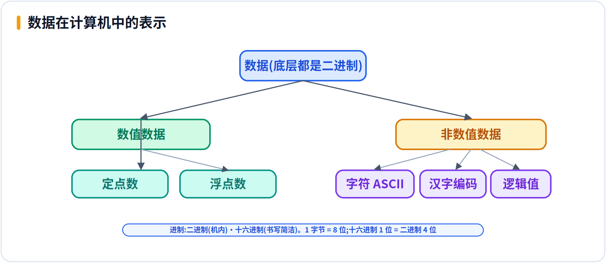

# 第 2 章 · 数据在计算机中的表示

> **一句话讲透**
> 计算机内部一切都是二进制。进制上,机内用二进制、书写常用十六进制(简洁,1 位十六进制 = 4 位二进制)。数据分两类:数值数据(定点数、浮点数)和非数值数据(字符 ASCII、汉字编码、逻辑值)。

**进制对照(0–15)**

| 十进制 | 二进制 | 十六进制 |
| --- | --- | --- |
| 0 / 1 / 2 / 3 | 0000 / 0001 / 0010 / 0011 | 0 / 1 / 2 / 3 |
| 4 / 5 / 6 / 7 | 0100 / 0101 / 0110 / 0111 | 4 / 5 / 6 / 7 |
| 8 / 9 / 10 / 11 | 1000 / 1001 / 1010 / 1011 | 8 / 9 / A / B |
| 12 / 13 / 14 / 15 | 1100 / 1101 / 1110 / 1111 | C / D / E / F |

**再往下挖**

ASCII 用 7 位表示 128 个字符;1 字节 = 8 位。Unicode/UTF-8 能表示世界上几乎所有字符。BCD 码用 4 位二进制表示 1 位十进制数。

**常见误区**

分清「位 bit」和「字节 Byte」:1 Byte = 8 bit;十六进制只是二进制的简写,本质仍是二进制。
