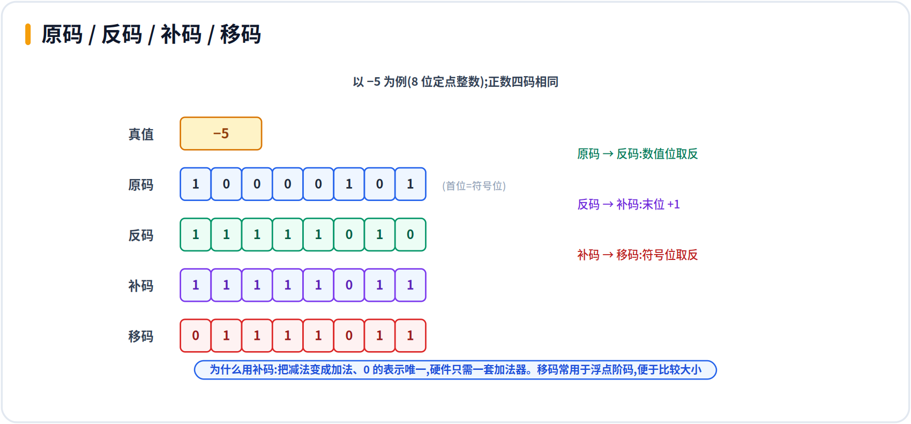

# 第 3 章 · 原码 / 反码 / 补码 / 移码

> **一句话讲透**
> 机器数的符号也用一位二进制表示(0 正、1 负)。原码 = 符号位 + 数值;反码 = 负数时把数值位逐位取反(正数不变);补码 = 反码 + 1;移码 = 补码的符号位取反。正数的原码、反码、补码三者相同。

**再往下挖**

为什么用补码:它把减法变成加法(A − B = A + [−B 的补码]),并且 0 的表示唯一,硬件只需一套加法器就能做加减。移码常用于浮点数的阶码,因为它便于直接比较大小。

**常见误区**

0 在原码、反码里有 +0 / −0 两种表示,补码只有一种(这是补码的优点)。8 位补码的表示范围是 −128 ~ +127,比原码多表示一个 −128。
