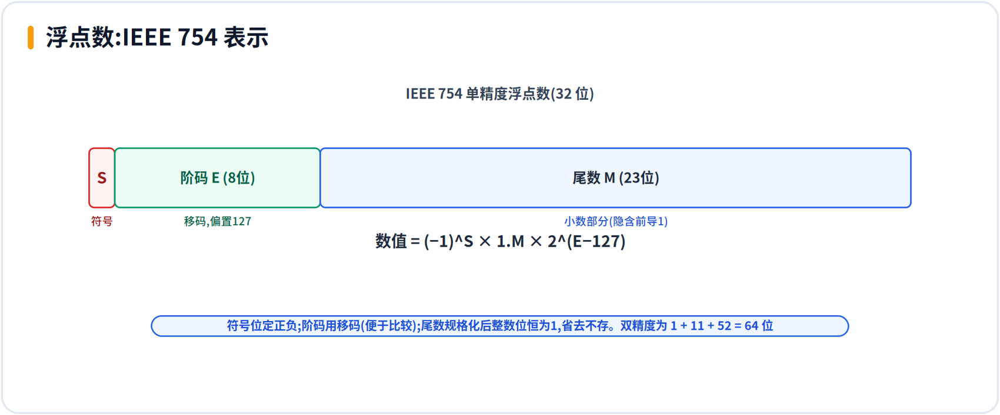

# 第 4 章 · 浮点数(IEEE 754)

> **一句话讲透**
> 浮点数由符号 S + 阶码 E + 尾数 M 三部分组成。单精度 32 位(1 + 8 + 23),双精度 64 位(1 + 11 + 52)。数值 = (−1)^S × 1.M × 2^(E−127)(单精度阶码偏置为 127)。

**再往下挖**

规格化:把尾数调整成 1.xxx 的形式,因为整数位恒为 1,所以隐藏起来不存(省 1 位精度)。阶码用移码,便于比较大小。浮点数的特点是表示范围大,但存在精度误差。

**常见误区**

浮点数比较不要用 ==(有精度误差,0.1 都不能精确表示),要判断两数之差在很小的误差范围内。记住:阶码决定范围,尾数决定精度。

> **放到 vibe coding 里**　模型用浮点算金额、或用 == 判等时立刻警觉：0.1+0.2≠0.3 是 IEEE 754 的必然，不是偶发 bug。该用整数分或定点 Decimal，而不是信它“应该没问题”。
