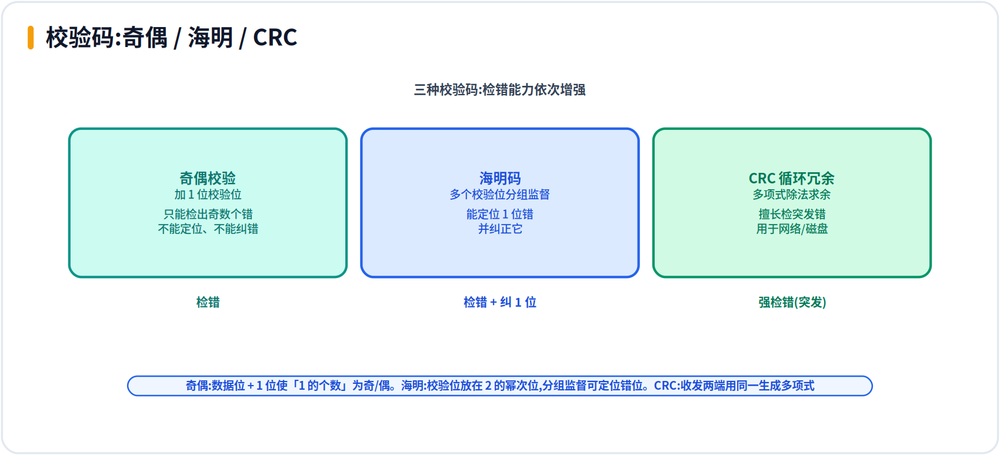

# 第 5 章 · 校验码(奇偶 / 海明 / CRC)

> **一句话讲透**
> 校验码靠「加冗余位」来发现甚至纠正错误。奇偶校验:加 1 位使「1 的个数」为奇或偶,只能检出奇数个错、不能纠;海明码:多个校验位分组监督,能定位并纠正 1 位错;CRC 循环冗余:用生成多项式做除法取余,擅长检出突发错误。

**再往下挖**

海明码校验位个数 k 满足 2^k ≥ n + k + 1(n 为数据位数),校验位放在第 1、2、4、8… 这些 2 的幂次位置。CRC 广泛用于网络帧校验和磁盘存储。

**常见误区**

奇偶校验检不出偶数个错。「检错」和「纠错」是两回事:能纠错的一定能检错,反过来不一定(奇偶能检错但不能纠错)。
