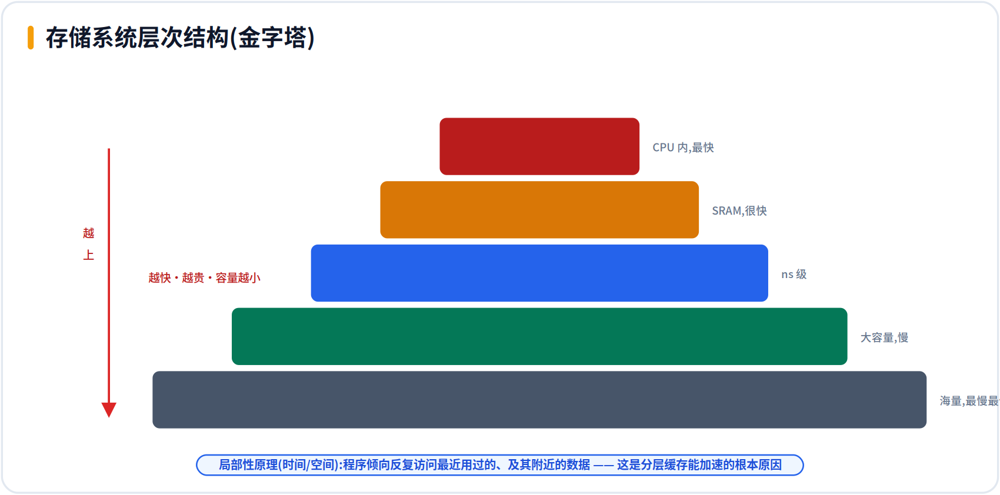

# 第 6 章 · 存储系统层次结构

> **一句话讲透**
> 存储器按「速度 / 容量 / 价格」分层成金字塔:寄存器 Cache 主存(内存) 辅存(SSD/HDD) 离线存储。越往上越快、越贵、容量越小。能这样分层加速,根本原因是程序的局部性原理。

**常见存储器类型**

| 类型 | 特点 | 用途 |
| --- | --- | --- |
| SRAM | 快、贵、不需刷新 | Cache |
| DRAM | 较慢、便宜、需定时刷新 | 主存(内存) |
| ROM | 断电不丢失、只读为主 | 固件/BIOS |
| Flash | 断电不丢、可擦写 | SSD / U 盘 |

**再往下挖**

局部性原理:时间局部性(刚访问过的还会再访问)+ 空间局部性(访问的地址附近也会被访问)。这正是 Cache 能命中、能加速的依据。

**常见误区**

别把 Cache 和虚拟内存搞混:Cache 在「CPU 主存」之间加速,是硬件自动管理;虚拟内存在「主存 辅存」之间扩容,由操作系统管理(见操作系统篇)。
