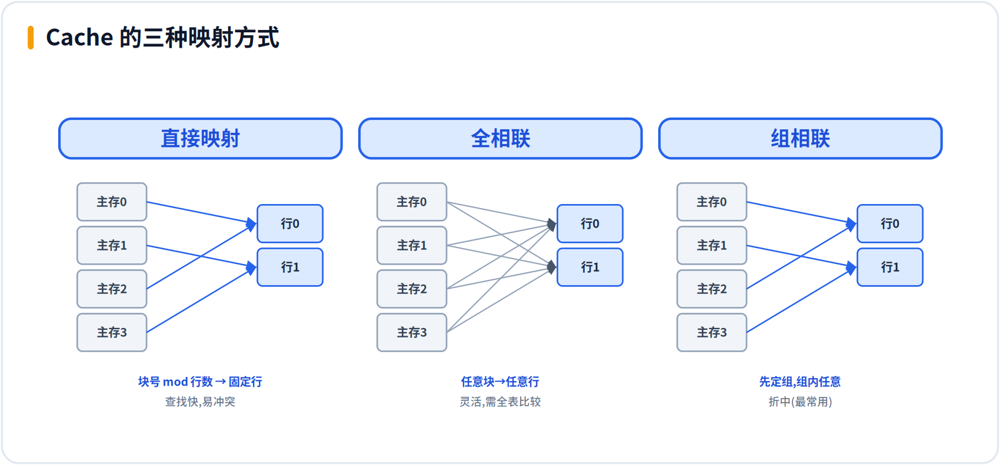

# 第 7 章 · 高速缓存 Cache

> **一句话讲透**
> Cache 用来存放 CPU 最近、最可能用到的主存数据,弥补 CPU 和主存的速度差。主存块到 Cache 行的映射有三种:直接映射(块号 mod 行数,落到固定行,易冲突)、全相联(可放任意行,需全表比较)、组相联(先定组、组内任意,是折中方案,最常用)。

**再往下挖**

替换算法:LRU(最近最少使用,最常用)、FIFO、随机。写策略:写直达(write-through,同时写 Cache 和主存,简单但慢)、写回(write-back,只写 Cache,被换出时再写回主存,快)。命中率是 Cache 的关键指标。

**常见误区**

直接映射查找最快但冲突最多;全相联最灵活但比较代价最大;组相联是两者折中。Cache 对程序员是透明的(由硬件自动管理,不用手动操作)。

> **放到 vibe coding 里**　两段逻辑等价的代码一快一慢，先想 cache 命中：是按行还是按列遍历、数据连不连续。模型很少主动考虑局部性，这正是你能补位的地方。
