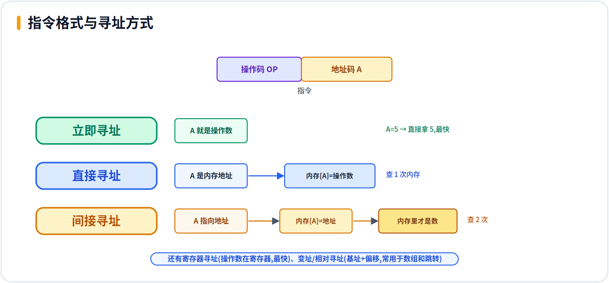

# 第 8 章 · 指令系统与寻址方式

> **一句话讲透**
> 一条指令 = 操作码(做什么)+ 地址码(操作数在哪)。寻址方式决定「怎么找操作数」:立即寻址(地址码就是操作数本身)、直接寻址(地址码是内存地址,查 1 次内存)、间接寻址(地址码指向的内存里存的才是地址,查 2 次)、寄存器寻址(操作数在寄存器,最快)、变址 / 相对寻址(基址 + 偏移)。

**CISC vs RISC**

| 对比 | CISC | RISC |
| --- | --- | --- |
| 指令 | 多而复杂、长度不定 | 少而规整、定长 |
| 代表 | x86 | ARM / RISC-V |
| 执行 | 一条指令可能多周期 | 多数一周期,适合流水线 |
| 趋势 | 兼容历史包袱重 | 现代主流思想 |

**再往下挖**

寻址方式越多越灵活,但译码越复杂。现代处理器普遍吸收 RISC 思想(指令规整、便于流水线),x86 内部也会把复杂指令拆成类 RISC 的微操作。

**常见误区**

间接寻址访存次数多、速度慢;立即寻址和寄存器寻址最快(不用或几乎不用访存)。
