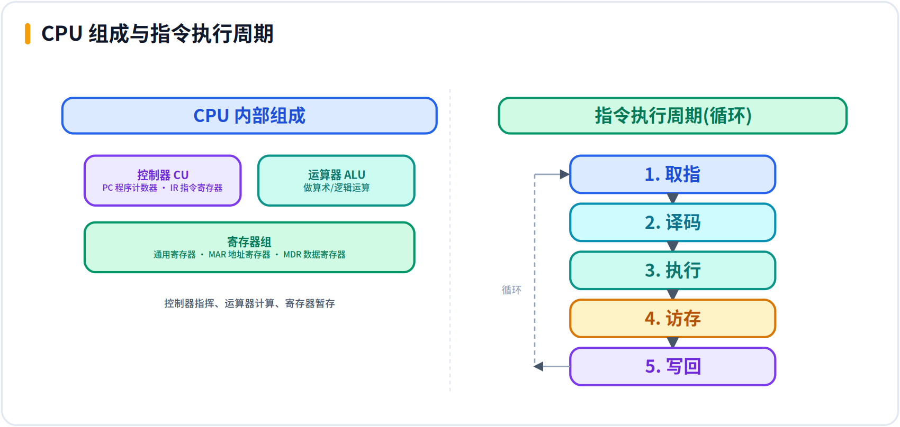

# 第 9 章 · CPU 与指令执行

> **一句话讲透**
> CPU = 控制器(CU,含 PC 程序计数器、IR 指令寄存器)+ 运算器(ALU)+ 寄存器组(通用寄存器、MAR 地址寄存器、MDR 数据寄存器)。一条指令的执行周期是:取指 译码 执行 访存 写回,循环往复直到程序结束。

**再往下挖**

PC 程序计数器指向下一条指令的地址(顺序执行时自动 +1,遇跳转则改成目标地址);取指后 PC 更新。控制器产生控制信号指挥各部件;数据在部件间流动的路径叫数据通路。

**常见误区**

PC 里存的是「下一条指令的地址」,不是指令本身;MAR 存地址、MDR 存数据,别记反。
