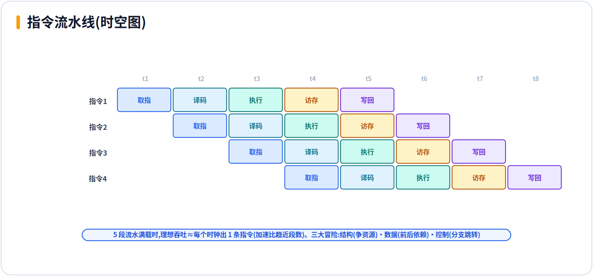

# 第 10 章 · 指令流水线

> **一句话讲透**
> 流水线把一条指令拆成多个阶段(如取指 / 译码 / 执行 / 访存 / 写回),让多条指令在不同阶段上重叠执行,就像工厂流水线。满载时理想吞吐约为「每个时钟周期出 1 条指令」,加速比趋近于流水段数。

**再往下挖**

三种冒险(冲突):结构冒险(多条指令争用同一硬件资源)、数据冒险(后一条要用前一条还没算完的结果——可用数据转发 forwarding 缓解)、控制冒险(分支跳转使已取的后续指令作废——可用分支预测缓解)。

**常见误区**

流水线加速比达不到理想的「等于段数」(有冒险、还有填充和排空的开销);分支预测一旦错误,要清空流水线,代价较大。

> **放到 vibe coding 里**　流水线靠“猜下一条指令”提速，猜错就清空重来——这就是为什么塞满难预测分支的热点循环会慢。模型写的代码里大量 if 难以预测时，你能指出代价。
