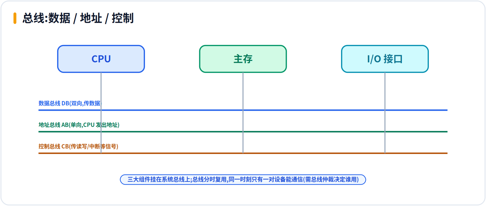

# 第 11 章 · 总线

> **一句话讲透**
> 总线是各部件共享的公共数据通路。系统总线分三类:数据总线 DB(双向,传数据,位宽决定一次能传多少位)、地址总线 AB(单向,由 CPU 发出,位数决定可寻址空间大小)、控制总线 CB(传读写、中断、时钟等控制信号)。

**再往下挖**

总线是分时复用的——同一时刻只有一对设备能通信,多个设备争用时要靠总线仲裁(链式查询、计数器定时查询、独立请求等)决定谁来用。地址总线 n 位 最多寻址 2^n 个单元。

**常见误区**

数据总线宽度和地址总线宽度是两回事(不一定相等);总线是共享资源,所以也是系统的性能瓶颈之一。
