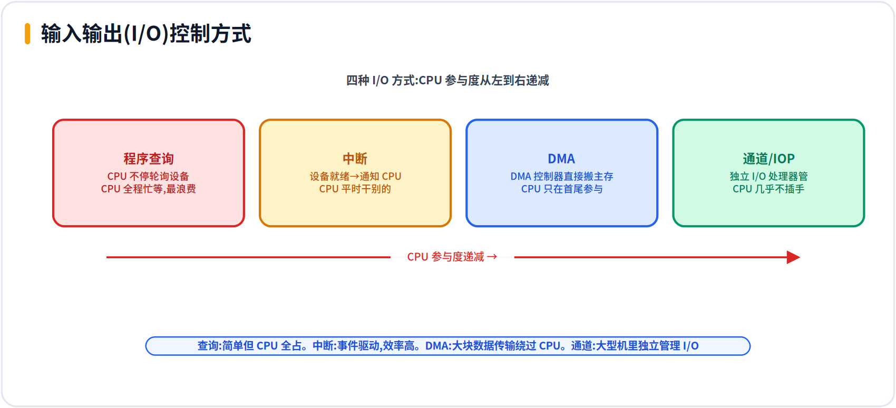

# 第 12 章 · 输入输出(I/O)

> **一句话讲透**
> I/O 控制方式按「CPU 参与程度从高到低」分四种:程序查询(CPU 不停轮询设备、忙等,最浪费)、中断(设备就绪时中断通知 CPU,事件驱动)、DMA(DMA 控制器直接在设备和主存之间搬数据,CPU 只在首尾参与)、通道(独立的 I/O 处理器,大型机使用)。

**四种 I/O 方式对比**

| 方式 | CPU 参与 | 适用 |
| --- | --- | --- |
| 程序查询 | 全程忙等,利用率最低 | 简单、低速设备 |
| 中断 | 平时干别的,就绪时响应 | 键盘等随机事件 |
| DMA | 只在传输首尾参与 | 磁盘等大块数据 |
| 通道 | 几乎不插手 | 大型机 I/O 管理 |

**再往下挖**

中断处理流程:保存现场 执行中断服务程序 恢复现场。DMA 传输时若与 CPU 争用主存,DMA 优先占用一个存取周期,这叫「周期窃取」。

**常见误区**

程序查询方式 CPU 利用率最低;DMA 传输期间 CPU 仍可执行不访问主存的指令,并不是完全停下。
