# 操作系统

操作系统怎么管理硬件、调度程序、扛住高并发：进程、内存、I/O 多路复用。

## 引言:操作系统到底在管什么

操作系统(OS)的八股看着杂,其实主线很清晰:它是夹在硬件和应用之间的“资源管理者”。向下,它管着 CPU、内存、磁盘、各种设备;向上,它把这些硬件抽象成进程、虚拟内存、文件等好用的概念,并通过系统调用为程序提供统一服务。所有考点——进程线程、内存管理、I/O——都是在回答同一个问题:OS 如何高效、安全地把有限的硬件资源分配给众多程序使用。

本文按“先打地基、再分专题”的顺序展开:先讲清 OS 是什么、内核与用户态/内核态;再深入重难点——内存管理(虚拟内存、分页分段、TLB、缺页、置换);然后是进程与线程两大主题(状态、通信、调度、同步);接着是高并发绕不开的 I/O 多路复用;最后补上文件链接与磁盘等常见小题。

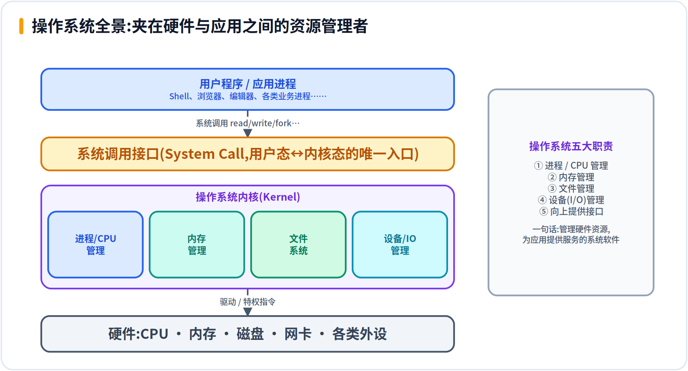

## 把它用在 vibe coding 上

操作系统是你和模型共用的“运行时常识”。模型能写出多线程、异步、共享内存的代码，但它不为后果负责——判断“这样跑会不会崩、会不会慢、会不会有竞态”的人是你。懂了这章，你在几件事上能压住模型：

- **选并发模型** —— 它该用多线程还是 epoll / 异步？知道“一个线程盯住上万连接”正是 I/O 多路复用要解决的问题，就不会被“每个连接开一个线程”的方案糊弄过去。
- **看出竞态与死锁** —— 它写的共享数据访问有没有加锁、会不会循环等待？死锁四条件在脑子里，review 时就有尺子，而不是“跑起来没崩就算过”。
- **判断性能瓶颈** —— 它说“加个缓存就好了”，你知道系统调用、上下文切换、随机磁盘 I/O 各自的代价，能追问到真正的瓶颈在哪。
- **划清资源边界** —— 进程崩了为什么不连累别的进程、内存不够时发生什么（OOM / swap），决定了你怎么给模型设运行约束。

## 第 1 章 · 操作系统基础:定义与主要功能

> **一句话讲透**
> 操作系统是管理计算机硬件资源、并为上层应用提供运行环境和服务的系统软件。它向下管理 CPU、内存、磁盘、设备,向上通过系统调用提供统一接口。五大核心功能:进程(CPU)管理、内存管理、文件管理、设备(I/O)管理,以及向用户和程序提供接口。

如果没有操作系统,每个程序都得自己直接操作硬件,既复杂又危险,还无法在多个程序间协调资源。OS 把硬件封装成进程、文件、虚拟内存这些易用的抽象,并负责在众多程序之间分配与隔离资源,保证系统稳定运行。

**再往下挖**

- OS 类型:批处理、分时(我们日常用的)、实时操作系统等;手机/服务器/嵌入式各有侧重。
- 用户态 / 内核态的分离是安全的基础;系统调用是用户程序请求内核服务的唯一合法入口(见第 2 章)。

## 第 2 章 · 系统结构:内核、用户态与内核态

> **一句话讲透**
> 内核是 OS 最核心的部分,常驻内存、运行在内核态,负责进程、内存、设备等管理。CPU 提供两种特权级:内核态(Ring 0)能执行特权指令、访问所有资源;用户态(Ring 3)受限,只能访问自己的用户空间。进程地址空间也分为用户空间(进程私有)和内核空间(所有进程共享同一份内核映射)。用户程序要使用内核功能,必须通过系统调用、中断或异常“陷入”内核态,执行完再返回用户态。

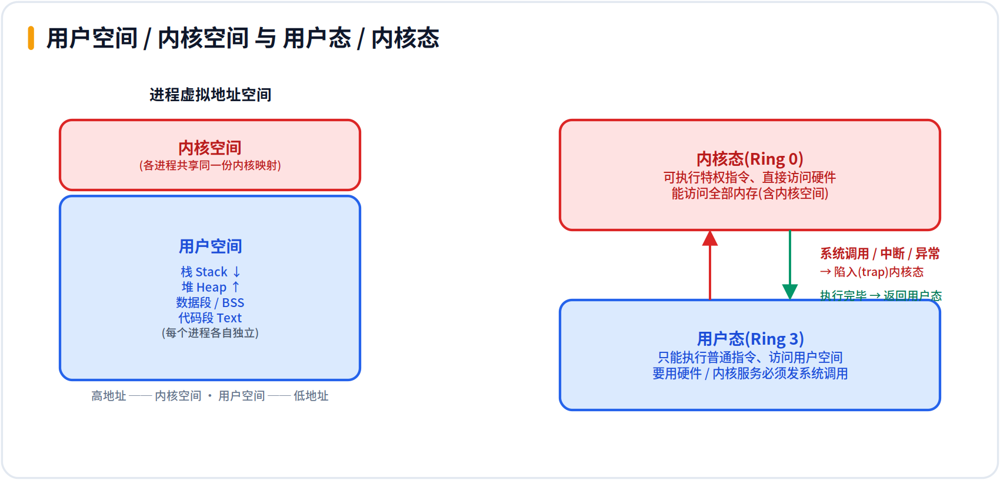

为什么要分两种态?核心是隔离与保护:防止用户程序直接乱碰硬件或访问他人内存而搞崩系统。用户态想做特权操作(读写磁盘、分配内存、创建进程),只能通过受控的系统调用(如 read / write / fork)请内核代劳。

**再往下挖**

- 进入内核态的三种方式:系统调用(主动)、中断(外部设备,如时钟/键盘)、异常(如缺页、除零)。
- 用户态内核态切换要保存/恢复上下文,有开销;频繁系统调用是常见性能瓶颈,这也是 mmap、零拷贝、io_uring 等技术想减少切换的原因。

## 第 3 章 · 物理内存与虚拟内存

> **一句话讲透**
> 物理内存就是实际的 RAM。虚拟内存是 OS 给每个进程提供的一块独立、连续、可比物理内存更大的逻辑地址空间:进程用虚拟地址访问,由 MMU 配合页表翻译成物理地址;物理内存放不下时,把不常用的页换到磁盘(交换空间)。

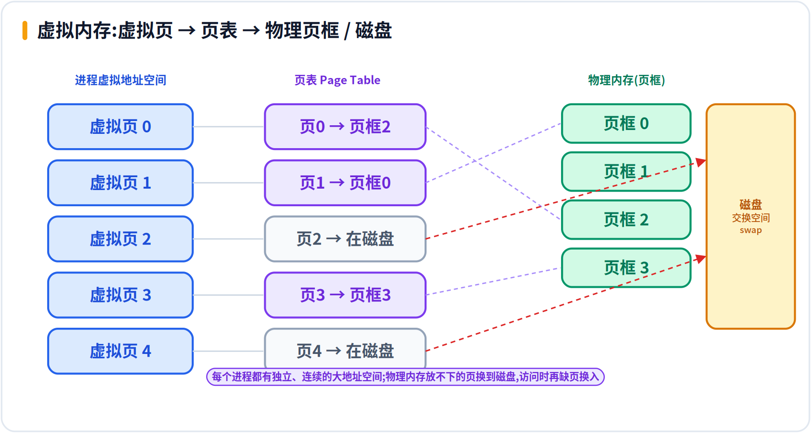

**虚拟内存的四大好处(常考)**

- **隔离与安全** —— 每个进程都有独立的虚拟地址空间,互相看不到、碰不到,一个进程崩溃不影响别人。
- **突破物理限制** —— 程序可用的地址空间不受物理内存大小限制,物理内存不够就用磁盘 swap 顶上。
- **地址连续(简化编程)** —— 进程看到的是连续的地址空间,无需关心物理内存是否碎片化,由页表负责离散映射。
- **便于共享** —— 多个进程可把同一物理页映射进各自空间,实现共享库、共享内存等。

**再往下挖**

- 虚拟地址物理地址由 MMU(内存管理单元)硬件 + 页表完成。
- 虚拟内存之所以高效,依赖程序的局部性原理(时间局部性 + 空间局部性):最近用过、邻近的数据大概率很快再用。

> **放到 vibe coding 里**　模型动不动建议“内存不够就加机器”。你能先追一句：是真用满了，还是在频繁 swap、抖动（thrashing）？知道虚拟内存和缺页的代价，就不会把“换页换到死”误当成“内存够用”。

## 第 4 章 · 内存分页与分段

> **一句话讲透**
> 两者都是“划分地址空间再映射到物理内存”的方式。分页把空间切成固定大小的页(如 4KB),物理内存切成同样大小的页框,通过页表映射——无外部碎片但有内部碎片,对程序员透明,目的是提高内存利用率(系统视角)。分段按逻辑模块(代码段/数据段/栈段)变长划分,通过段表映射——便于共享和保护,但有外部碎片,对程序员可见,目的是满足程序的逻辑结构(用户视角)。

**分页与分段的区别**

| 对比维度 | 分页 Paging | 分段 Segmentation |
| --- | --- | --- |
| 划分依据 | 固定大小的页(物理单位) | 逻辑模块(代码/数据/栈) |
| 大小 | 固定 | 可变 |
| 碎片 | 有内部碎片,无外部碎片 | 有外部碎片,无内部碎片 |
| 地址结构 | 一维(页号+偏移) | 二维(段号+段内偏移) |
| 对程序员 | 透明(系统视角) | 可见(用户视角) |
| 主要目的 | 提高内存利用率 | 满足逻辑/共享保护需求 |

**再往下挖**

现代系统常用段页式:先按段划分逻辑结构,再在段内分页管理物理内存,兼顾两者优点。

## 第 5 章 · 多级页表、快表与地址翻译

> **一句话讲透**
> 单级页表太大(32 位、4KB 页时每个进程需 2²⁰ 个表项),多级页表按需分配——只为用到的地址段建立下级页表,大幅节省空间;代价是要多次访存。于是加一个快表 TLB(缓存常用页表项的硬件 Cache):翻译地址时先查 TLB,命中就直接拿到物理页框;未命中才去查多级页表,再把结果写回 TLB。

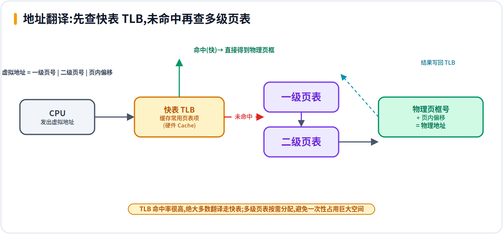

- **多级页表** —— 把页表本身再分级、按需分配,没用到的下级页表不占空间,解决单级页表过大的问题。
- **快表 TLB** —— CPU 内的小型高速缓存,存放最近用过的“虚拟页物理页框”映射,命中即可免去访问内存中的页表。

**再往下挖**

- 因为局部性原理,TLB 命中率通常很高,绝大多数地址翻译都走快表,速度很快。
- 进程切换会使 TLB 失效(需刷新或用 ASID 区分),这正是“进程切换比线程切换更贵”的原因之一(见第 10 章)。

## 第 6 章 · 缺页中断、交换空间与页面置换

> **一句话讲透**
> 访问的页不在物理内存(present=0)时触发缺页中断,陷入内核处理:检查地址合法性 有空闲页框就分配,否则用页面置换算法选一个“牺牲页”换出(若是脏页先写回磁盘) 从磁盘读入缺失页 更新页表 重新执行刚才那条指令。交换空间(swap)就是磁盘上专门用于换出页的区域。

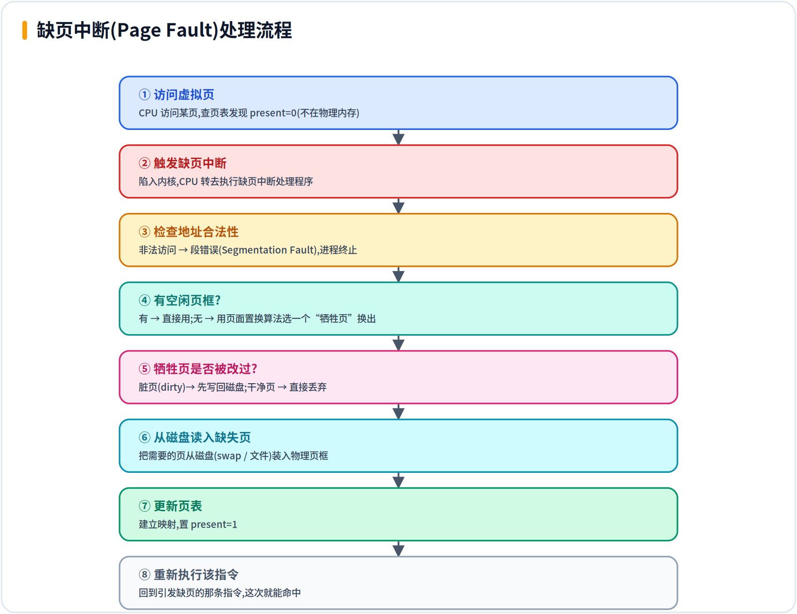

**常见页面置换算法**

| 算法 | 核心思想 / 特点 |
| --- | --- |
| OPT 最优 | 换出“未来最久不会用”的页;命中率最高,但需预知未来,只能作理论上界。 |
| FIFO 先进先出 | 换出最早进来的页;实现简单,但可能出现 Belady 异常(增页框反而更多缺页)。 |
| LRU 最近最久未用 | 换出最久没被访问的页;贴近实际、效果好,但精确实现开销大。 |
| LFU 最不经常使用 | 换出访问次数最少的页;对访问频率敏感。 |
| Clock 时钟/二次机会 | 用访问位近似 LRU,环形扫描给“第二次机会”;开销小,工程常用。 |

**常见误区**

- 缺页中断属于“故障(fault)”类异常,处理完会重新执行触发它的那条指令,这点和普通中断不同。
- 区分“缺页”和“非法访问”:访问越界/无权限会触发段错误(Segmentation Fault)直接杀进程,而不是换页。
- 抖动(Thrashing):分配的页框太少导致频繁缺页换入换出,CPU 大量耗在换页上——常见追问。

## 第 7 章 · 进程基础:状态 / 并发 / 僵尸与孤儿

> **一句话讲透**
> 进程是程序的一次执行,是 OS 资源分配的基本单位,拥有独立的地址空间和 PCB(进程控制块)。五态模型:创建 就绪 运行 阻塞 终止;运行态可因时间片用完或被抢占回到就绪,或因等待 I/O 进入阻塞,阻塞结束只能先回就绪、不能直接运行。

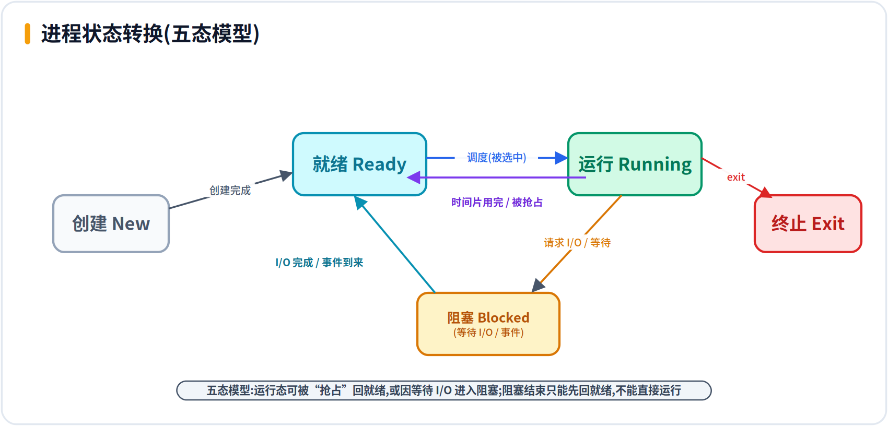

**并行 vs 并发(高频区分)**

并发是同一时间段内多个任务交替执行(单核也能并发,靠快速切换造成“同时”的错觉);并行是同一时刻多个任务真正同时执行(必须有多核/多 CPU)。一句话:并发是“轮流”,并行是“同时”。

**进程上下文切换**

切换进程时,OS 要保存当前进程的 CPU 寄存器、程序计数器、PCB 等状态,再加载下一个进程的状态;还可能切换页表,导致 TLB 和 Cache 失效。因此进程切换开销较大。

**两种特殊进程**

- **僵尸进程 Zombie** —— 子进程已结束,但父进程没调用 wait/waitpid 回收它的 PCB,残留一个“已死却占着进程号”的表项。
- **孤儿进程 Orphan** —— 父进程先结束,子进程被 init(pid=1)进程收养并负责回收,无危害。

**常见误区**

- 僵尸进程的危害是占用进程号等资源,过多会导致无法创建新进程。
- 解决:父进程及时 wait/waitpid;或处理/忽略 SIGCHLD 信号让系统回收;父进程退出后,残留子进程会被 init 接管回收。

## 第 8 章 · 进程间通信(IPC)

> **一句话讲透**
> 进程地址空间相互独立,通信要借助内核提供的 IPC 机制,常见六种:管道、信号、消息队列、共享内存、信号量、套接字。

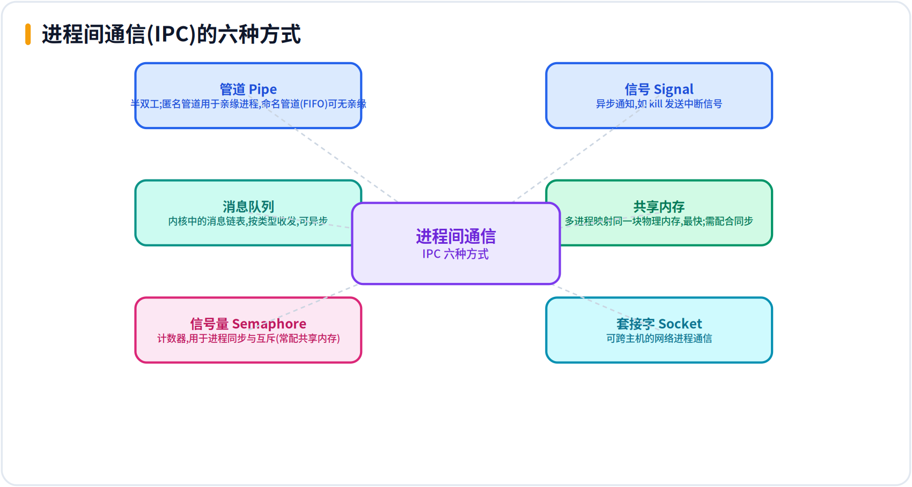

- **管道 Pipe** —— 半双工;匿名管道用于父子等亲缘进程,命名管道(FIFO)可用于无亲缘关系的进程。
- **信号 Signal** —— 异步通知机制,如用 kill 向进程发送信号、Ctrl+C 发 SIGINT。
- **消息队列** —— 内核中按类型组织的消息链表,进程按类型收发,可异步、可避免管道的同步阻塞。
- **共享内存** —— 多个进程映射同一块物理内存,直接读写、速度最快;但需自己配合信号量等做同步。
- **信号量 Semaphore** —— 本质是计数器,用于进程/线程间的同步与互斥,常与共享内存搭配使用。
- **套接字 Socket** —— 既能本机进程通信,也能跨主机网络通信,是分布式通信的基础。

**再往下挖**

共享内存最快(数据不经内核来回拷贝),但要自己解决同步;套接字适合跨机器;管道/消息队列适合本机简单数据传递。

## 第 9 章 · 进程调度算法

> **一句话讲透**
> 调度算法决定就绪队列中下一个该运行哪个进程。常见有:先来先服务 FCFS、短作业优先 SJF、优先级调度、时间片轮转 RR、多级反馈队列 MLFQ。衡量指标包括周转时间、等待时间、响应时间、吞吐量与公平性。

| 算法 | 思想 | 优 / 缺点 |
| --- | --- | --- |
| FCFS 先来先服务 | 按到达顺序执行 | 简单;但短作业会被长作业拖慢(护航效应) |
| SJF 短作业优先 | 优先运行预计最短的作业 | 平均等待最短;但长作业可能饿死,需预估运行时间 |
| 优先级调度 | 优先级高的先运行 | 灵活;低优先级可能饿死,用“老化”缓解 |
| RR 时间片轮转 | 每个进程轮流跑一个时间片 | 公平、响应快;时间片大小很关键 |
| MLFQ 多级反馈队列 | 多优先级队列+动态调整 | 兼顾响应与公平,通用 OS 常用 |

**再往下挖**

时间片太大 RR 退化成 FCFS、响应变差;太小 切换太频繁、开销大。多级反馈队列让短作业/交互任务优先,又不会让长作业彻底饿死。

## 第 10 章 · 线程 vs 进程

> **一句话讲透**
> 进程是资源分配的基本单位,线程是 CPU 调度/执行的基本单位。同一进程内的多个线程共享地址空间、代码段、数据段、堆和打开的文件,各自只私有栈、寄存器和程序计数器。所以线程更轻量:创建/销毁/切换开销都比进程小,线程间通信直接共享内存即可。代价是一个线程崩溃可能拖垮整个进程,且共享数据需要同步。

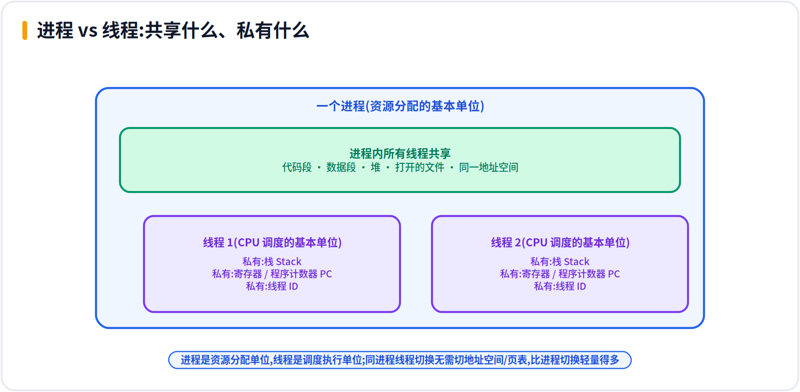

| 对比维度 | 进程 | 线程 |
| --- | --- | --- |
| 定义 | 资源分配的基本单位 | CPU 调度的基本单位 |
| 地址空间 | 各自独立 | 同进程内共享 |
| 共享资源 | 默认不共享 | 代码/数据/堆/文件全共享 |
| 切换开销 | 大(切页表TLB 失效) | 小(不切地址空间) |
| 通信 | 需 IPC | 直接读写共享内存 |
| 健壮性 | 一个崩溃不影响其他进程 | 一个崩溃可能拖垮整个进程 |

**再往下挖**

“为什么进程切换比线程切换贵?”关键在于进程切换要切换虚拟地址空间(换页表),导致 TLB、Cache 大量失效;线程切换在同一地址空间内,省去了这部分。

## 第 11 章 · 线程的实现方式

> **一句话讲透**
> 三种实现:用户级线程(N:1)、内核级线程(1:1)、混合(M:N)。区别在于“用户线程由谁调度、是否被内核感知”。

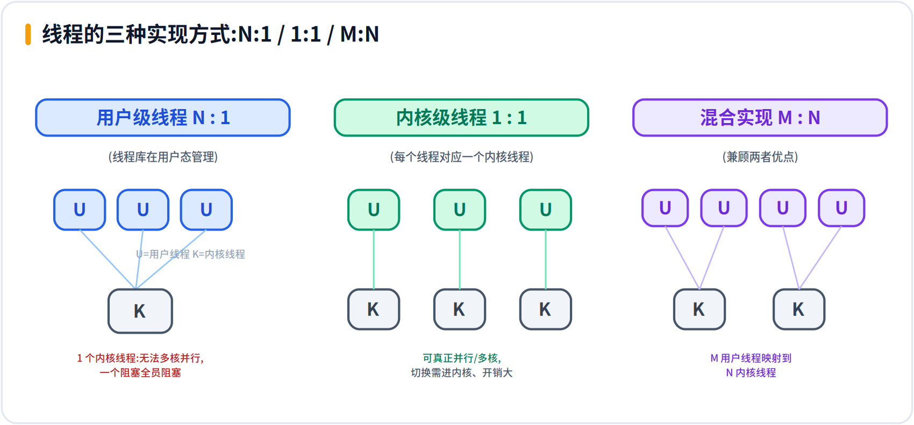

- **用户级线程(N:1)** —— 多个用户线程映射到 1 个内核线程,线程库在用户态调度。切换快、不进内核;但无法利用多核并行,且一个线程阻塞会导致整个进程阻塞。
- **内核级线程(1:1)** —— 每个用户线程对应一个内核线程,由内核统一调度。能真正并行/多核,单个线程阻塞不影响其他;缺点是创建和切换都要进内核、开销较大。
- **混合实现(M:N)** —— M 个用户线程映射到 N 个内核线程,试图兼顾前两者优点,但实现复杂。

**再往下挖**

- 现代主流操作系统(Linux、Windows)大多采用 1:1 模型。
- 协程是用户级线程思想的延伸:由程序自己在用户态调度、切换开销极小,适合高并发 I/O。

## 第 12 章 · 线程间同步与死锁

> **一句话讲透**
> 多个线程共享数据会产生竞态条件,需要同步来保证对临界区(一次只能一个线程进入的代码段)的互斥访问。常用机制:互斥锁、信号量、条件变量、读写锁、自旋锁。

| 同步机制 | 用途 / 特点 |
| --- | --- |
| 互斥锁 Mutex | 加锁/解锁保证互斥,强调“所有权”(谁加锁谁解锁);值只有锁定/未锁定。 |
| 信号量 Semaphore | 计数器,P(减)/V(加)操作;可控制多个资源、也可做线程同步。 |
| 条件变量 Condition | 线程在条件不满足时等待、满足时被唤醒;必须配合互斥锁使用。 |
| 读写锁 RWLock | 读共享、写独占;适合读多写少的场景。 |
| 自旋锁 Spinlock | 拿不到锁时忙等(不睡眠);适合临界区极短、不愿付出切换代价的场景。 |

**常见误区**

- 互斥锁 vs 信号量:互斥锁是 0/1 且有所有权(同一线程加解锁),信号量是计数信号、可由不同线程 P/V,常用于同步或控制多个资源。
- 死锁四个必要条件:互斥、占有并等待、不可剥夺、循环等待——四个同时满足才会死锁;破坏任意一个即可预防。这是几乎必问的追问。

> **放到 vibe coding 里**　模型写并发最爱漏锁，或几把锁的获取顺序不一致。拿死锁四条件当 checklist 过一遍它给的代码：有没有共享可变状态没保护？多把锁的加锁顺序统一吗？这是你 review 它的硬标准，而不是“跑起来没崩就放行”。

## 第 13 章 · I/O 模型与多路复用(select/poll/epoll)

> **一句话讲透**
> 阻塞 I/O:发起 read 后线程一直阻塞,直到数据就绪并拷贝完成;非阻塞 I/O:read 立即返回,没数据就返回错误,需要轮询。I/O 多路复用:用一个线程通过 select/poll/epoll 同时监听多个 fd,哪个就绪就处理哪个,避免为每个连接开线程或盲目轮询——这是高并发服务器的基石。

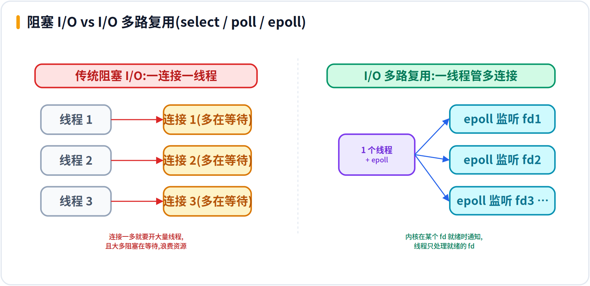

**select / poll / epoll 对比**

| 维度 | select | poll | epoll |
| --- | --- | --- | --- |
| fd 上限 | 通常 1024 | 无硬上限 | 无硬上限 |
| 底层结构 | 位图 bitmap | 链表 | 红黑树 + 就绪链表 |
| 获取就绪 | 遍历全部 O(n) | 遍历全部 O(n) | 只返回就绪 fd,接近 O(1) |
| 重复拷贝 | 每次拷贝整个集合 | 每次拷贝 | 注册一次,无需重复拷贝 |
| 适用场景 | 连接数少 | 一般 | 海量并发连接 |

**常见误区**

- epoll 的优势在于“注册一次、内核主动告知就绪 fd”,省去了 select/poll 每次的全量拷贝与遍历;Nginx、Redis 都基于它。
- 水平触发 LT vs 边缘触发 ET:LT 只要就绪就一直通知,ET 只在状态变化时通知一次(需一次读干净)——高频追问。
- I/O 模型共五种:阻塞、非阻塞、I/O 多路复用、信号驱动、异步 I/O(AIO);前四种都属于同步 I/O。

> **放到 vibe coding 里**　当模型为“高并发”给出“每来一个请求就开一个线程”时立刻警觉：连接一多，光线程切换就把 CPU 吃干。心里有 epoll 的“一个线程管海量连接”，你才能把它引导到对的并发模型上。

## 第 14 章 · 其他:软硬链接与机械硬盘

**软链接 vs 硬链接**

> **一句话讲透**
> 硬链接是给同一个 inode(同一份数据)起多个文件名,删除一个名字只是把 inode 的链接数减 1,数据要等链接数为 0 才真正删除;不能跨文件系统、不能链接目录。软链接(符号链接)是一个独立的小文件,内容是目标的路径,访问时按路径去找目标;可以跨文件系统、可以链接目录,目标被删后它会变成“悬空链接”。

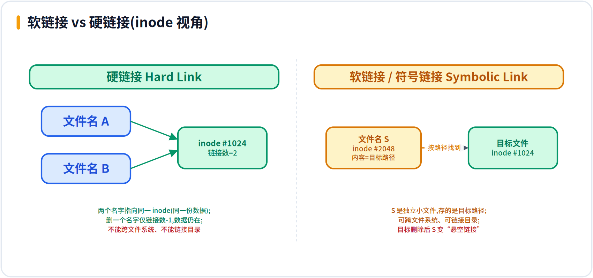

| 对比维度 | 硬链接 | 软链接(符号链接) |
| --- | --- | --- |
| 指向 | 同一个 inode(同份数据) | 一个存“目标路径”的独立文件 |
| 跨文件系统 | 不能 | 可以 |
| 链接目录 | 不能 | 可以 |
| 目标删除后 | 数据仍在(链接数>0) | 变成悬空链接,失效 |

**机械硬盘(HDD)**

机械硬盘靠盘片旋转、磁头移动来读写。一次访问时间 = 寻道时间(磁头移到目标磁道)+ 旋转延迟(目标扇区转到磁头下)+ 传输时间。由于寻道和旋转是机械动作,随机 I/O 因频繁寻道而很慢,顺序 I/O 则快得多。这正是数据库用 B+ 树降低磁盘随机访问、日志采用顺序写、以及操作系统做磁盘调度(电梯算法等)的根本原因;而 SSD 没有机械结构,随机性能远高于 HDD。

## 第 15 章 · 总结:速查表 + 要点回顾

把操作系统八股收个尾:OS 是硬件与应用之间的资源管理者;内核在内核态运行、用户程序在用户态通过系统调用求助;内存管理用虚拟内存做隔离与扩展,靠分页/分段 + 多级页表 + TLB 完成地址翻译,内存不足时缺页换页;进程是资源单位、线程是调度单位,围绕状态、通信、调度、同步展开;高并发靠 I/O 多路复用(epoll);文件链接与磁盘特性则是常见小题。

**名词 / 高频题速查表**

| 考点 | 一句话速答 |
| --- | --- |
| 操作系统 | 管理硬件资源、为应用提供服务的系统软件。 |
| 内核 / 用户态内核态 | 内核管核心资源;用户态受限,经系统调用陷入内核态。 |
| 系统调用 | 用户程序请求内核服务的唯一合法入口。 |
| 虚拟内存 | 给每个进程独立、连续、可超物理大小的地址空间。 |
| 分页 vs 分段 | 页固定大小(系统视角)vs 段变长(逻辑/用户视角)。 |
| 多级页表 / TLB | 按需建页表省空间;TLB 缓存映射加速翻译。 |
| 缺页中断 | 页不在内存中断(置换)换入更新页表重执行。 |
| 页面置换 | OPT 最优、FIFO、LRU、LFU、Clock。 |
| 进程 vs 线程 | 资源分配单位 vs 调度单位;线程共享地址空间、切换更轻。 |
| 进程状态 | 创建/就绪/运行/阻塞/终止;阻塞醒来只能先回就绪。 |
| 并行 vs 并发 | 并行=同时(多核),并发=轮流(交替)。 |
| 僵尸 / 孤儿进程 | 子未被回收=僵尸(占号);父先死被 init 收养=孤儿。 |
| IPC | 管道/信号/消息队列/共享内存/信号量/套接字。 |
| 进程调度 | FCFS/SJF/优先级/RR/多级反馈队列。 |
| 线程实现 | N:1 用户级、1:1 内核级、M:N 混合;主流 1:1。 |
| 线程同步 | 互斥锁/信号量/条件变量/读写锁/自旋锁。 |
| 死锁四条件 | 互斥、占有并等待、不可剥夺、循环等待。 |
| I/O 多路复用 | select/poll(O(n)) epoll(只返回就绪,高并发)。 |
| 软链接 vs 硬链接 | 软=存路径的独立文件可跨盘;硬=同 inode 多名字。 |
| 机械硬盘 | 访问=寻道+旋转延迟+传输;随机慢、顺序快。 |

**抓住这几点**

- 先把“一句话讲透”讲清楚,能完整说清即可答好
- 凡是“为什么”的题(为什么要虚拟内存、为什么进程切换比线程贵、为什么用 epoll)都要讲出动机,这是区分背诵与理解的关键
- 答完主动延伸一句相关追问(死锁四条件、Belady 异常、LT/ET、抖动 Thrashing),会显得功底扎实。

理解了“为什么”,八股就不再是死记硬背。愿你真正把它用起来!
