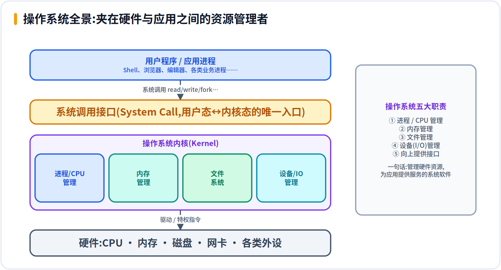

# 第 1 章 · 操作系统基础:定义与主要功能

> **一句话讲透**
> 操作系统是管理计算机硬件资源、并为上层应用提供运行环境和服务的系统软件。它向下管理 CPU、内存、磁盘、设备,向上通过系统调用提供统一接口。五大核心功能:进程(CPU)管理、内存管理、文件管理、设备(I/O)管理,以及向用户和程序提供接口。

如果没有操作系统,每个程序都得自己直接操作硬件,既复杂又危险,还无法在多个程序间协调资源。OS 把硬件封装成进程、文件、虚拟内存这些易用的抽象,并负责在众多程序之间分配与隔离资源,保证系统稳定运行。

**再往下挖**

- OS 类型:批处理、分时(我们日常用的)、实时操作系统等;手机/服务器/嵌入式各有侧重。
- 用户态 / 内核态的分离是安全的基础;系统调用是用户程序请求内核服务的唯一合法入口(见第 2 章)。
