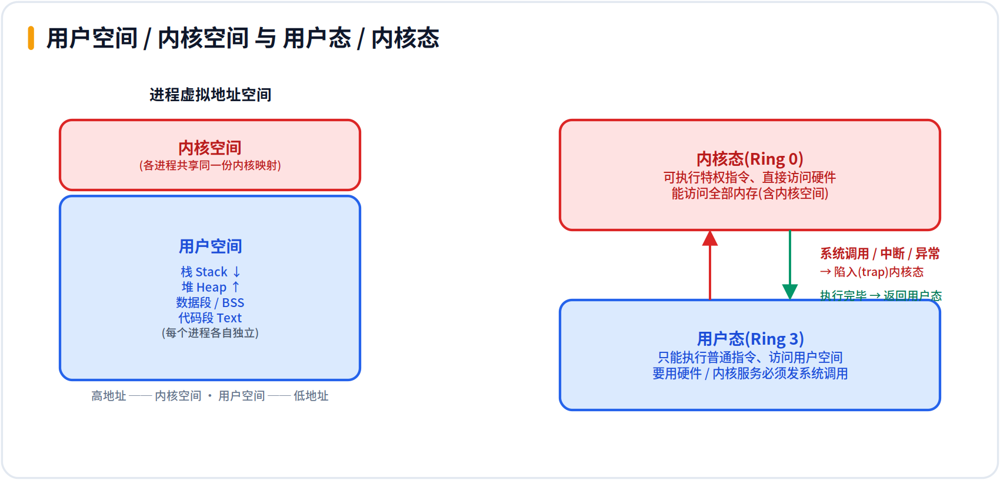

# 第 2 章 · 系统结构:内核、用户态与内核态

> **一句话讲透**
> 内核是 OS 最核心的部分,常驻内存、运行在内核态,负责进程、内存、设备等管理。CPU 提供两种特权级:内核态(Ring 0)能执行特权指令、访问所有资源;用户态(Ring 3)受限,只能访问自己的用户空间。进程地址空间也分为用户空间(进程私有)和内核空间(所有进程共享同一份内核映射)。用户程序要使用内核功能,必须通过系统调用、中断或异常“陷入”内核态,执行完再返回用户态。

为什么要分两种态?核心是隔离与保护:防止用户程序直接乱碰硬件或访问他人内存而搞崩系统。用户态想做特权操作(读写磁盘、分配内存、创建进程),只能通过受控的系统调用(如 read / write / fork)请内核代劳。

**再往下挖**

- 进入内核态的三种方式:系统调用(主动)、中断(外部设备,如时钟/键盘)、异常(如缺页、除零)。
- 用户态内核态切换要保存/恢复上下文,有开销;频繁系统调用是常见性能瓶颈,这也是 mmap、零拷贝、io_uring 等技术想减少切换的原因。
