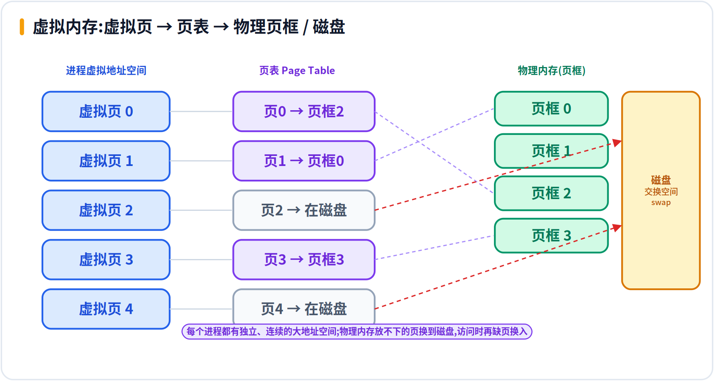

# 第 3 章 · 物理内存与虚拟内存

> **一句话讲透**
> 物理内存就是实际的 RAM。虚拟内存是 OS 给每个进程提供的一块独立、连续、可比物理内存更大的逻辑地址空间:进程用虚拟地址访问,由 MMU 配合页表翻译成物理地址;物理内存放不下时,把不常用的页换到磁盘(交换空间)。

**虚拟内存的四大好处(常考)**

- **隔离与安全** —— 每个进程都有独立的虚拟地址空间,互相看不到、碰不到,一个进程崩溃不影响别人。
- **突破物理限制** —— 程序可用的地址空间不受物理内存大小限制,物理内存不够就用磁盘 swap 顶上。
- **地址连续(简化编程)** —— 进程看到的是连续的地址空间,无需关心物理内存是否碎片化,由页表负责离散映射。
- **便于共享** —— 多个进程可把同一物理页映射进各自空间,实现共享库、共享内存等。

**再往下挖**

- 虚拟地址物理地址由 MMU(内存管理单元)硬件 + 页表完成。
- 虚拟内存之所以高效,依赖程序的局部性原理(时间局部性 + 空间局部性):最近用过、邻近的数据大概率很快再用。

> **放到 vibe coding 里**　模型动不动建议“内存不够就加机器”。你能先追一句：是真用满了，还是在频繁 swap、抖动（thrashing）？知道虚拟内存和缺页的代价，就不会把“换页换到死”误当成“内存够用”。
