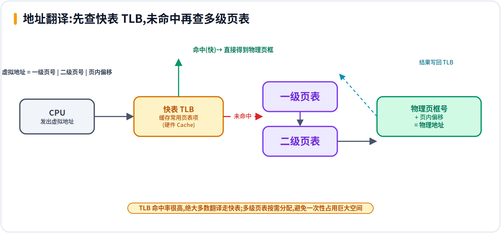

# 第 5 章 · 多级页表、快表与地址翻译

> **一句话讲透**
> 单级页表太大(32 位、4KB 页时每个进程需 2²⁰ 个表项),多级页表按需分配——只为用到的地址段建立下级页表,大幅节省空间;代价是要多次访存。于是加一个快表 TLB(缓存常用页表项的硬件 Cache):翻译地址时先查 TLB,命中就直接拿到物理页框;未命中才去查多级页表,再把结果写回 TLB。

- **多级页表** —— 把页表本身再分级、按需分配,没用到的下级页表不占空间,解决单级页表过大的问题。
- **快表 TLB** —— CPU 内的小型高速缓存,存放最近用过的“虚拟页物理页框”映射,命中即可免去访问内存中的页表。

**再往下挖**

- 因为局部性原理,TLB 命中率通常很高,绝大多数地址翻译都走快表,速度很快。
- 进程切换会使 TLB 失效(需刷新或用 ASID 区分),这正是“进程切换比线程切换更贵”的原因之一(见第 10 章)。
