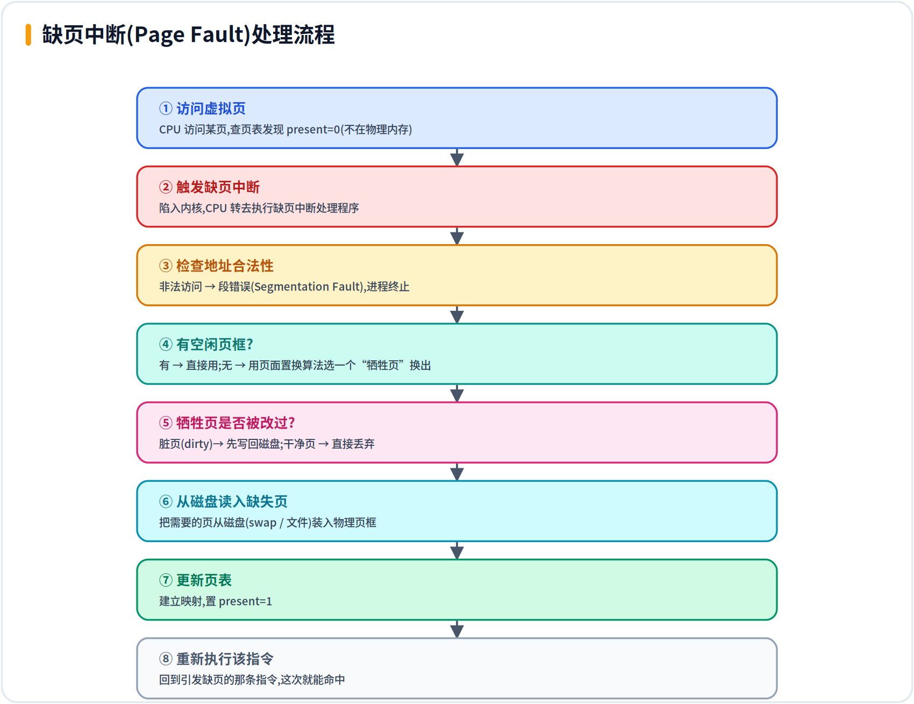

# 第 6 章 · 缺页中断、交换空间与页面置换

> **一句话讲透**
> 访问的页不在物理内存(present=0)时触发缺页中断,陷入内核处理:检查地址合法性 有空闲页框就分配,否则用页面置换算法选一个“牺牲页”换出(若是脏页先写回磁盘) 从磁盘读入缺失页 更新页表 重新执行刚才那条指令。交换空间(swap)就是磁盘上专门用于换出页的区域。

**常见页面置换算法**

| 算法 | 核心思想 / 特点 |
| --- | --- |
| OPT 最优 | 换出“未来最久不会用”的页;命中率最高,但需预知未来,只能作理论上界。 |
| FIFO 先进先出 | 换出最早进来的页;实现简单,但可能出现 Belady 异常(增页框反而更多缺页)。 |
| LRU 最近最久未用 | 换出最久没被访问的页;贴近实际、效果好,但精确实现开销大。 |
| LFU 最不经常使用 | 换出访问次数最少的页;对访问频率敏感。 |
| Clock 时钟/二次机会 | 用访问位近似 LRU,环形扫描给“第二次机会”;开销小,工程常用。 |

**常见误区**

- 缺页中断属于“故障(fault)”类异常,处理完会重新执行触发它的那条指令,这点和普通中断不同。
- 区分“缺页”和“非法访问”:访问越界/无权限会触发段错误(Segmentation Fault)直接杀进程,而不是换页。
- 抖动(Thrashing):分配的页框太少导致频繁缺页换入换出,CPU 大量耗在换页上——常见追问。
