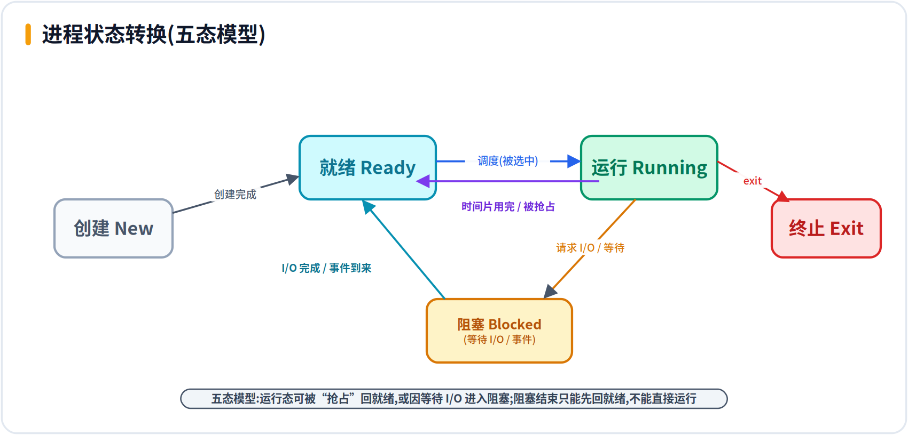

# 第 7 章 · 进程基础:状态 / 并发 / 僵尸与孤儿

> **一句话讲透**
> 进程是程序的一次执行,是 OS 资源分配的基本单位,拥有独立的地址空间和 PCB(进程控制块)。五态模型:创建 就绪 运行 阻塞 终止;运行态可因时间片用完或被抢占回到就绪,或因等待 I/O 进入阻塞,阻塞结束只能先回就绪、不能直接运行。

**并行 vs 并发(高频区分)**

并发是同一时间段内多个任务交替执行(单核也能并发,靠快速切换造成“同时”的错觉);并行是同一时刻多个任务真正同时执行(必须有多核/多 CPU)。一句话:并发是“轮流”,并行是“同时”。

**进程上下文切换**

切换进程时,OS 要保存当前进程的 CPU 寄存器、程序计数器、PCB 等状态,再加载下一个进程的状态;还可能切换页表,导致 TLB 和 Cache 失效。因此进程切换开销较大。

**两种特殊进程**

- **僵尸进程 Zombie** —— 子进程已结束,但父进程没调用 wait/waitpid 回收它的 PCB,残留一个“已死却占着进程号”的表项。
- **孤儿进程 Orphan** —— 父进程先结束,子进程被 init(pid=1)进程收养并负责回收,无危害。

**常见误区**

- 僵尸进程的危害是占用进程号等资源,过多会导致无法创建新进程。
- 解决:父进程及时 wait/waitpid;或处理/忽略 SIGCHLD 信号让系统回收;父进程退出后,残留子进程会被 init 接管回收。
