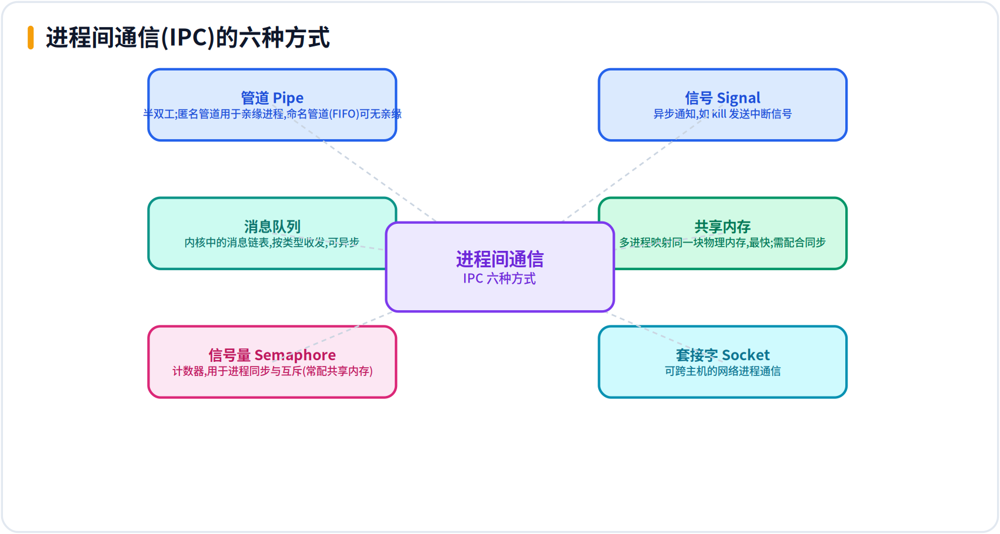

# 第 8 章 · 进程间通信(IPC)

> **一句话讲透**
> 进程地址空间相互独立,通信要借助内核提供的 IPC 机制,常见六种:管道、信号、消息队列、共享内存、信号量、套接字。

- **管道 Pipe** —— 半双工;匿名管道用于父子等亲缘进程,命名管道(FIFO)可用于无亲缘关系的进程。
- **信号 Signal** —— 异步通知机制,如用 kill 向进程发送信号、Ctrl+C 发 SIGINT。
- **消息队列** —— 内核中按类型组织的消息链表,进程按类型收发,可异步、可避免管道的同步阻塞。
- **共享内存** —— 多个进程映射同一块物理内存,直接读写、速度最快;但需自己配合信号量等做同步。
- **信号量 Semaphore** —— 本质是计数器,用于进程/线程间的同步与互斥,常与共享内存搭配使用。
- **套接字 Socket** —— 既能本机进程通信,也能跨主机网络通信,是分布式通信的基础。

**再往下挖**

共享内存最快(数据不经内核来回拷贝),但要自己解决同步;套接字适合跨机器;管道/消息队列适合本机简单数据传递。
