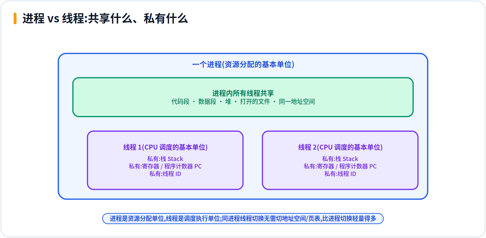

# 第 10 章 · 线程 vs 进程

> **一句话讲透**
> 进程是资源分配的基本单位,线程是 CPU 调度/执行的基本单位。同一进程内的多个线程共享地址空间、代码段、数据段、堆和打开的文件,各自只私有栈、寄存器和程序计数器。所以线程更轻量:创建/销毁/切换开销都比进程小,线程间通信直接共享内存即可。代价是一个线程崩溃可能拖垮整个进程,且共享数据需要同步。

| 对比维度 | 进程 | 线程 |
| --- | --- | --- |
| 定义 | 资源分配的基本单位 | CPU 调度的基本单位 |
| 地址空间 | 各自独立 | 同进程内共享 |
| 共享资源 | 默认不共享 | 代码/数据/堆/文件全共享 |
| 切换开销 | 大(切页表TLB 失效) | 小(不切地址空间) |
| 通信 | 需 IPC | 直接读写共享内存 |
| 健壮性 | 一个崩溃不影响其他进程 | 一个崩溃可能拖垮整个进程 |

**再往下挖**

“为什么进程切换比线程切换贵?”关键在于进程切换要切换虚拟地址空间(换页表),导致 TLB、Cache 大量失效;线程切换在同一地址空间内,省去了这部分。
