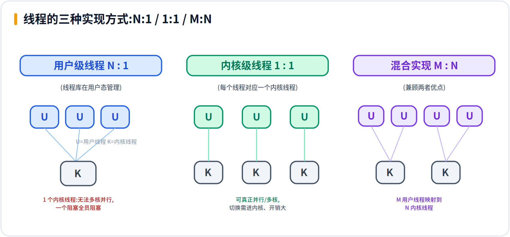

# 第 11 章 · 线程的实现方式

> **一句话讲透**
> 三种实现:用户级线程(N:1)、内核级线程(1:1)、混合(M:N)。区别在于“用户线程由谁调度、是否被内核感知”。

- **用户级线程(N:1)** —— 多个用户线程映射到 1 个内核线程,线程库在用户态调度。切换快、不进内核;但无法利用多核并行,且一个线程阻塞会导致整个进程阻塞。
- **内核级线程(1:1)** —— 每个用户线程对应一个内核线程,由内核统一调度。能真正并行/多核,单个线程阻塞不影响其他;缺点是创建和切换都要进内核、开销较大。
- **混合实现(M:N)** —— M 个用户线程映射到 N 个内核线程,试图兼顾前两者优点,但实现复杂。

**再往下挖**

- 现代主流操作系统(Linux、Windows)大多采用 1:1 模型。
- 协程是用户级线程思想的延伸:由程序自己在用户态调度、切换开销极小,适合高并发 I/O。
