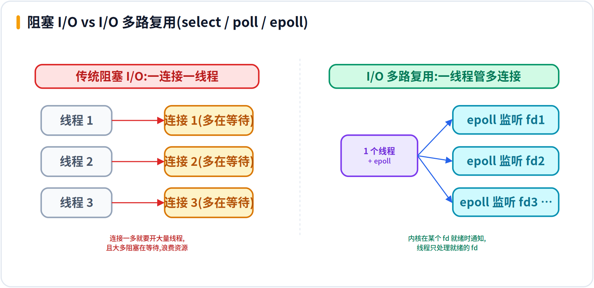

# 第 13 章 · I/O 模型与多路复用(select/poll/epoll)

> **一句话讲透**
> 阻塞 I/O:发起 read 后线程一直阻塞,直到数据就绪并拷贝完成;非阻塞 I/O:read 立即返回,没数据就返回错误,需要轮询。I/O 多路复用:用一个线程通过 select/poll/epoll 同时监听多个 fd,哪个就绪就处理哪个,避免为每个连接开线程或盲目轮询——这是高并发服务器的基石。

**select / poll / epoll 对比**

| 维度 | select | poll | epoll |
| --- | --- | --- | --- |
| fd 上限 | 通常 1024 | 无硬上限 | 无硬上限 |
| 底层结构 | 位图 bitmap | 链表 | 红黑树 + 就绪链表 |
| 获取就绪 | 遍历全部 O(n) | 遍历全部 O(n) | 只返回就绪 fd,接近 O(1) |
| 重复拷贝 | 每次拷贝整个集合 | 每次拷贝 | 注册一次,无需重复拷贝 |
| 适用场景 | 连接数少 | 一般 | 海量并发连接 |

**常见误区**

- epoll 的优势在于“注册一次、内核主动告知就绪 fd”,省去了 select/poll 每次的全量拷贝与遍历;Nginx、Redis 都基于它。
- 水平触发 LT vs 边缘触发 ET:LT 只要就绪就一直通知,ET 只在状态变化时通知一次(需一次读干净)——高频追问。
- I/O 模型共五种:阻塞、非阻塞、I/O 多路复用、信号驱动、异步 I/O(AIO);前四种都属于同步 I/O。

> **放到 vibe coding 里**　当模型为“高并发”给出“每来一个请求就开一个线程”时立刻警觉：连接一多，光线程切换就把 CPU 吃干。心里有 epoll 的“一个线程管海量连接”，你才能把它引导到对的并发模型上。
