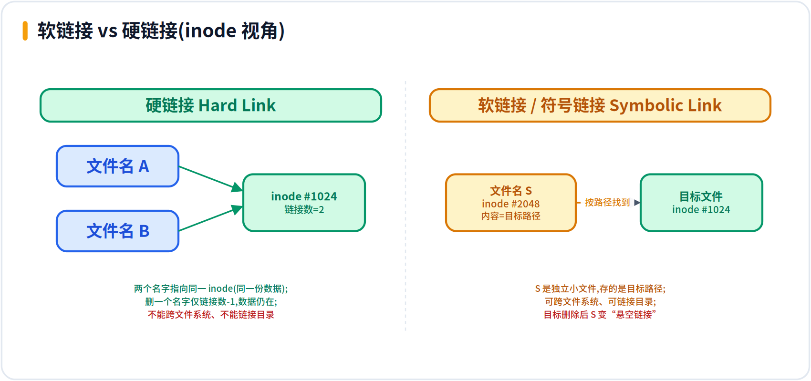

# 第 14 章 · 其他:软硬链接与机械硬盘

**软链接 vs 硬链接**

> **一句话讲透**
> 硬链接是给同一个 inode(同一份数据)起多个文件名,删除一个名字只是把 inode 的链接数减 1,数据要等链接数为 0 才真正删除;不能跨文件系统、不能链接目录。软链接(符号链接)是一个独立的小文件,内容是目标的路径,访问时按路径去找目标;可以跨文件系统、可以链接目录,目标被删后它会变成“悬空链接”。

| 对比维度 | 硬链接 | 软链接(符号链接) |
| --- | --- | --- |
| 指向 | 同一个 inode(同份数据) | 一个存“目标路径”的独立文件 |
| 跨文件系统 | 不能 | 可以 |
| 链接目录 | 不能 | 可以 |
| 目标删除后 | 数据仍在(链接数>0) | 变成悬空链接,失效 |

**机械硬盘(HDD)**

机械硬盘靠盘片旋转、磁头移动来读写。一次访问时间 = 寻道时间(磁头移到目标磁道)+ 旋转延迟(目标扇区转到磁头下)+ 传输时间。由于寻道和旋转是机械动作,随机 I/O 因频繁寻道而很慢,顺序 I/O 则快得多。这正是数据库用 B+ 树降低磁盘随机访问、日志采用顺序写、以及操作系统做磁盘调度(电梯算法等)的根本原因;而 SSD 没有机械结构,随机性能远高于 HDD。
