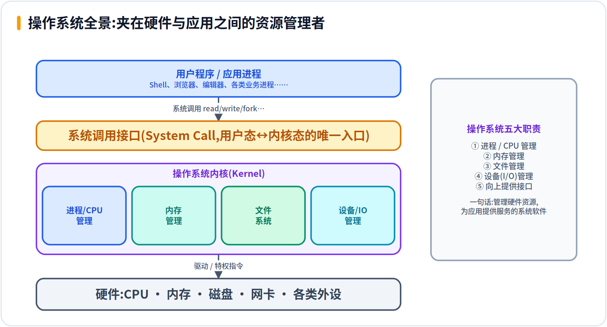

# 操作系统

操作系统怎么管理硬件、调度程序、扛住高并发：进程、内存、I/O 多路复用。

## 引言:操作系统到底在管什么

操作系统(OS)的八股看着杂,其实主线很清晰:它是夹在硬件和应用之间的“资源管理者”。向下,它管着 CPU、内存、磁盘、各种设备;向上,它把这些硬件抽象成进程、虚拟内存、文件等好用的概念,并通过系统调用为程序提供统一服务。所有考点——进程线程、内存管理、I/O——都是在回答同一个问题:OS 如何高效、安全地把有限的硬件资源分配给众多程序使用。

本文按“先打地基、再分专题”的顺序展开:先讲清 OS 是什么、内核与用户态/内核态;再深入重难点——内存管理(虚拟内存、分页分段、TLB、缺页、置换);然后是进程与线程两大主题(状态、通信、调度、同步);接着是高并发绕不开的 I/O 多路复用;最后补上文件链接与磁盘等常见小题。

## 把它用在 vibe coding 上

操作系统是你和模型共用的“运行时常识”。模型能写出多线程、异步、共享内存的代码，但它不为后果负责——判断“这样跑会不会崩、会不会慢、会不会有竞态”的人是你。懂了这章，你在几件事上能压住模型：

- **选并发模型** —— 它该用多线程还是 epoll / 异步？知道“一个线程盯住上万连接”正是 I/O 多路复用要解决的问题，就不会被“每个连接开一个线程”的方案糊弄过去。
- **看出竞态与死锁** —— 它写的共享数据访问有没有加锁、会不会循环等待？死锁四条件在脑子里，review 时就有尺子，而不是“跑起来没崩就算过”。
- **判断性能瓶颈** —— 它说“加个缓存就好了”，你知道系统调用、上下文切换、随机磁盘 I/O 各自的代价，能追问到真正的瓶颈在哪。
- **划清资源边界** —— 进程崩了为什么不连累别的进程、内存不够时发生什么（OOM / swap），决定了你怎么给模型设运行约束。

## 本篇章节

- [第 1 章 · 操作系统基础:定义与主要功能](./ch01)
- [第 2 章 · 系统结构:内核、用户态与内核态](./ch02)
- [第 3 章 · 物理内存与虚拟内存](./ch03)
- [第 4 章 · 内存分页与分段](./ch04)
- [第 5 章 · 多级页表、快表与地址翻译](./ch05)
- [第 6 章 · 缺页中断、交换空间与页面置换](./ch06)
- [第 7 章 · 进程基础:状态 / 并发 / 僵尸与孤儿](./ch07)
- [第 8 章 · 进程间通信(IPC)](./ch08)
- [第 9 章 · 进程调度算法](./ch09)
- [第 10 章 · 线程 vs 进程](./ch10)
- [第 11 章 · 线程的实现方式](./ch11)
- [第 12 章 · 线程间同步与死锁](./ch12)
- [第 13 章 · I/O 模型与多路复用(select/poll/epoll)](./ch13)
- [第 14 章 · 其他:软硬链接与机械硬盘](./ch14)
- [第 15 章 · 总结:速查表 + 要点回顾](./ch15)
