# 计算机网络

**覆盖**：分层模型 · IP/ARP · TCP(握手挥手/可靠/流控/拥塞) · UDP · HTTP/HTTPS · Cookie/Session · URL 全过程 · DNS

## 把它用在 vibe coding 上

网络是你和模型一起写的每个服务“看不见的地基”。请求为什么超时、为什么偶尔丢包、为什么 HTTPS 配错——都在这层。

- **定位“时好时坏”** —— 三次握手、超时重传、拥塞控制让你知道网络抖动长什么样，不会把网络问题当成代码 bug 让模型瞎改一通。
- **判断 API 设计** —— HTTP 方法、状态码、幂等性，决定模型给的接口经不经得起重试和缓存。
- **看懂安全握手** —— HTTPS / TLS 流程让你能 review 模型给的证书与加密配置，而不是复制一段就上线。

## 引言:把网络想成「盖楼 + 装修」

计算机网络的八股看着多,其实可以用一个比喻一口气串起来:网络通信就像盖一栋楼再装修。最底下是地基与水电——物理层把比特变成信号、数据链路层把帧送到同一网段的对端、网络层(IP)负责跨网络一路寻址路由,把数据包送到正确的那台机器;往上是装修——传输层(TCP)保证数据完整、有序、不丢地送达,应用层(HTTP)决定“住进去之后怎么交流”。

所以本文不按脑图的随机顺序,而是从“地基”讲到“装修”:先分层模型,再 IP/ARP,然后传输层的 TCP(握手、挥手、可靠、流控、拥塞)与 UDP,接着应用层的 HTTP / HTTPS / Cookie-Session,最后用“在浏览器输入一个网址到页面显示”这道综合大题,把整栋楼从上到下走一遍,顺带把 DNS 讲透。

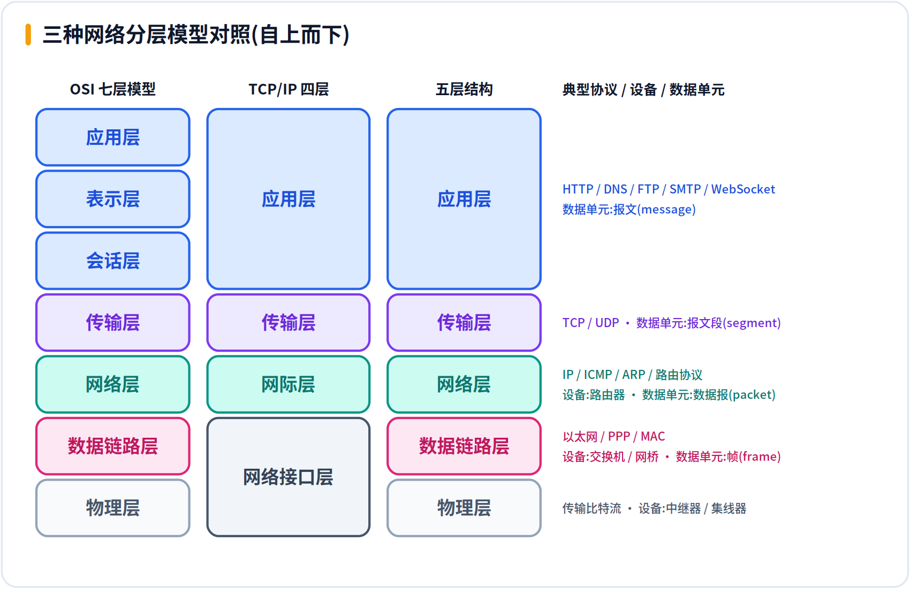

## 第 1 章 · 网络分层模型(OSI / TCP-IP / 五层)

> **一句话讲透**
> 分层是为了“解耦”:每一层只干自己的事、只依赖下一层提供的服务,任意一层的实现都可以独立替换。常见三套模型——OSI 七层(理论):应用层、表示层、会话层、传输层、网络层、数据链路层、物理层;TCP/IP 四层(工程实际):应用层、传输层、网际层、网络接口层;教学常用五层:在四层基础上把“网络接口层”拆成数据链路层 + 物理层。

**各层在干什么(自下而上)**

- **物理层** —— 在物理介质上传输比特流(0/1 信号);设备如中继器、集线器。
- **数据链路层** —— 把比特组织成“帧”,通过 MAC 地址在同一局域网内点到点 / 广播传输,负责差错检测;设备如交换机、网桥。
- **网络层** —— 把分组(IP 数据报)从源主机跨越多个网络路由到目的主机,核心是 IP 寻址与路由;协议有 IP、ICMP、ARP,设备是路由器。
- **传输层** —— 为两台主机上的进程提供端到端通信:TCP 提供可靠、有序、面向连接的字节流;UDP 提供不可靠、无连接的数据报。靠端口号区分进程。
- **应用层** —— 直接面向用户的应用协议:HTTP、DNS、FTP、SMTP、WebSocket 等(OSI 把它再细分为应用 / 表示 / 会话三层)。

**再往下挖**

- 数据封装:每往下一层就加一层头部(应用数据 TCP 段 IP 数据报 帧 比特),接收端逐层解封装。
- 各层数据单元别名:应用层“报文”、传输层“段(segment)”、网络层“数据报 / 分组(packet)”、链路层“帧(frame)”、物理层“比特”。
- 为什么工程上用四层不用七层:OSI 的表示层、会话层职责在实践中大多并入应用层,过度分层反而冗余。

> 一句话小结 核心 分层 = 解耦 + 各司其职;记住五层(应用/传输/网络/链路/物理)及每层的代表协议即可应对绝大多数题。

## 第 2 章 · IP 协议与 ARP

**IP 协议的作用**

> **一句话讲透**
> IP 工作在网络层,核心职责是“寻址 + 路由”:用 IP 地址唯一标识一台主机在网络中的位置,并负责把数据包从源主机经过若干路由器转发到目的主机。它提供的是无连接、不保证可靠(尽力而为)的交付——不保证不丢、不保证有序、不保证不重复,这些可靠性交给上层的 TCP 去做。

补充常考点:IP 地址分为网络号 + 主机号,靠子网掩码划分;同一网段内可直接通信,跨网段要经过网关(路由器)转发。IPv4 地址 32 位、IPv6 128 位。

**ARP 协议工作过程(已知 IP 求 MAC)**

数据最终要在链路层按 MAC 地址传输,但应用只知道目的 IP,不知道目的 MAC,ARP 就是把“IP 地址”翻译成“MAC 地址”的协议。

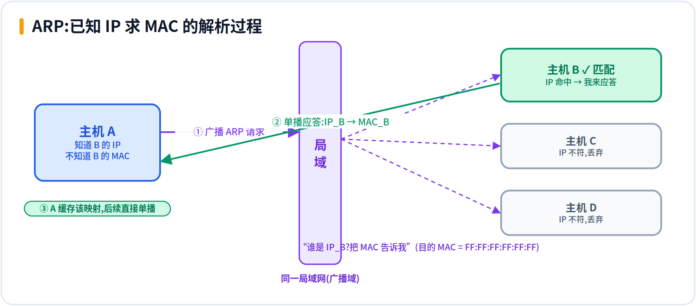

过程:① 主机先查本机 ARP 缓存,命中则直接用;② 未命中则在局域网内广播 ARP 请求(目的 MAC 为全 F),内容是“谁的 IP 是 X?请把 MAC 告诉我”;③ 同网段所有主机都收到,只有 IP 匹配的目标主机单播回复自己的 MAC;④ 请求方收到后写入 ARP 缓存,后续直接单播。若目标在另一网段,则解析的是网关的 MAC。

> 一句话小结 IP 网络层寻址与路由,尽力而为、不保证可靠。 ARP 局域网内“广播问、单播答”,把 IP 解析成 MAC,并缓存结果。

## 第 3 章 · TCP 三次握手

> **一句话讲透**
> 三次握手用来建立连接、同步双方的初始序列号(ISN),并确认双方的发送与接收能力都正常。过程:① 客户端发 SYN(seq=x),进入 SYN_SENT;② 服务端回 SYN+ACK(seq=y, ack=x+1),进入 SYN_RCVD;③ 客户端再回 ACK(seq=x+1, ack=y+1),双方进入 ESTABLISHED,连接建立。

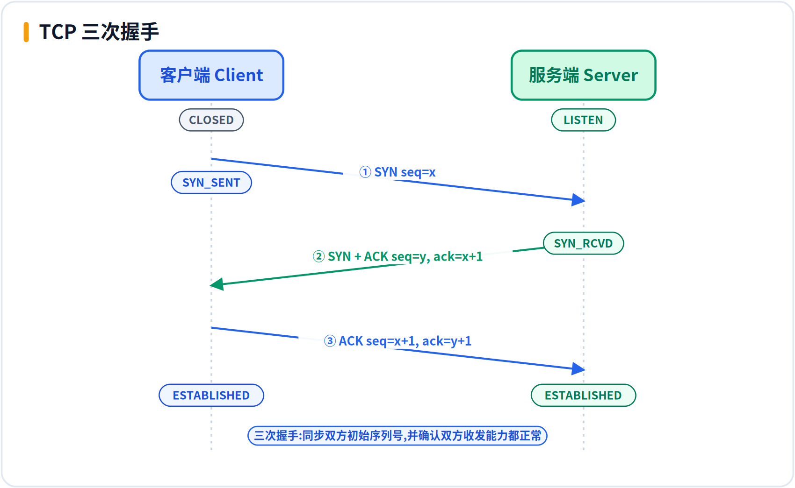

**为什么是三次,不是两次?**

两次握手有两个致命问题:其一,服务端发出 SYN+ACK 后就认为连接已建立,但它无法确认客户端是否真的收到了这个应答——也就无法确认“客户端的接收能力 / 自己的发送能力”是否正常;其二,无法防止失效的历史连接请求:如果一个早已超时的旧 SYN 在网络里兜了一圈后才到达服务端,两次握手会让服务端直接建立一个客户端根本不想要的连接,白白浪费资源。三次握手中客户端的最后一个 ACK 恰好解决了这两点。

**为什么不是四次?**

理论上服务端的“确认(ACK)”和“自己的同步请求(SYN)”是两件事,但它们可以合并在同一个报文里一起发出(SYN+ACK),所以四次被压缩成了三次,没有必要拆开。

**常见误区**

- 别把 seq/ack 关系说反:ack = 对方 seq + 1。
- “第三次握手能不能带数据?”可以,客户端发最后一个 ACK 时可以携带应用数据;而前两次握手报文不允许携带数据。
- SYN 洪泛攻击:伪造大量 SYN 让服务端的半连接队列被占满,可用 SYN Cookie 缓解——这是常见加分追问。

## 第 4 章 · TCP 四次挥手

> **一句话讲透**
> TCP 是全双工,关闭连接要双方各自关闭自己的发送方向,所以需要四次:① 主动方发 FIN(seq=u) FIN_WAIT_1;② 被动方回 ACK(ack=u+1) CLOSE_WAIT,主动方进入 FIN_WAIT_2;③ 被动方把剩余数据发完后再发 FIN(seq=w) LAST_ACK;④ 主动方回 ACK(ack=w+1) TIME_WAIT,等待 2MSL 后 CLOSED,被动方收到 ACK 即 CLOSED。

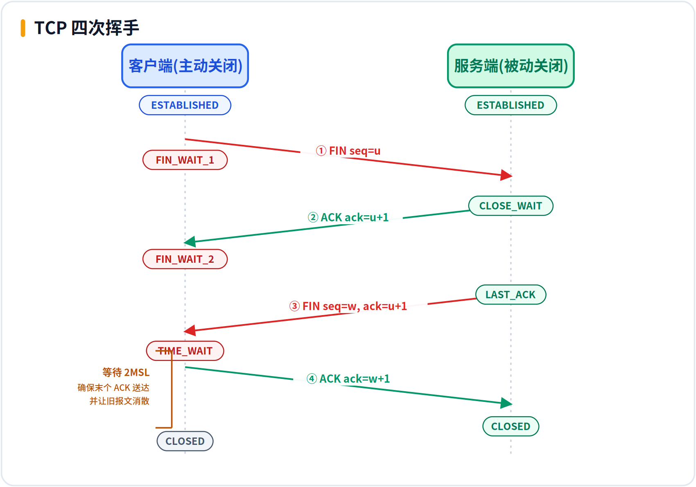

**为什么挥手要四次(握手却只要三次)?**

握手时服务端的 ACK 和 SYN 可以合并;但挥手时,被动方收到 FIN 后往往还有数据没发完,它必须先立刻回一个 ACK 表示“我知道你要关了”,等自己的数据发送完毕后才能发出自己的 FIN,这两步无法合并,所以比握手多一次。

为什么主动方要在 TIME_WAIT 等待 2MSL?

两个原因:① 保证最后一个 ACK 能可靠到达对方——如果这个 ACK 丢了,被动方会超时重发 FIN,主动方在 TIME_WAIT 期间还能再次响应;若直接关闭就无法重发,被动方会一直卡在 LAST_ACK。② 让本次连接产生的所有报文在网络中彻底消散(MSL 是报文最大生存时间,2MSL 即一来一回),避免它们干扰之后使用相同四元组(源/目的 IP+端口)的新连接。

**再往下挖**

- CLOSE_WAIT 大量堆积 = 被动方收到 FIN 却没有 close(),通常是程序没正确关闭连接的 bug。
- TIME_WAIT 过多(高并发短连接)会占用端口,可通过开启连接复用、调整内核参数缓解。

## 第 5 章 · TCP 如何保证可靠传输

> **一句话讲透**
> TCP 靠一整套机制保证可靠:序列号 + 确认应答、超时重传、校验和、数据排序与去重、流量控制、拥塞控制,以及连接管理。核心思想是“每段数据都编号,收到要确认,丢了会重传,乱了能重排”。

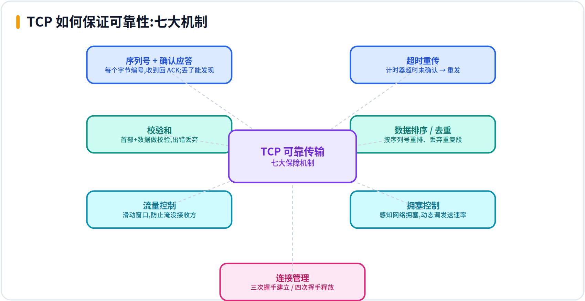

- **序列号 + 确认应答(ACK)** —— 每个字节都有序号,接收方用 ACK 告知“已正确收到、期望的下一个序号”,从而发现丢失。
- **超时重传 / 快速重传** —— 发出去的数据在计时器(RTO)超时仍未被确认就重传;若提前收到 3 个重复 ACK,则不等超时立即重传(快速重传)。
- **校验和** —— 首部和数据一起做校验,出错的段直接丢弃、不确认,等待重传。
- **数据排序与去重** —— 接收方按序列号把乱序到达的段重新排好,并丢弃重复的段。
- **流量控制** —— 用滑动窗口控制发送速率,防止发送方发太快淹没接收方(见第 6 章)。
- **拥塞控制** —— 感知网络拥塞,动态调整发送速率,避免压垮网络(见第 7 章)。

**超时重传 vs 快速重传(高频对比)**

超时重传依赖 RTO 定时器,要等到超时才重发,延迟较高;快速重传则在收到 3 个重复 ACK 时就判定中间某段丢失,立即重传,无需等待超时,响应更快。两者配合使用。

> 一句话小结 记忆口诀 编号 + 确认 + 重传 + 重排 + 流控 + 拥塞 + 连接管理 —— 七件套撑起“可靠”。

## 第 6 章 · TCP 流量控制

> **一句话讲透**
> 流量控制解决的是“发送方 vs 接收方”的速度匹配问题:防止发送方发得太快,把接收方的接收缓冲区塞爆。手段是滑动窗口——接收方在每个 ACK 里通过“通告窗口(rwnd)”告诉发送方自己还能接收多少字节,发送方的发送窗口不能超过这个值。

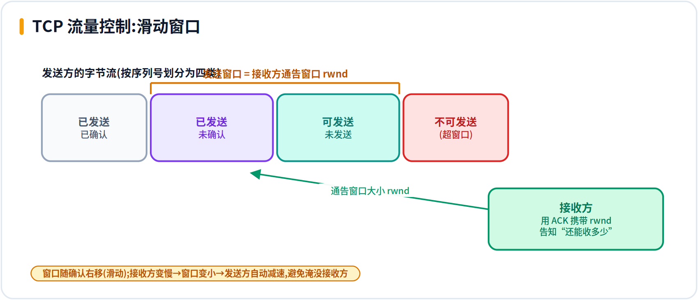

接收方缓冲区快满时,就把 rwnd 调小甚至调成 0,发送方据此减速或暂停;缓冲区腾出空间后再调大,窗口随确认不断右移(“滑动”)。这样就把发送速率自动约束在接收方能消化的范围内。

**再往下挖**

- 零窗口问题:接收方通告 rwnd=0 后,若后续“窗口已打开”的通知丢失,双方会僵持;TCP 用持续计时器(persist timer)定期发探测报文(零窗口探测)来打破僵局。
- 区分流量控制与拥塞控制:前者看“接收方能不能收得下”(rwnd),后者看“网络堵不堵”(cwnd);实际发送窗口取两者较小值 min(rwnd, cwnd)。

## 第 7 章 · TCP 拥塞控制

> **一句话讲透**
> 拥塞控制解决的是“发送方 vs 网络”的问题:避免太多数据注入网络导致路由器拥塞、丢包加剧。它用一个拥塞窗口 cwnd,通过四个经典算法动态调节:慢启动、拥塞避免、快重传、快恢复。

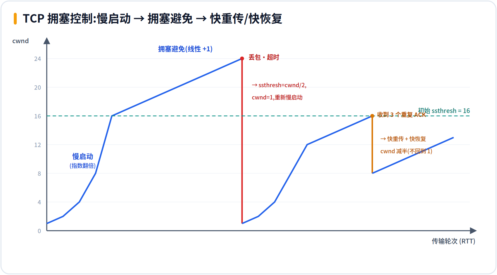

- **慢启动** —— 连接初期 cwnd 从 1 个 MSS 开始,每经过一个 RTT 翻倍(指数增长),快速试探网络容量,直到达到阈值 ssthresh。
- **拥塞避免** —— 到达 ssthresh 后改为每个 RTT 只 +1(线性增长),小心地继续增大,避免一下子把网络压垮。
- **拥塞发生(超时)** —— 若发生超时(RTO),认为网络严重拥塞:把 ssthresh 设为当前 cwnd 的一半,cwnd 直接降回 1,重新慢启动。
- **快重传 + 快恢复** —— 若只是收到 3 个重复 ACK(轻度丢包):立即快重传丢失段;并执行快恢复——ssthresh 减半,cwnd 设为减半后的值(不回到 1),直接进入拥塞避免。

**常见误区**

- 别把流控和拥塞控制搞混:rwnd 是接收方给的,cwnd 是发送方根据网络自己算的;真正能发多少 = min(rwnd, cwnd)。
- “超时”和“3 个重复 ACK”的处理不同:前者回到 cwnd=1 重新慢启动(反应剧烈),后者只减半进入拥塞避免(反应温和)。这是最常被深挖的点。

## 第 8 章 · UDP 与 TCP/UDP 对比

> **一句话讲透**
> UDP 是无连接、不可靠、面向报文的传输协议:不握手、不保证送达、不保证有序、没有流控拥塞控制,首部只有 8 字节,但因此开销小、速度快、实时性好,适合 DNS、视频/直播、在线游戏、DHCP 等场景。TCP 则面向连接、可靠、面向字节流,适合对完整性要求高的场景(网页、文件传输、邮件)。

**TCP 与 UDP 核心区别**

| 对比维度 | TCP | UDP |
| --- | --- | --- |
| 连接 | 面向连接(先三次握手) | 无连接,直接发 |
| 可靠性 | 可靠:确认/重传/排序 | 不可靠:尽力而为 |
| 有序性 | 保证按序到达 | 不保证顺序 |
| 流量/拥塞控制 | 有 | 无 |
| 传输方式 | 面向字节流 | 面向报文(数据报) |
| 首部开销 | 20 字节起 | 仅 8 字节 |
| 通信对象 | 一对一 | 一对一/一对多/多对多 |
| 速度/实时性 | 较慢,延迟较高 | 快,实时性好 |
| 典型应用 | HTTP/HTTPS、FTP、SMTP | DNS、视频直播、游戏、DHCP |

**UDP 如何保证消息不丢失?**

UDP 本身不保证,但可以在应用层“自己实现可靠性”:给数据包加序列号、接收方回 ACK 确认、发送方维护重传队列做超时重传、对乱序做重排——本质就是把 TCP 的可靠机制在应用层重做一遍。工程上也可直接使用成熟方案,如 QUIC(HTTP/3 的底层)、KCP、RUDP 等,它们在 UDP 之上实现了可靠且低延迟的传输。

> 一句话小结 选型 要可靠、要完整 TCP;要快、要实时、能容忍少量丢包 UDP(再按需在应用层补可靠)。

## 第 9 章 · HTTP:报文 / 方法 / 状态码

**HTTP 报文结构**

HTTP 是应用层基于请求-响应的无状态协议。请求与响应的报文结构是对称的:起始行 + 头部字段 + 空行 + 主体。

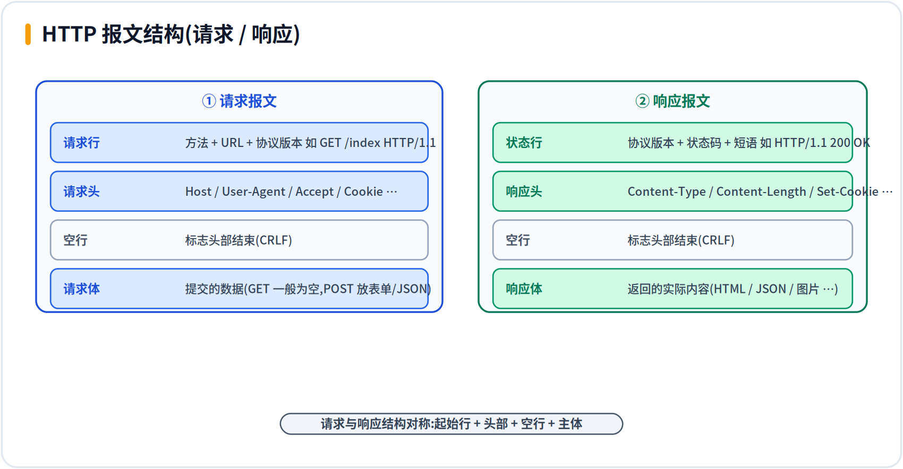

**GET 与 POST 的区别**

| 对比维度 | GET | POST |
| --- | --- | --- |
| 语义 | 获取资源 | 提交 / 新建数据 |
| 参数位置 | 拼在 URL 查询串 | 放在请求体 |
| 长度限制 | 受 URL 长度限制(浏览器/服务器) | 理论上无限制 |
| 幂等/安全 | 安全且幂等 | 非安全、非幂等 |
| 缓存/收藏 | 可被缓存、可收藏、留历史 | 默认不缓存 |
| 回退/刷新 | 无副作用 | 可能重复提交 |

**常见误区**

- “POST 比 GET 安全”是误区:GET 参数暴露在 URL 里确实更易泄露,但 POST 的请求体同样是明文,真正的安全要靠 HTTPS。
- “GET 一定不能带请求体、POST 一定发两个包”都不严谨:这些是约定俗成或特定实现,规范层面并非绝对。

**常见状态码**

| 状态码 | 含义 / 场景 |
| --- | --- |
| 1xx | 信息性:请求已收到,继续处理 |
| 200 OK | 请求成功 |
| 301 / 302 | 永久重定向 / 临时重定向 |
| 304 Not Modified | 协商缓存命中,用本地缓存 |
| 400 Bad Request | 请求报文有错(参数/格式) |
| 401 / 403 | 未认证 / 已认证但无权限 |
| 404 Not Found | 资源不存在 |
| 500 Internal Server Error | 服务器内部错误 |
| 502 / 503 / 504 | 网关错误 / 服务不可用 / 网关超时 |

**再往下挖**

- HTTP/1.1 默认开启长连接(Keep-Alive)复用 TCP;HTTP/2 引入多路复用、头部压缩;HTTP/3 改用基于 UDP 的 QUIC。
- 强缓存(Cache-Control / Expires)vs 协商缓存(ETag / Last-Modified,命中返回 304),是缓存方向的常考点。

> **放到 vibe coding 里**　模型给的接口让 GET 改数据、或对非幂等的 POST 盲目重试，是经典坑。懂方法语义和状态码，你一眼能看出哪些请求能安全重试、能缓存。

## 第 10 章 · HTTPS 工作流程

> **一句话讲透**
> HTTPS = HTTP + TLS/SSL(端口 443),在 TCP 之上、HTTP 之下加了一层加密。核心思路是“用非对称加密安全地协商出一把对称密钥,之后用对称加密传数据”,从而兼顾安全(防窃听、防篡改、防伪装)与性能(对称加密快)。

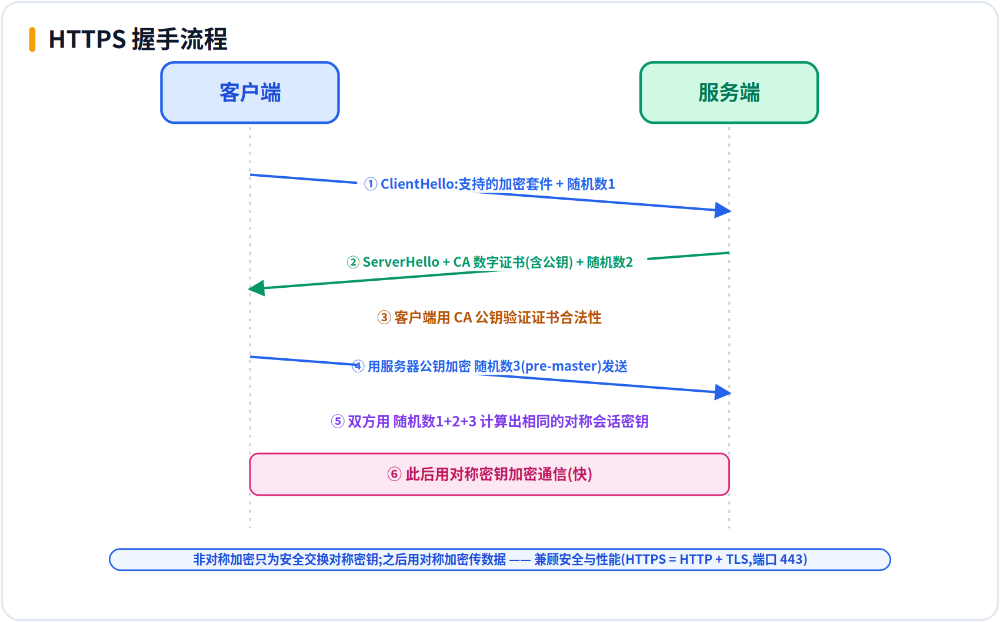

简化流程:① 客户端发起,携带支持的加密套件和随机数1;② 服务器返回选定套件、随机数2,以及由 CA 签发的数字证书(内含公钥);③ 客户端用 CA 的公钥验证证书是否合法可信;④ 客户端生成随机数3(pre-master),用服务器公钥加密后发回;⑤ 双方用随机数1+2+3 计算出相同的对称会话密钥;⑥ 之后所有通信都用这把对称密钥加密。

**再往下挖**

- 为什么不全程用非对称加密?非对称运算慢,只适合用来安全交换密钥;大量数据用对称加密才高效。
- 数字证书解决“公钥是不是真的属于这个网站”——靠 CA 用自己的私钥对网站公钥签名,浏览器用内置 CA 公钥验签,防止中间人伪造。
- 现代 TLS 多用 ECDHE 做密钥交换以实现前向安全;上面的 RSA 交换是便于理解的经典版本。

> **放到 vibe coding 里**　模型贴一段“关闭证书校验”让 HTTPS 跑通时，那是把安全直接关掉。懂 TLS 握手在验什么，你才不会为图快放行这种“修复”。

## 第 11 章 · Cookie 与 Session

> **一句话讲透**
> HTTP 是无状态的,Cookie 和 Session 用来在多次请求间维持状态(如登录态)。Cookie 存在客户端浏览器,每次请求自动带上;Session 存在服务端,保存真正的用户数据,二者通过一个 SessionID 关联——SessionID 通常就放在 Cookie 里随请求传回服务器。

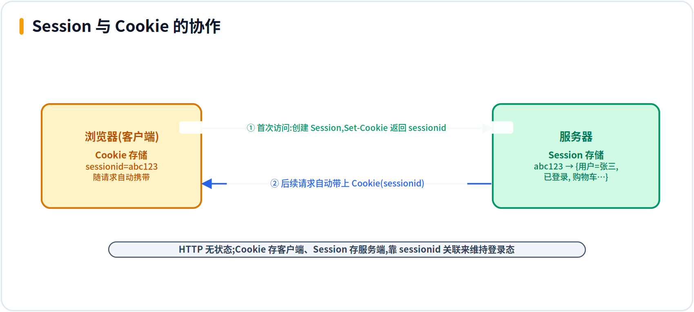

**Cookie 与 Session 对比**

| 对比维度 | Cookie | Session |
| --- | --- | --- |
| 存储位置 | 客户端(浏览器) | 服务端 |
| 安全性 | 较低(可被查看/篡改) | 较高(数据不出服务端) |
| 容量 | 单个约 4KB,数量有限 | 受服务端内存/存储限制 |
| 生命周期 | 可设过期时间,可持久化 | 默认会话级,可配置超时 |
| 对服务端压力 | 几乎无 | 占用服务端资源 |

**再往下挖**

- 分布式/集群下 Session 共享问题:可用 Session 复制、Session 集中存储(Redis)、或一致性哈希粘性会话解决。
- 另一条路是 Token / JWT:把状态编码进令牌交给客户端保存,服务端无需存 Session,天然适合分布式;这是高频对比追问。

## 第 12 章 · 输入 URL 到页面显示的全过程

这是计算机网络的“综合大题”,几乎必考,因为它能把 DNS、TCP、HTTP、HTTPS、渲染全部串起来。

> **一句话讲透**
> ① 解析 URL(协议/域名/端口/路径),查浏览器缓存;② DNS 解析把域名转成 IP;③ 与服务器进行 TCP 三次握手;④ 若是 HTTPS 再做 TLS 握手协商密钥;⑤ 发送 HTTP 请求;⑥ 服务器处理并返回响应;⑦ 浏览器解析渲染:HTMLDOM 树、CSSCSSOM、合成渲染树布局(Layout)绘制(Paint),期间 JS 可能阻塞解析;⑧ 数据传输完成后按需四次挥手断开,或用 Keep-Alive 复用连接。

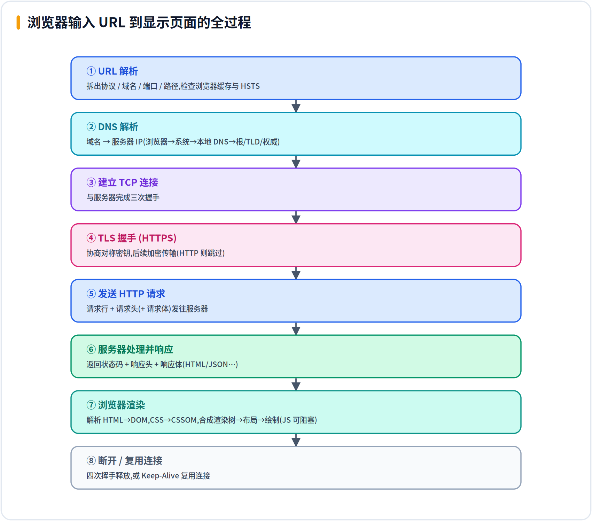

渲染细节(前端岗高频):浏览器边下载边解析 HTML 构建 DOM,遇到 CSS 构建 CSSOM,二者合成渲染树(只含可见节点);随后进行布局计算每个节点的几何位置,再绘制成像素,最后合成图层显示。遇到 <script> 默认会阻塞 DOM 解析(可用 async / defer 优化);CSS 会阻塞渲染。修改样式触发的“重排(reflow)/重绘(repaint)”是性能优化重点。

> 一句话小结 记忆主线 解析URL DNS TCP握手 (TLS) 发请求 收响应 渲染 断开;能背这条链就拿下这道题。

> **放到 vibe coding 里**　这条链（DNS→TCP→TLS→HTTP→渲染）是你排查“页面打不开 / 很慢”的地图。模型乱猜原因时，你能按链路一段段定位到底卡在哪一环。

## 第 13 章 · DNS 解析过程

> **一句话讲透**
> DNS 把域名解析成 IP。查找顺序:先查浏览器缓存 操作系统缓存(含 hosts 文件) 本地 DNS 服务器(LDNS)缓存;都没命中,LDNS 就发起迭代查询:先问根域名服务器(返回顶级域服务器地址) 再问顶级域 TLD 服务器(返回权威服务器地址) 最后问权威域名服务器拿到 IP;LDNS 缓存结果并返回给客户端。

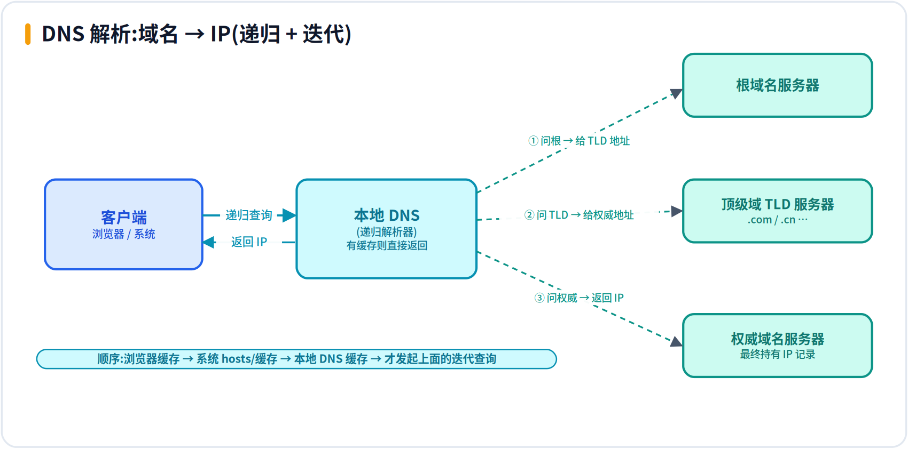

**再往下挖**

- 递归 vs 迭代:客户端到本地 DNS 通常是递归查询(“你帮我查到为止”);本地 DNS 到根/TLD/权威是迭代查询(“你告诉我下一步问谁”)。
- DNS 默认用 UDP(快,报文小),数据较大或区域传送时用 TCP;各级缓存 + TTL 大幅减少查询。

## 第 14 章 · 总结:高频速答清单 + 名词速查表

把整套网络八股按“地基装修”收个尾:分层模型搭骨架,IP/ARP 负责跨网与局域网寻址,TCP 用握手挥手 + 七大机制保证可靠、用滑动窗口做流控、用 cwnd 四算法做拥塞控制,UDP 主打轻量实时;应用层 HTTP 定义请求响应、HTTPS 加一层 TLS 加密、Cookie/Session 维持状态;最后“输入 URL 全过程”把所有环节串成一条线,DNS 则是这条线的第一步。

**名词 / 高频题速查表**

| 考点 | 一句话速答 |
| --- | --- |
| OSI 七层 / TCP-IP 四层 | 解耦分层;记五层:应用/传输/网络/链路/物理。 |
| IP 协议 | 网络层寻址 + 路由,尽力而为不保证可靠。 |
| ARP | 局域网广播问、单播答,IPMAC 并缓存。 |
| 三次握手 | 同步初始序列号 + 确认双方收发能力;防历史失效连接。 |
| 为什么不是两次 | 服务端无法确认客户端收到 ACK,且无法防旧 SYN 建连。 |
| 四次挥手 | 全双工各关一个方向;被动方 ACK 与 FIN 不能合并。 |
| TIME_WAIT 2MSL | 保证末个 ACK 送达 + 让旧报文消散。 |
| TCP 可靠性 | 序号确认+重传+校验和+排序+流控+拥塞+连接管理。 |
| 超时 vs 快速重传 | 等 RTO 超时 vs 收到 3 个重复 ACK 立即重传。 |
| 流量控制 | 滑动窗口 rwnd,防淹没接收方。 |
| 拥塞控制 | 慢启动/拥塞避免/快重传/快恢复;发送量取 min(rwnd,cwnd)。 |
| TCP vs UDP | 可靠面向连接字节流 vs 无连接不可靠数据报、快。 |
| GET vs POST | 取/提交;参数在 URL/在体;GET 幂等可缓存。 |
| 常见状态码 | 200 成功、301/302 重定向、304 缓存、4xx 客户端、5xx 服务端。 |
| HTTPS | 非对称协商对称密钥,再对称加密传输;CA 证书防伪装。 |
| Cookie vs Session | 客户端存 vs 服务端存,靠 SessionID 关联。 |
| 输入 URL 全过程 | 解析DNSTCPTLS请求响应渲染断开。 |
| DNS 解析 | 缓存优先;未命中递归+迭代:根TLD权威。 |

**抓住这几点**

- 先背“一句话讲透”,能完整说出主线就及格
- 凡是“为什么”的题(为什么三次/四次、为什么 2MSL、为什么先非对称再对称)都要能讲出动机,这是区分背诵和理解的关键
- 答完主动延伸一句相关追问(如 SYN 洪泛、min(rwnd,cwnd)、JWT 替代 Session),会显得功底扎实。

理解了“为什么”,八股就不再是死记硬背。愿你真正把它用起来!
