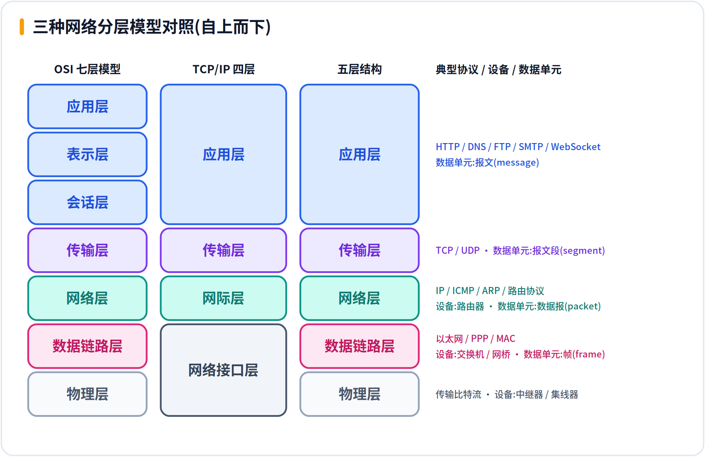

# 第 1 章 · 网络分层模型(OSI / TCP-IP / 五层)

> **一句话讲透**
> 分层是为了“解耦”:每一层只干自己的事、只依赖下一层提供的服务,任意一层的实现都可以独立替换。常见三套模型——OSI 七层(理论):应用层、表示层、会话层、传输层、网络层、数据链路层、物理层;TCP/IP 四层(工程实际):应用层、传输层、网际层、网络接口层;教学常用五层:在四层基础上把“网络接口层”拆成数据链路层 + 物理层。

**各层在干什么(自下而上)**

- **物理层** —— 在物理介质上传输比特流(0/1 信号);设备如中继器、集线器。
- **数据链路层** —— 把比特组织成“帧”,通过 MAC 地址在同一局域网内点到点 / 广播传输,负责差错检测;设备如交换机、网桥。
- **网络层** —— 把分组(IP 数据报)从源主机跨越多个网络路由到目的主机,核心是 IP 寻址与路由;协议有 IP、ICMP、ARP,设备是路由器。
- **传输层** —— 为两台主机上的进程提供端到端通信:TCP 提供可靠、有序、面向连接的字节流;UDP 提供不可靠、无连接的数据报。靠端口号区分进程。
- **应用层** —— 直接面向用户的应用协议:HTTP、DNS、FTP、SMTP、WebSocket 等(OSI 把它再细分为应用 / 表示 / 会话三层)。

**再往下挖**

- 数据封装:每往下一层就加一层头部(应用数据 TCP 段 IP 数据报 帧 比特),接收端逐层解封装。
- 各层数据单元别名:应用层“报文”、传输层“段(segment)”、网络层“数据报 / 分组(packet)”、链路层“帧(frame)”、物理层“比特”。
- 为什么工程上用四层不用七层:OSI 的表示层、会话层职责在实践中大多并入应用层,过度分层反而冗余。

> **一句话小结**
> 核心 分层 = 解耦 + 各司其职;记住五层(应用/传输/网络/链路/物理)及每层的代表协议即可应对绝大多数题。
