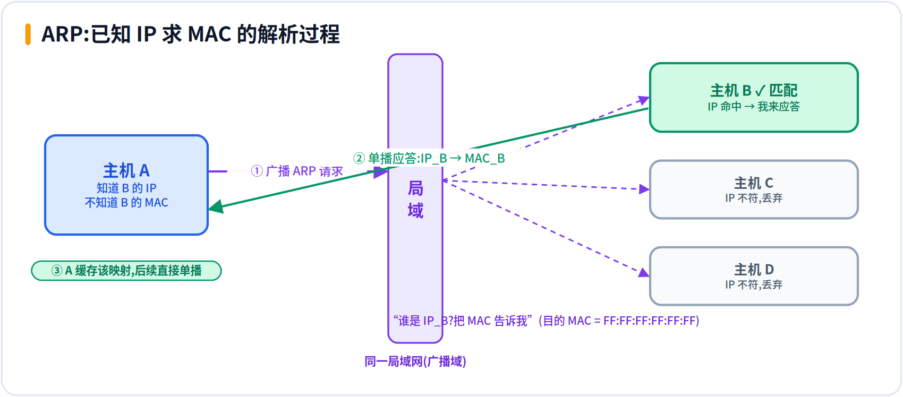

# 第 2 章 · IP 协议与 ARP

**IP 协议的作用**

> **一句话讲透**
> IP 工作在网络层,核心职责是“寻址 + 路由”:用 IP 地址唯一标识一台主机在网络中的位置,并负责把数据包从源主机经过若干路由器转发到目的主机。它提供的是无连接、不保证可靠(尽力而为)的交付——不保证不丢、不保证有序、不保证不重复,这些可靠性交给上层的 TCP 去做。

补充常考点:IP 地址分为网络号 + 主机号,靠子网掩码划分;同一网段内可直接通信,跨网段要经过网关(路由器)转发。IPv4 地址 32 位、IPv6 128 位。

**ARP 协议工作过程(已知 IP 求 MAC)**

数据最终要在链路层按 MAC 地址传输,但应用只知道目的 IP,不知道目的 MAC,ARP 就是把“IP 地址”翻译成“MAC 地址”的协议。

过程:① 主机先查本机 ARP 缓存,命中则直接用;② 未命中则在局域网内广播 ARP 请求(目的 MAC 为全 F),内容是“谁的 IP 是 X?请把 MAC 告诉我”;③ 同网段所有主机都收到,只有 IP 匹配的目标主机单播回复自己的 MAC;④ 请求方收到后写入 ARP 缓存,后续直接单播。若目标在另一网段,则解析的是网关的 MAC。

> **一句话小结**
> IP 网络层寻址与路由,尽力而为、不保证可靠。 ARP 局域网内“广播问、单播答”,把 IP 解析成 MAC,并缓存结果。
