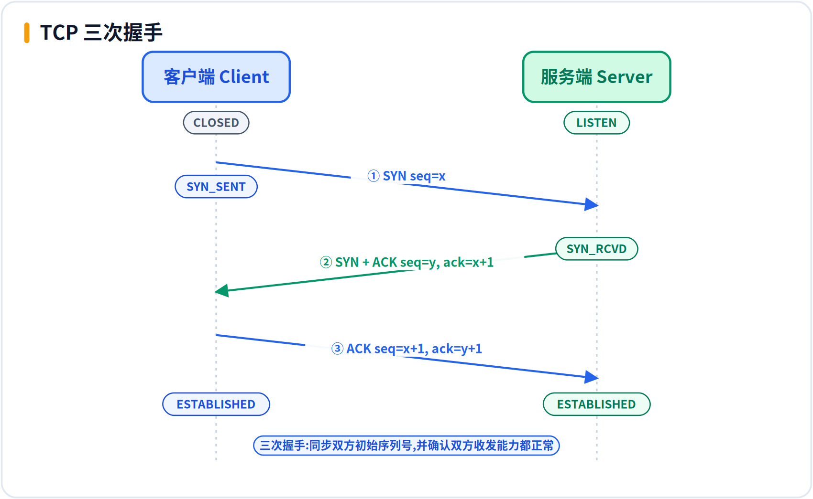

# 第 3 章 · TCP 三次握手

> **一句话讲透**
> 三次握手用来建立连接、同步双方的初始序列号(ISN),并确认双方的发送与接收能力都正常。过程:① 客户端发 SYN(seq=x),进入 SYN_SENT;② 服务端回 SYN+ACK(seq=y, ack=x+1),进入 SYN_RCVD;③ 客户端再回 ACK(seq=x+1, ack=y+1),双方进入 ESTABLISHED,连接建立。

**为什么是三次,不是两次?**

两次握手有两个致命问题:其一,服务端发出 SYN+ACK 后就认为连接已建立,但它无法确认客户端是否真的收到了这个应答——也就无法确认“客户端的接收能力 / 自己的发送能力”是否正常;其二,无法防止失效的历史连接请求:如果一个早已超时的旧 SYN 在网络里兜了一圈后才到达服务端,两次握手会让服务端直接建立一个客户端根本不想要的连接,白白浪费资源。三次握手中客户端的最后一个 ACK 恰好解决了这两点。

**为什么不是四次?**

理论上服务端的“确认(ACK)”和“自己的同步请求(SYN)”是两件事,但它们可以合并在同一个报文里一起发出(SYN+ACK),所以四次被压缩成了三次,没有必要拆开。

**常见误区**

- 别把 seq/ack 关系说反:ack = 对方 seq + 1。
- “第三次握手能不能带数据?”可以,客户端发最后一个 ACK 时可以携带应用数据;而前两次握手报文不允许携带数据。
- SYN 洪泛攻击:伪造大量 SYN 让服务端的半连接队列被占满,可用 SYN Cookie 缓解——这是常见加分追问。
