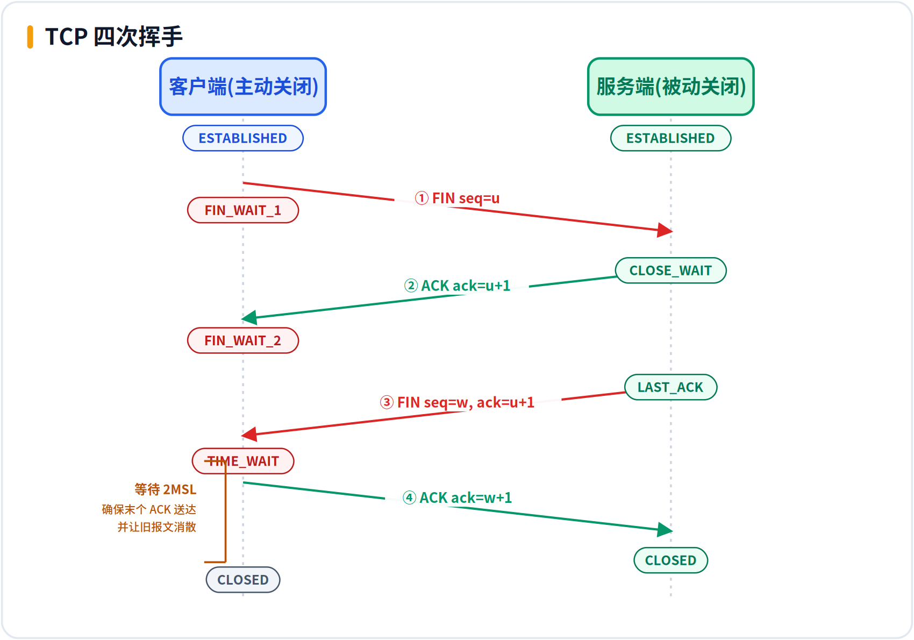

# 第 4 章 · TCP 四次挥手

> **一句话讲透**
> TCP 是全双工,关闭连接要双方各自关闭自己的发送方向,所以需要四次:① 主动方发 FIN(seq=u) FIN_WAIT_1;② 被动方回 ACK(ack=u+1) CLOSE_WAIT,主动方进入 FIN_WAIT_2;③ 被动方把剩余数据发完后再发 FIN(seq=w) LAST_ACK;④ 主动方回 ACK(ack=w+1) TIME_WAIT,等待 2MSL 后 CLOSED,被动方收到 ACK 即 CLOSED。

**为什么挥手要四次(握手却只要三次)?**

握手时服务端的 ACK 和 SYN 可以合并;但挥手时,被动方收到 FIN 后往往还有数据没发完,它必须先立刻回一个 ACK 表示“我知道你要关了”,等自己的数据发送完毕后才能发出自己的 FIN,这两步无法合并,所以比握手多一次。

为什么主动方要在 TIME_WAIT 等待 2MSL?

两个原因:① 保证最后一个 ACK 能可靠到达对方——如果这个 ACK 丢了,被动方会超时重发 FIN,主动方在 TIME_WAIT 期间还能再次响应;若直接关闭就无法重发,被动方会一直卡在 LAST_ACK。② 让本次连接产生的所有报文在网络中彻底消散(MSL 是报文最大生存时间,2MSL 即一来一回),避免它们干扰之后使用相同四元组(源/目的 IP+端口)的新连接。

**再往下挖**

- CLOSE_WAIT 大量堆积 = 被动方收到 FIN 却没有 close(),通常是程序没正确关闭连接的 bug。
- TIME_WAIT 过多(高并发短连接)会占用端口,可通过开启连接复用、调整内核参数缓解。
