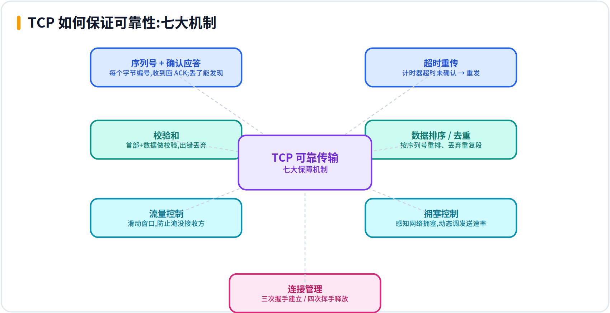

# 第 5 章 · TCP 如何保证可靠传输

> **一句话讲透**
> TCP 靠一整套机制保证可靠:序列号 + 确认应答、超时重传、校验和、数据排序与去重、流量控制、拥塞控制,以及连接管理。核心思想是“每段数据都编号,收到要确认,丢了会重传,乱了能重排”。

- **序列号 + 确认应答(ACK)** —— 每个字节都有序号,接收方用 ACK 告知“已正确收到、期望的下一个序号”,从而发现丢失。
- **超时重传 / 快速重传** —— 发出去的数据在计时器(RTO)超时仍未被确认就重传;若提前收到 3 个重复 ACK,则不等超时立即重传(快速重传)。
- **校验和** —— 首部和数据一起做校验,出错的段直接丢弃、不确认,等待重传。
- **数据排序与去重** —— 接收方按序列号把乱序到达的段重新排好,并丢弃重复的段。
- **流量控制** —— 用滑动窗口控制发送速率,防止发送方发太快淹没接收方(见第 6 章)。
- **拥塞控制** —— 感知网络拥塞,动态调整发送速率,避免压垮网络(见第 7 章)。

**超时重传 vs 快速重传(高频对比)**

超时重传依赖 RTO 定时器,要等到超时才重发,延迟较高;快速重传则在收到 3 个重复 ACK 时就判定中间某段丢失,立即重传,无需等待超时,响应更快。两者配合使用。

> **一句话小结**
> 记忆口诀 编号 + 确认 + 重传 + 重排 + 流控 + 拥塞 + 连接管理 —— 七件套撑起“可靠”。
