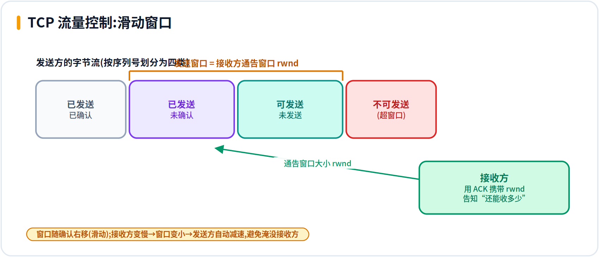

# 第 6 章 · TCP 流量控制

> **一句话讲透**
> 流量控制解决的是“发送方 vs 接收方”的速度匹配问题:防止发送方发得太快,把接收方的接收缓冲区塞爆。手段是滑动窗口——接收方在每个 ACK 里通过“通告窗口(rwnd)”告诉发送方自己还能接收多少字节,发送方的发送窗口不能超过这个值。

接收方缓冲区快满时,就把 rwnd 调小甚至调成 0,发送方据此减速或暂停;缓冲区腾出空间后再调大,窗口随确认不断右移(“滑动”)。这样就把发送速率自动约束在接收方能消化的范围内。

**再往下挖**

- 零窗口问题:接收方通告 rwnd=0 后,若后续“窗口已打开”的通知丢失,双方会僵持;TCP 用持续计时器(persist timer)定期发探测报文(零窗口探测)来打破僵局。
- 区分流量控制与拥塞控制:前者看“接收方能不能收得下”(rwnd),后者看“网络堵不堵”(cwnd);实际发送窗口取两者较小值 min(rwnd, cwnd)。
