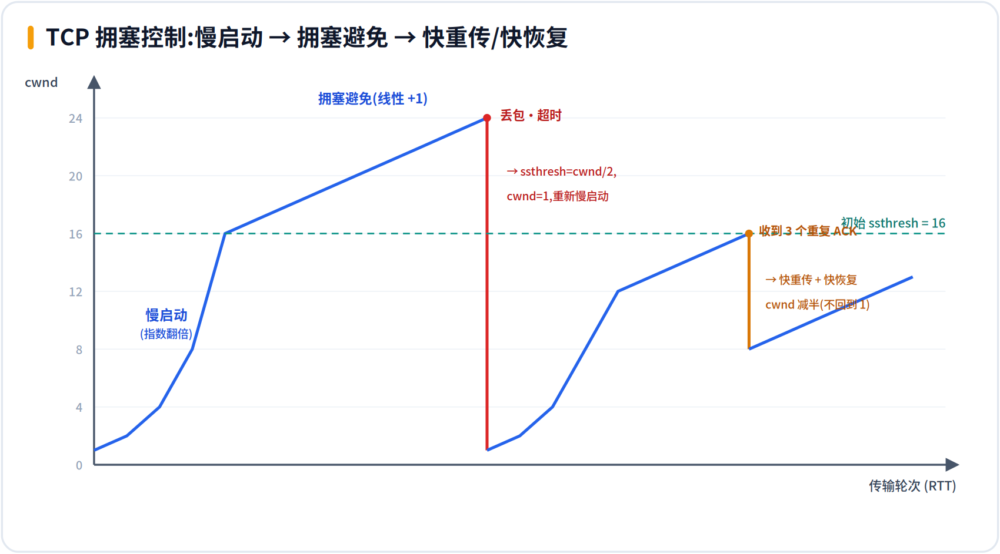

# 第 7 章 · TCP 拥塞控制

> **一句话讲透**
> 拥塞控制解决的是“发送方 vs 网络”的问题:避免太多数据注入网络导致路由器拥塞、丢包加剧。它用一个拥塞窗口 cwnd,通过四个经典算法动态调节:慢启动、拥塞避免、快重传、快恢复。

- **慢启动** —— 连接初期 cwnd 从 1 个 MSS 开始,每经过一个 RTT 翻倍(指数增长),快速试探网络容量,直到达到阈值 ssthresh。
- **拥塞避免** —— 到达 ssthresh 后改为每个 RTT 只 +1(线性增长),小心地继续增大,避免一下子把网络压垮。
- **拥塞发生(超时)** —— 若发生超时(RTO),认为网络严重拥塞:把 ssthresh 设为当前 cwnd 的一半,cwnd 直接降回 1,重新慢启动。
- **快重传 + 快恢复** —— 若只是收到 3 个重复 ACK(轻度丢包):立即快重传丢失段;并执行快恢复——ssthresh 减半,cwnd 设为减半后的值(不回到 1),直接进入拥塞避免。

**常见误区**

- 别把流控和拥塞控制搞混:rwnd 是接收方给的,cwnd 是发送方根据网络自己算的;真正能发多少 = min(rwnd, cwnd)。
- “超时”和“3 个重复 ACK”的处理不同:前者回到 cwnd=1 重新慢启动(反应剧烈),后者只减半进入拥塞避免(反应温和)。这是最常被深挖的点。
