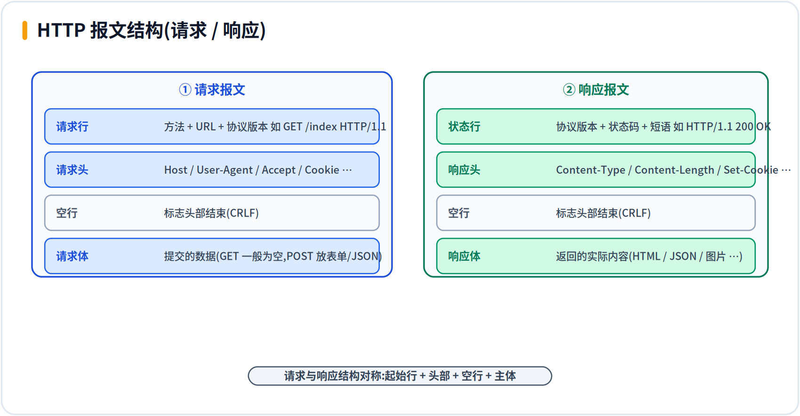

# 第 9 章 · HTTP:报文 / 方法 / 状态码

**HTTP 报文结构**

HTTP 是应用层基于请求-响应的无状态协议。请求与响应的报文结构是对称的:起始行 + 头部字段 + 空行 + 主体。

**GET 与 POST 的区别**

| 对比维度 | GET | POST |
| --- | --- | --- |
| 语义 | 获取资源 | 提交 / 新建数据 |
| 参数位置 | 拼在 URL 查询串 | 放在请求体 |
| 长度限制 | 受 URL 长度限制(浏览器/服务器) | 理论上无限制 |
| 幂等/安全 | 安全且幂等 | 非安全、非幂等 |
| 缓存/收藏 | 可被缓存、可收藏、留历史 | 默认不缓存 |
| 回退/刷新 | 无副作用 | 可能重复提交 |

**常见误区**

- “POST 比 GET 安全”是误区:GET 参数暴露在 URL 里确实更易泄露,但 POST 的请求体同样是明文,真正的安全要靠 HTTPS。
- “GET 一定不能带请求体、POST 一定发两个包”都不严谨:这些是约定俗成或特定实现,规范层面并非绝对。

**常见状态码**

| 状态码 | 含义 / 场景 |
| --- | --- |
| 1xx | 信息性:请求已收到,继续处理 |
| 200 OK | 请求成功 |
| 301 / 302 | 永久重定向 / 临时重定向 |
| 304 Not Modified | 协商缓存命中,用本地缓存 |
| 400 Bad Request | 请求报文有错(参数/格式) |
| 401 / 403 | 未认证 / 已认证但无权限 |
| 404 Not Found | 资源不存在 |
| 500 Internal Server Error | 服务器内部错误 |
| 502 / 503 / 504 | 网关错误 / 服务不可用 / 网关超时 |

**再往下挖**

- HTTP/1.1 默认开启长连接(Keep-Alive)复用 TCP;HTTP/2 引入多路复用、头部压缩;HTTP/3 改用基于 UDP 的 QUIC。
- 强缓存(Cache-Control / Expires)vs 协商缓存(ETag / Last-Modified,命中返回 304),是缓存方向的常考点。

> **放到 vibe coding 里**　模型给的接口让 GET 改数据、或对非幂等的 POST 盲目重试，是经典坑。懂方法语义和状态码，你一眼能看出哪些请求能安全重试、能缓存。
