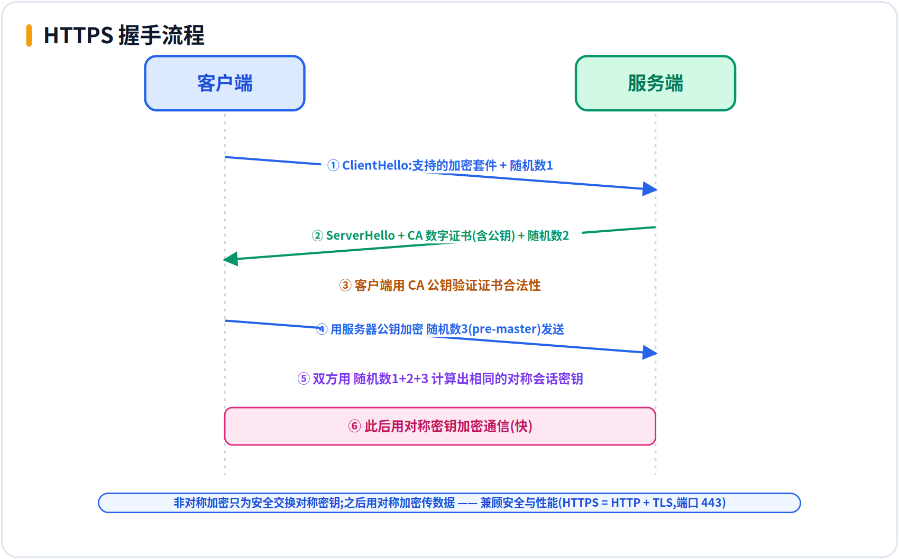

# 第 10 章 · HTTPS 工作流程

> **一句话讲透**
> HTTPS = HTTP + TLS/SSL(端口 443),在 TCP 之上、HTTP 之下加了一层加密。核心思路是“用非对称加密安全地协商出一把对称密钥,之后用对称加密传数据”,从而兼顾安全(防窃听、防篡改、防伪装)与性能(对称加密快)。

简化流程:① 客户端发起,携带支持的加密套件和随机数1;② 服务器返回选定套件、随机数2,以及由 CA 签发的数字证书(内含公钥);③ 客户端用 CA 的公钥验证证书是否合法可信;④ 客户端生成随机数3(pre-master),用服务器公钥加密后发回;⑤ 双方用随机数1+2+3 计算出相同的对称会话密钥;⑥ 之后所有通信都用这把对称密钥加密。

**再往下挖**

- 为什么不全程用非对称加密?非对称运算慢,只适合用来安全交换密钥;大量数据用对称加密才高效。
- 数字证书解决“公钥是不是真的属于这个网站”——靠 CA 用自己的私钥对网站公钥签名,浏览器用内置 CA 公钥验签,防止中间人伪造。
- 现代 TLS 多用 ECDHE 做密钥交换以实现前向安全;上面的 RSA 交换是便于理解的经典版本。

> **放到 vibe coding 里**　模型贴一段“关闭证书校验”让 HTTPS 跑通时，那是把安全直接关掉。懂 TLS 握手在验什么，你才不会为图快放行这种“修复”。
