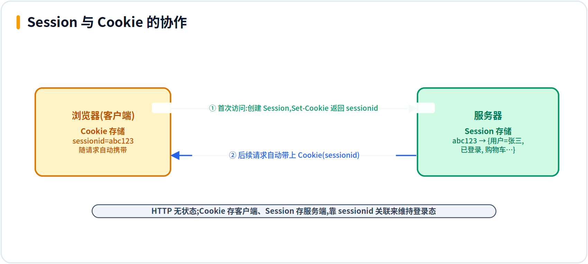

# 第 11 章 · Cookie 与 Session

> **一句话讲透**
> HTTP 是无状态的,Cookie 和 Session 用来在多次请求间维持状态(如登录态)。Cookie 存在客户端浏览器,每次请求自动带上;Session 存在服务端,保存真正的用户数据,二者通过一个 SessionID 关联——SessionID 通常就放在 Cookie 里随请求传回服务器。

**Cookie 与 Session 对比**

| 对比维度 | Cookie | Session |
| --- | --- | --- |
| 存储位置 | 客户端(浏览器) | 服务端 |
| 安全性 | 较低(可被查看/篡改) | 较高(数据不出服务端) |
| 容量 | 单个约 4KB,数量有限 | 受服务端内存/存储限制 |
| 生命周期 | 可设过期时间,可持久化 | 默认会话级,可配置超时 |
| 对服务端压力 | 几乎无 | 占用服务端资源 |

**再往下挖**

- 分布式/集群下 Session 共享问题:可用 Session 复制、Session 集中存储(Redis)、或一致性哈希粘性会话解决。
- 另一条路是 Token / JWT:把状态编码进令牌交给客户端保存,服务端无需存 Session,天然适合分布式;这是高频对比追问。
