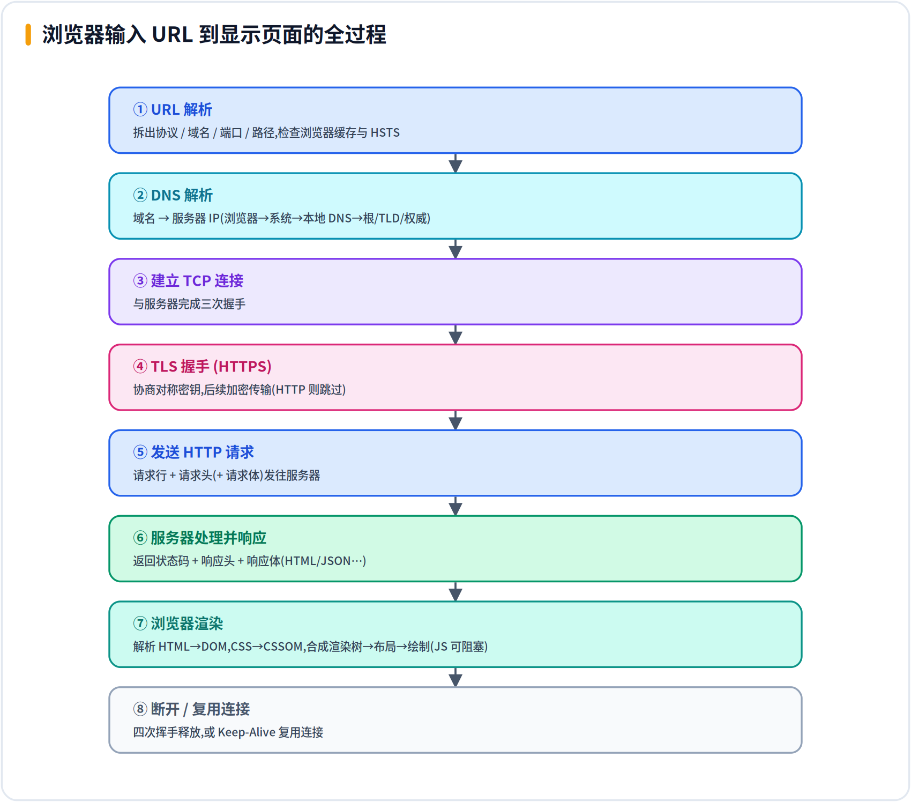

# 第 12 章 · 输入 URL 到页面显示的全过程

这是计算机网络的“综合大题”,几乎必考,因为它能把 DNS、TCP、HTTP、HTTPS、渲染全部串起来。

> **一句话讲透**
> ① 解析 URL(协议/域名/端口/路径),查浏览器缓存;② DNS 解析把域名转成 IP;③ 与服务器进行 TCP 三次握手;④ 若是 HTTPS 再做 TLS 握手协商密钥;⑤ 发送 HTTP 请求;⑥ 服务器处理并返回响应;⑦ 浏览器解析渲染:HTMLDOM 树、CSSCSSOM、合成渲染树布局(Layout)绘制(Paint),期间 JS 可能阻塞解析;⑧ 数据传输完成后按需四次挥手断开,或用 Keep-Alive 复用连接。

渲染细节(前端岗高频):浏览器边下载边解析 HTML 构建 DOM,遇到 CSS 构建 CSSOM,二者合成渲染树(只含可见节点);随后进行布局计算每个节点的几何位置,再绘制成像素,最后合成图层显示。遇到 &lt;script> 默认会阻塞 DOM 解析(可用 async / defer 优化);CSS 会阻塞渲染。修改样式触发的“重排(reflow)/重绘(repaint)”是性能优化重点。

> **一句话小结**
> 记忆主线 解析URL DNS TCP握手 (TLS) 发请求 收响应 渲染 断开;能背这条链就拿下这道题。

> **放到 vibe coding 里**　这条链（DNS→TCP→TLS→HTTP→渲染）是你排查“页面打不开 / 很慢”的地图。模型乱猜原因时，你能按链路一段段定位到底卡在哪一环。
