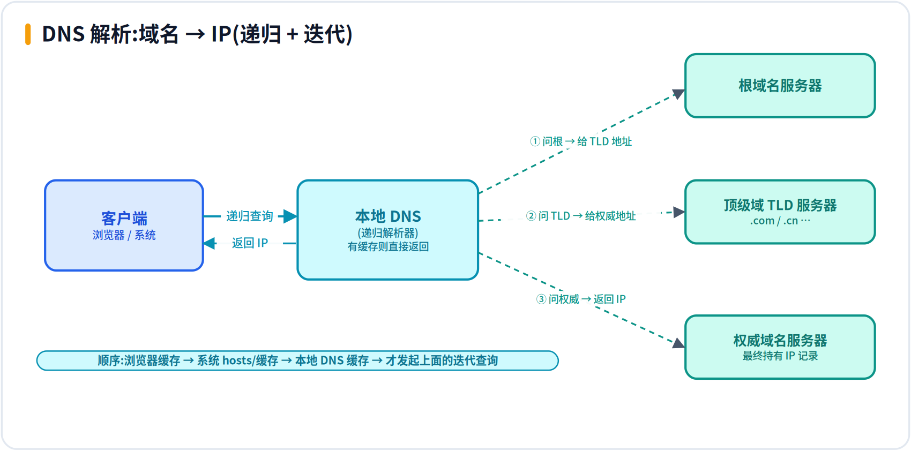

# 第 13 章 · DNS 解析过程

> **一句话讲透**
> DNS 把域名解析成 IP。查找顺序:先查浏览器缓存 操作系统缓存(含 hosts 文件) 本地 DNS 服务器(LDNS)缓存;都没命中,LDNS 就发起迭代查询:先问根域名服务器(返回顶级域服务器地址) 再问顶级域 TLD 服务器(返回权威服务器地址) 最后问权威域名服务器拿到 IP;LDNS 缓存结果并返回给客户端。

**再往下挖**

- 递归 vs 迭代:客户端到本地 DNS 通常是递归查询(“你帮我查到为止”);本地 DNS 到根/TLD/权威是迭代查询(“你告诉我下一步问谁”)。
- DNS 默认用 UDP(快,报文小),数据较大或区域传送时用 TCP;各级缓存 + TTL 大幅减少查询。
