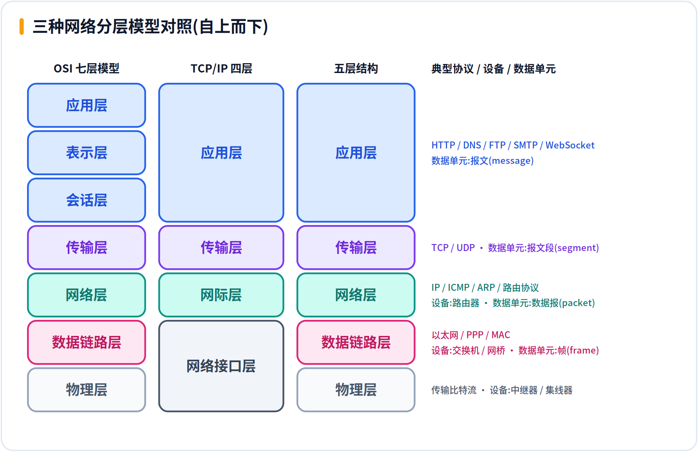

# 计算机网络

数据怎么跨机器可靠送达：TCP/IP、HTTP、HTTPS，以及“为什么超时、为什么丢包”。

## 引言:把网络想成「盖楼 + 装修」

计算机网络的八股看着多,其实可以用一个比喻一口气串起来:网络通信就像盖一栋楼再装修。最底下是地基与水电——物理层把比特变成信号、数据链路层把帧送到同一网段的对端、网络层(IP)负责跨网络一路寻址路由,把数据包送到正确的那台机器;往上是装修——传输层(TCP)保证数据完整、有序、不丢地送达,应用层(HTTP)决定“住进去之后怎么交流”。

所以本文不按脑图的随机顺序,而是从“地基”讲到“装修”:先分层模型,再 IP/ARP,然后传输层的 TCP(握手、挥手、可靠、流控、拥塞)与 UDP,接着应用层的 HTTP / HTTPS / Cookie-Session,最后用“在浏览器输入一个网址到页面显示”这道综合大题,把整栋楼从上到下走一遍,顺带把 DNS 讲透。

## 把它用在 vibe coding 上

网络是你和模型一起写的每个服务“看不见的地基”。请求为什么超时、为什么偶尔丢包、为什么 HTTPS 配错——都在这层。

- **定位“时好时坏”** —— 三次握手、超时重传、拥塞控制让你知道网络抖动长什么样，不会把网络问题当成代码 bug 让模型瞎改一通。
- **判断 API 设计** —— HTTP 方法、状态码、幂等性，决定模型给的接口经不经得起重试和缓存。
- **看懂安全握手** —— HTTPS / TLS 流程让你能 review 模型给的证书与加密配置，而不是复制一段就上线。

## 本篇章节

- [第 1 章 · 网络分层模型(OSI / TCP-IP / 五层)](./ch01)
- [第 2 章 · IP 协议与 ARP](./ch02)
- [第 3 章 · TCP 三次握手](./ch03)
- [第 4 章 · TCP 四次挥手](./ch04)
- [第 5 章 · TCP 如何保证可靠传输](./ch05)
- [第 6 章 · TCP 流量控制](./ch06)
- [第 7 章 · TCP 拥塞控制](./ch07)
- [第 8 章 · UDP 与 TCP/UDP 对比](./ch08)
- [第 9 章 · HTTP:报文 / 方法 / 状态码](./ch09)
- [第 10 章 · HTTPS 工作流程](./ch10)
- [第 11 章 · Cookie 与 Session](./ch11)
- [第 12 章 · 输入 URL 到页面显示的全过程](./ch12)
- [第 13 章 · DNS 解析过程](./ch13)
- [第 14 章 · 总结:高频速答清单 + 名词速查表](./ch14)
