# 数据结构与算法

**覆盖**：复杂度 · 数组链表 · 栈队列 · 哈希表 · 树 · 堆 · 图 · 二分 · 排序 · 分治 · 回溯 · 动态规划 · 贪心

## 把它用在 vibe coding 上

数据结构与算法是模型最爱“炫技”、也最容易过度设计的地方。懂它，你判断的是：这个结构 / 算法选得对不对、复杂度配不配得上数据规模。

- **看复杂度配不配规模** —— 模型上来就上红黑树、跳表，可能几百条数据用数组就够。拿 O(n) 直觉就能否掉过度设计。
- **选对容器** —— 查得多用哈希、要有序用树、先进先出用队列。模型选错容器导致的慢，你能一眼换掉。
- **审它的“最优解”** —— 模型说“这是最优”，你能追问：拿时间换了空间吗？边界处理了吗？最坏情况呢？

## 引言:数据结构与算法是什么

一句话:数据结构研究“数据怎么组织和存储”,算法研究“怎么高效地解决问题”,二者相辅相成——著名的等式就是“程序 = 数据结构 + 算法”。同样一个问题,选对数据结构、用对算法,运行时间可能从几小时降到几毫秒。大厂面试无论是手撕代码还是八股提问,数据结构与算法都是绕不开的核心。

本文按由浅入深的主线展开:先讲复杂度分析(衡量好坏的标尺),再逐一过各种数据结构(数组链表、栈队列、哈希表、树、堆、图),然后是查找与排序,最后是四大算法范式(分治、回溯、动态规划、贪心),并在结尾给出复杂度速查表和“看到什么题用什么套路”的速查表。

## 第 1 章 · 复杂度分析

> **一句话讲透**
> 复杂度衡量算法随输入规模 n 增长时的资源消耗趋势。时间复杂度用大 O 表示渐进上界,常见从小到大:O(1) < O(log n) < O(n) < O(n log n) < O(n²) < O(2^n) < O(n!);空间复杂度衡量额外内存的增长。大 O 关注最坏情况的上界,忽略常数项与低阶项。

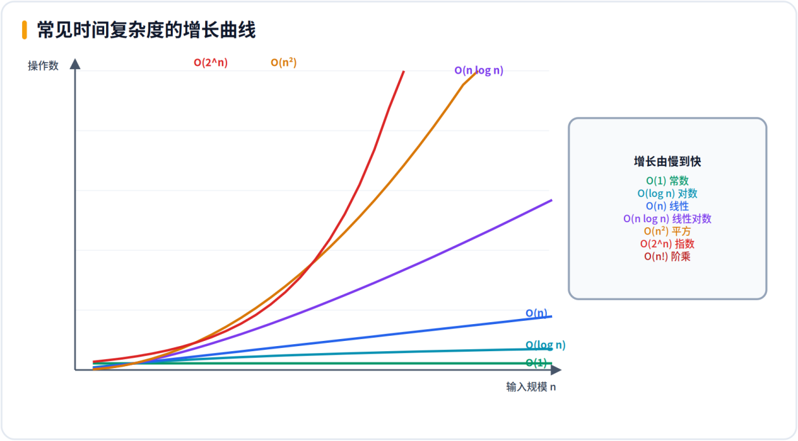

| 复杂度 | 名称 | 典型例子 |
| --- | --- | --- |
| O(1) | 常数 | 数组按下标访问、哈希查找 |
| O(log n) | 对数 | 二分查找、平衡树的增删查 |
| O(n) | 线性 | 遍历数组 / 链表一次 |
| O(n log n) | 线性对数 | 快排、归并、堆排序 |
| O(n²) | 平方 | 冒泡 / 选择 / 插入排序、双重循环 |
| O(2^n) | 指数 | 朴素递归(斐波那契)、枚举所有子集 |

**再往下挖**

- 怎么算:看循环嵌套层数;递归用递归树或主定理;均摊分析(如动态数组扩容,单次最坏 O(n) 但均摊 O(1))。
- 区分最好 / 最坏 / 平均复杂度;面试默认问最坏或平均。空间复杂度也要会分析(递归栈深度也算空间)。

> **放到 vibe coding 里**　让模型给方案时顺手问一句“这随数据量怎么涨”。它常给能跑但 O(n²) 的实现，数据一大就卡——复杂度直觉是你最便宜的一道闸。

## 第 2 章 · 数组与链表

> **一句话讲透**
> 数组是连续内存,支持按下标 O(1) 随机访问,但插入/删除要移动后续元素 O(n),且大小固定(动态数组扩容是均摊 O(1));链表由分散的节点经指针相连,在已定位的位置插入/删除只需改指针 O(1),但访问要从头遍历 O(n),还有指针的额外空间开销。

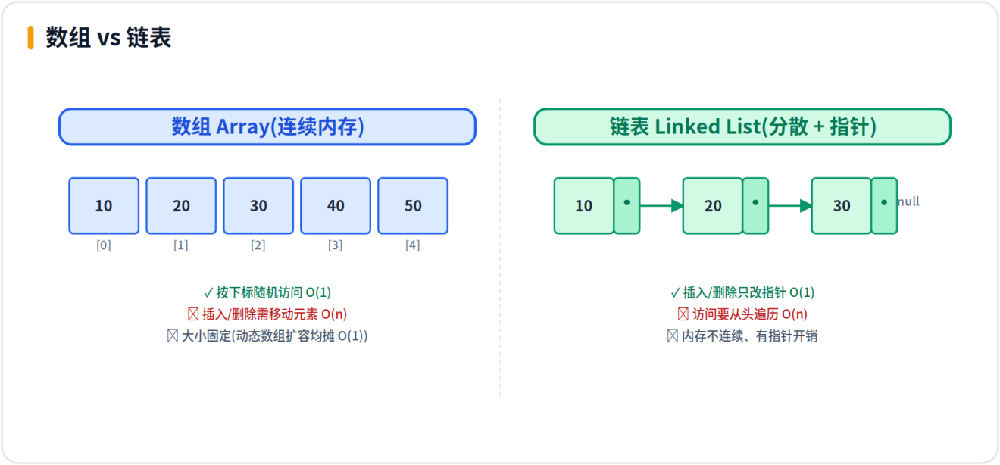

**再往下挖**

- 链表分单链表、双链表、循环链表;动态数组(ArrayList / vector)满了会开 2 倍新数组并拷贝旧元素,所以单次插入均摊 O(1)。
- 怎么选:频繁随机访问用数组;频繁在中间增删用链表。
 易错点 
链表“插入/删除 O(1)”的前提是已经定位到了目标节点;如果要先查找位置,查找本身仍是 O(n)。

## 第 3 章 · 栈与队列

> **一句话讲透**
> 栈是后进先出(LIFO),只能在栈顶 push / pop;队列是先进先出(FIFO),队尾入队、队首出队。两者都可用数组或链表实现,基本操作都是 O(1)。

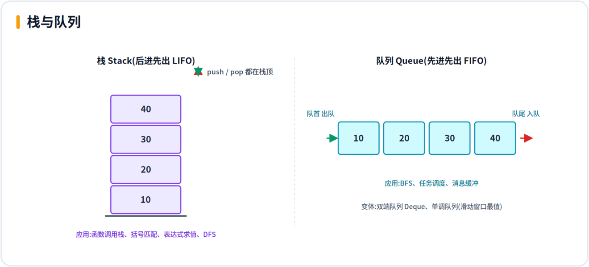

**再往下挖**

- 栈的应用:函数调用栈、括号匹配、表达式求值、单调栈(下一个更大元素)、DFS;队列的应用:BFS、任务调度、缓冲。
- 变体:双端队列 Deque、单调队列(滑动窗口最大值)、优先队列(底层是堆)。“用两个栈实现队列 / 用队列实现栈”是经典手撕题。

## 第 4 章 · 哈希表

> **一句话讲透**
> 哈希表通过哈希函数把 key 映射到桶(数组下标),实现平均 O(1) 的增、删、查。不同 key 映射到同一位置叫哈希冲突,常用链地址法(桶里挂链表 / 红黑树)或开放寻址(线性、二次探测)解决;当负载因子超过阈值(如 0.75)时扩容并 rehash。

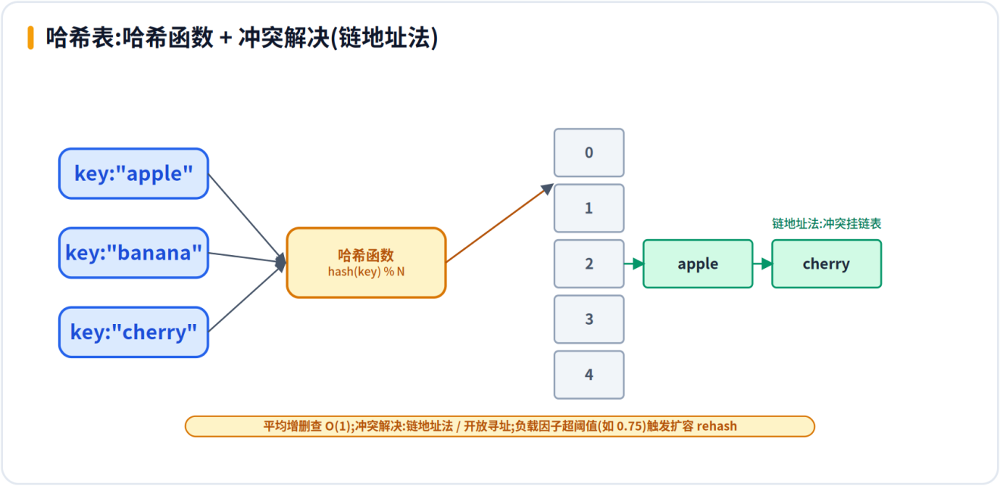

**再往下挖**

- Java HashMap = 数组 + 链表 + 红黑树(链表长度 ≥ 8 且容量 ≥ 64 时转红黑树);最坏 O(n)(大量冲突)。
- 哈希表无序;要按序遍历用 TreeMap(红黑树,O(log n))。作 key 的对象要正确实现 hashCode / equals。

> **放到 vibe coding 里**　“用字典存一下就 O(1) 了”是模型口头禅，但哈希冲突、key 不可哈希、内存翻倍它常不提。你知道代价，才判断得了这次空间换时间值不值。

## 第 5 章 · 树

> **一句话讲透**
> 二叉树每个节点最多两个子节点。遍历分前序(根·左·右)、中序(左·根·右)、后序(左·右·根)——都是 DFS,以及层序(BFS,用队列)。二叉搜索树 BST 满足左 < 根 < 右,查找/插入/删除平均 O(log n)、最坏 O(n)(退化成链表);为避免退化用平衡树:AVL(严格平衡)、红黑树(近似平衡,增删更高效,Java/C++ 的有序 map 都用它),都保证 O(log n)。

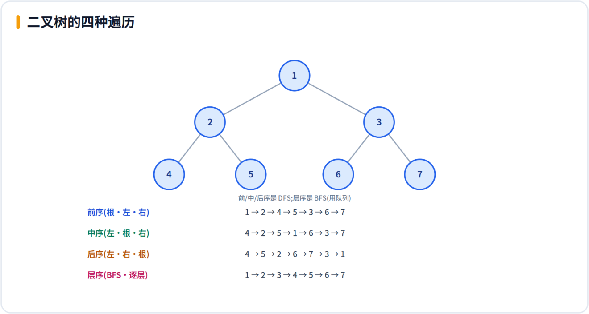

**再往下挖**

- 中序遍历 BST 得到升序序列;B / B+ 树是多路平衡树,用于数据库与磁盘索引;Trie(字典树)用于字符串前缀检索。
- 高频手撕:前/中/后序的递归与迭代写法、层序遍历、由“前序 + 中序”重建二叉树、判断平衡 / 对称、最近公共祖先 LCA。

## 第 6 章 · 堆

> **一句话讲透**
> 二叉堆是一棵完全二叉树,通常用数组存储(节点 i 的左右孩子是 2i+1、2i+2,父节点是 (i-1)/2)。大顶堆满足父 ≥ 子,小顶堆父 ≤ 子。插入(尾部加入后“上浮”)和删除堆顶(末尾换到堆顶后“下沉”)都是 O(log n),建堆 O(n)。

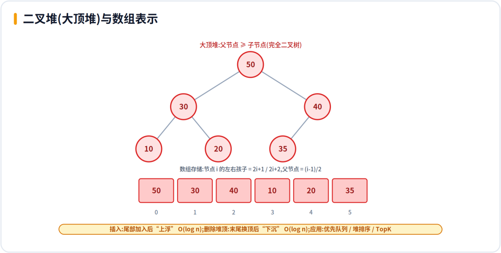

**再往下挖**

- 应用:优先队列、堆排序 O(n log n)、TopK(维护大小为 k 的堆)、数据流中位数(大顶堆 + 小顶堆)、合并 K 个有序链表。
 易错点 
求“最大的 K 个”要用小顶堆(堆顶是这 K 个里最小的,新元素比堆顶大才入堆并弹出堆顶);求“最小的 K 个”用大顶堆。别记反。

## 第 7 章 · 图

> **一句话讲透**
> 图由顶点和边组成,分有向/无向、带权/无权。两种表示:邻接矩阵(n×n,空间 O(V²),判断两点是否相邻 O(1),适合稠密图)和邻接表(每个顶点存邻居列表,空间 O(V+E),适合稀疏图)。两种遍历:BFS(队列,逐层扩展,可求无权图最短路径)和 DFS(递归或栈)。

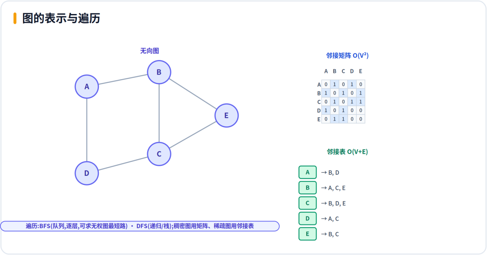

**再往下挖**

- 经典算法:最短路——Dijkstra(非负权)、Bellman-Ford(可负权)、Floyd(多源);最小生成树——Prim、Kruskal;拓扑排序(有向无环图);并查集(判连通 / 合并集合)。
 易错点 
BFS 求最短路只适用于无权图(或所有边权相等);带权图要用 Dijkstra 等算法。

## 第 8 章 · 搜索:二分查找

> **一句话讲透**
> 二分查找在有序数组上每次取中间元素与目标比较,把搜索区间砍掉一半,时间 O(log n)。要点:统一区间约定(如左闭右闭)、防溢出 mid = low + (high - low) / 2。

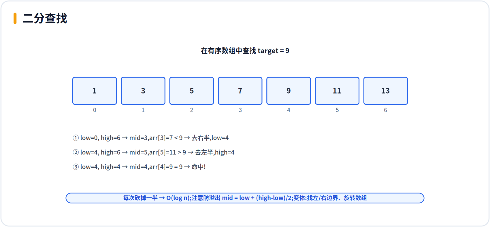

**再往下挖**

- 变体:查找左 / 右边界(第一个 / 最后一个等于 target)、在旋转有序数组中查找、对“答案”二分(二分答案)。
- 其他查找:线性查找 O(n)、哈希查找 O(1)、树 / 图的 BFS / DFS。
 易错点 
二分的边界(用 <= 还是 <、mid 要不要 ±1、区间是闭还是半开)极易写错;务必固定一套区间约定并据此推导循环条件。

## 第 9 章 · 排序

> **一句话讲透**
> 常考排序:冒泡 / 选择 / 插入都是 O(n²);快速排序(分治 + 分区)平均 O(n log n)、最坏 O(n²)、不稳定;归并排序(分治 + 合并)稳定 O(n log n)、空间 O(n);堆排序 O(n log n)、空间 O(1)、不稳定;计数 / 桶 / 基数是非比较排序,特定场景可达 O(n+k)。基于比较的排序时间下界是 O(n log n)。

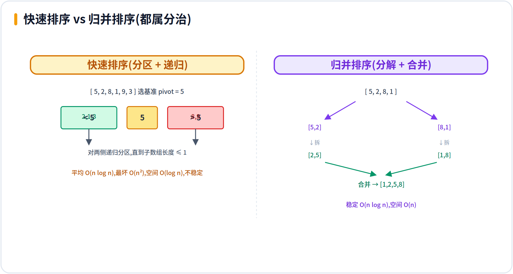

| 算法 | 平均时间 | 最坏时间 | 空间 | 稳定性 |
| --- | --- | --- | --- | --- |
| 冒泡排序 | O(n²) | O(n²) | O(1) | 稳定 |
| 选择排序 | O(n²) | O(n²) | O(1) | 不稳定 |
| 插入排序 | O(n²) | O(n²) | O(1) | 稳定 |
| 快速排序 | O(n log n) | O(n²) | O(log n) | 不稳定 |
| 归并排序 | O(n log n) | O(n log n) | O(n) | 稳定 |
| 堆排序 | O(n log n) | O(n log n) | O(1) | 不稳定 |
| 计数排序 | O(n+k) | O(n+k) | O(k) | 稳定 |

**再往下挖**

- 稳定性 = 相等元素的相对顺序是否保持不变。快排最坏 O(n²) 出现在“数组近乎有序且基准选得差”时,用随机化基准或三数取中可避免。
- 工程里常用混合排序:如 Java 对象数组用 TimSort、基本类型用双轴快排;C++ sort 是内省排序(快排 + 堆排 + 插排)。

## 第 10 章 · 分治

> **一句话讲透**
> 分治把一个大问题分成若干同类的子问题,递归求解后再合并结果,三步:分(divide)、治(conquer)、合(combine)。归并排序、快速排序、二分查找、快速幂都是分治的典型应用;复杂度常用主定理 T(n) = a·T(n/b) + f(n) 求解。

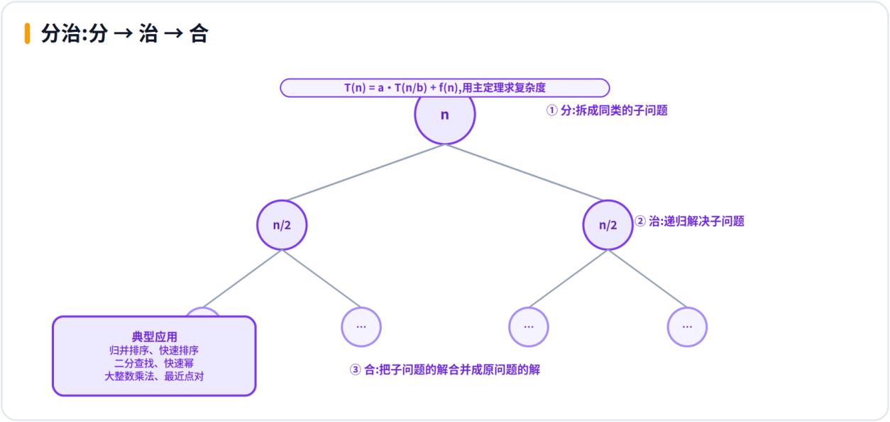

**再往下挖**

分治与动态规划的关键区别:分治的子问题相互独立(各算各的),动态规划的子问题相互重叠(要把解存下来避免重复计算)。

## 第 11 章 · 回溯

> **一句话讲透**
> 回溯是一种系统地搜索所有候选解的方法,本质是 DFS + 剪枝:沿着决策树“做选择 递归进入下一层 撤销选择”地遍历,遇到不可行的分支就剪枝返回。模板:满足结束条件就收集解,否则遍历选择列表,对每个选择执行“做选择 递归 撤销选择”。

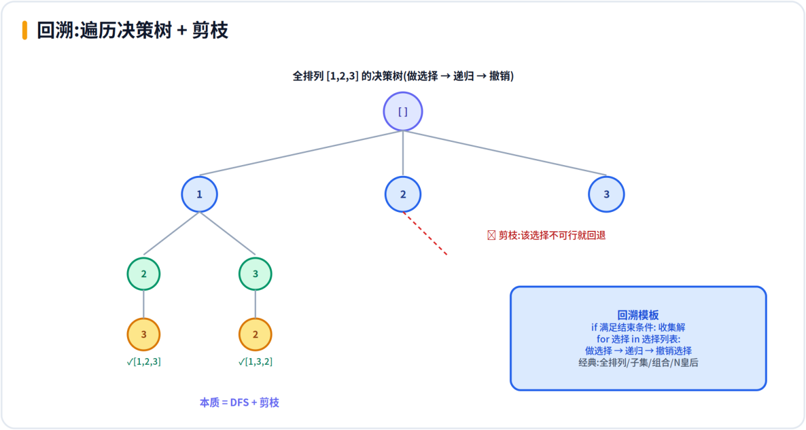

**再往下挖**

经典题:全排列、组合、子集、N 皇后、数独、括号生成、单词搜索。剪枝是优化关键(可行性剪枝、去重剪枝),不剪枝就是暴力枚举,复杂度常为指数级。

## 第 12 章 · 动态规划

> **一句话讲透**
> 动态规划把问题拆成相互重叠的子问题,保存子问题的解避免重复计算。适用条件:最优子结构 + 重叠子问题 + 无后效性。解题三要素:状态定义(dp[i] 表示什么)、状态转移方程、初始 / 边界条件。实现有自顶向下(记忆化递归)和自底向上(递推填表)两种。

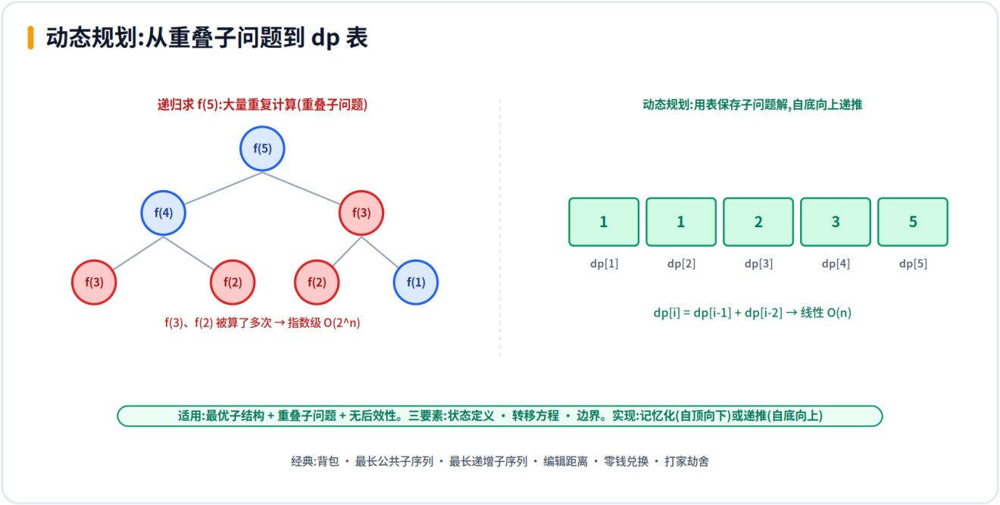

**再往下挖**

- 经典题:爬楼梯 / 斐波那契、0-1 背包 / 完全背包、最长公共子序列 LCS、最长递增子序列 LIS、编辑距离、零钱兑换、打家劫舍、股票买卖。常可用“滚动数组”把空间从 O(n) 降到 O(1)。
 易错点
- 与分治区别:子问题是否重叠;与贪心区别:DP 会考虑所有选择求全局最优,贪心每步只取当前局部最优。
- DP 最难的是“定义状态 + 写对转移方程”;先想清楚 dp[i] 的确切含义,转移方程往往就出来了。

> **放到 vibe coding 里**　模型给的 DP 经常状态定义含糊、边界写错。你抓住“状态、转移、边界”三件套去对，比让它“再调调”高效得多。

## 第 13 章 · 贪心

> **一句话讲透**
> 贪心在每一步都做当前看来最优的选择,期望最终得到全局最优。适用前提是问题具有“贪心选择性质”(局部最优能推出全局最优)和最优子结构;贪心不一定总能得到最优解,需要证明其正确性。

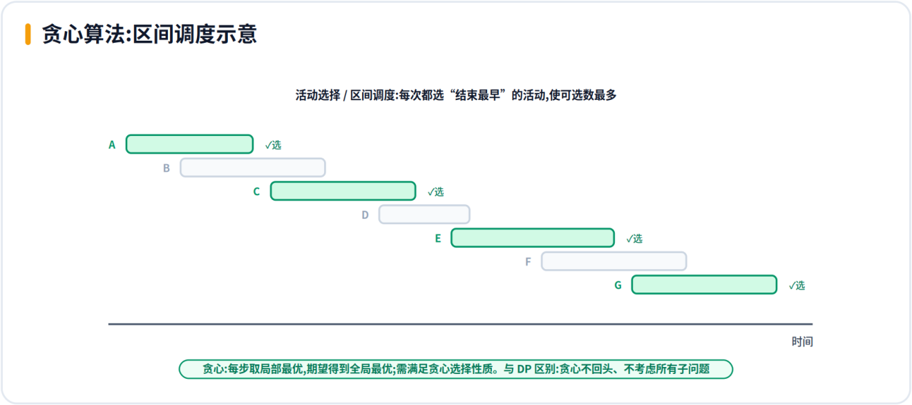

**再往下挖**

- 经典题:活动选择 / 区间调度(按结束时间排序后贪心选)、找零钱、霍夫曼编码、最小生成树(Prim / Kruskal)、跳跃游戏、分发糖果。很多贪心题要先排序。
 易错点 
与 DP 区别:贪心做出选择后不回头、不考虑所有子问题,DP 则会考虑所有可能。能用贪心的问题通常也能用 DP,但贪心更快;不确定时优先想 DP 保正确。

## 第 14 章 · 总结:速查表 + 算法套路 + 要点回顾

把数据结构与算法收个尾:先用复杂度衡量好坏;数据结构是“数据怎么存”——数组/链表是基础,栈/队列限定存取顺序,哈希表换 O(1) 查找,树/堆/图各有拿手场景;算法范式是“怎么解”——分治拆解、回溯穷举带剪枝、动态规划记忆化求最优、贪心每步取最优。下面两张速查表是冲刺时最该背的。

**常见数据结构操作复杂度(平均)**

| 数据结构 | 访问 / 取值 | 查找 | 插入 | 删除 |
| --- | --- | --- | --- | --- |
| 数组 | O(1) | O(n) | O(n) | O(n) |
| 链表 | O(n) | O(n) | O(1)* | O(1)* |
| 栈 / 队列 | 栈顶/队首 O(1) | O(n) | O(1) | O(1) |
| 哈希表 | — | O(1) | O(1) | O(1) |
| 平衡二叉搜索树 | O(log n) | O(log n) | O(log n) | O(log n) |
| 堆 | 取堆顶 O(1) | O(n) | O(log n) | O(log n) |

* 注:链表的插入/删除是在“已定位到节点”的前提下为 O(1);若需先查找位置则为 O(n)。

**算法套路速查:看到什么题,用什么思路**

| 题目信号 | 首选思路 |
| --- | --- |
| 有序数组找数 / 找边界 | 二分查找 |
| 连续子数组 / 子串 | 滑动窗口、双指针、前缀和 |
| 两数之和 / 去重 / 计数 | 哈希表 |
| 树按层处理 | BFS;树的路径 / 遍历 DFS / 递归 |
| 无权图最短路 | BFS;带权最短路 Dijkstra |
| 求所有排列 / 组合 / 子集 | 回溯(DFS + 剪枝) |
| 求最优(最大/最小/方案数)且子问题重叠 | 动态规划 |
| 每步局部最优可达全局最优 | 贪心(常需先排序) |
| 区间问题 | 排序 + 贪心 / 合并 |
| TopK / 第 K 大 | 堆 或 快速选择 |
| 括号匹配 / 下一个更大元素 | 栈 / 单调栈 |

**抓住这几点**

- 复杂度分析是基础中的基础,任何手撕题都要能说出时间/空间复杂度
- 数据结构记住“各操作复杂度 + 适用场景”,算法记住“套路 + 模板 + 经典题”
- 手撕代码靠平时刷题(建议按专题刷),临场先讲思路再写、写完主动分析复杂度和边界
- 二分边界、回溯的“撤销”、DP 的状态定义最容易出错,重点练。

数据结构与算法重在理解和动手,多画图、多刷题。愿你真正把它用起来!
