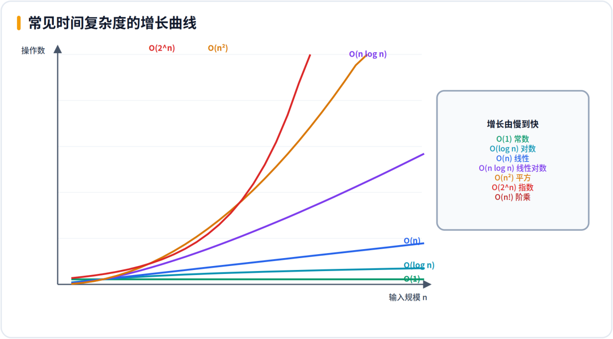

# 第 1 章 · 复杂度分析

> **一句话讲透**
> 复杂度衡量算法随输入规模 n 增长时的资源消耗趋势。时间复杂度用大 O 表示渐进上界,常见从小到大:O(1) < O(log n) < O(n) < O(n log n) < O(n²) < O(2^n) < O(n!);空间复杂度衡量额外内存的增长。大 O 关注最坏情况的上界,忽略常数项与低阶项。

| 复杂度 | 名称 | 典型例子 |
| --- | --- | --- |
| O(1) | 常数 | 数组按下标访问、哈希查找 |
| O(log n) | 对数 | 二分查找、平衡树的增删查 |
| O(n) | 线性 | 遍历数组 / 链表一次 |
| O(n log n) | 线性对数 | 快排、归并、堆排序 |
| O(n²) | 平方 | 冒泡 / 选择 / 插入排序、双重循环 |
| O(2^n) | 指数 | 朴素递归(斐波那契)、枚举所有子集 |

**再往下挖**

- 怎么算:看循环嵌套层数;递归用递归树或主定理;均摊分析(如动态数组扩容,单次最坏 O(n) 但均摊 O(1))。
- 区分最好 / 最坏 / 平均复杂度;面试默认问最坏或平均。空间复杂度也要会分析(递归栈深度也算空间)。

> **放到 vibe coding 里**　让模型给方案时顺手问一句“这随数据量怎么涨”。它常给能跑但 O(n²) 的实现，数据一大就卡——复杂度直觉是你最便宜的一道闸。
