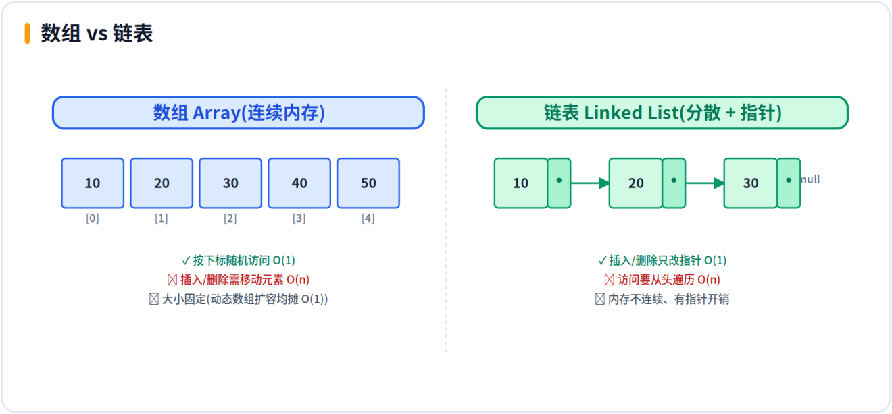

# 第 2 章 · 数组与链表

> **一句话讲透**
> 数组是连续内存,支持按下标 O(1) 随机访问,但插入/删除要移动后续元素 O(n),且大小固定(动态数组扩容是均摊 O(1));链表由分散的节点经指针相连,在已定位的位置插入/删除只需改指针 O(1),但访问要从头遍历 O(n),还有指针的额外空间开销。

**再往下挖**

- 链表分单链表、双链表、循环链表;动态数组(ArrayList / vector)满了会开 2 倍新数组并拷贝旧元素,所以单次插入均摊 O(1)。
- 怎么选:频繁随机访问用数组;频繁在中间增删用链表。
 易错点 
链表“插入/删除 O(1)”的前提是已经定位到了目标节点;如果要先查找位置,查找本身仍是 O(n)。
