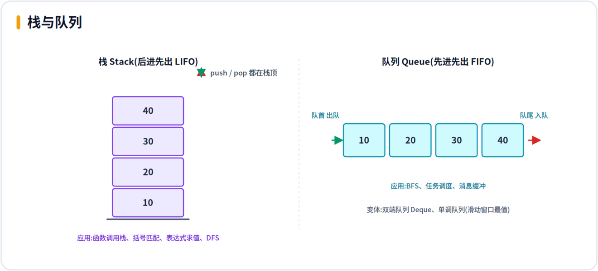

# 第 3 章 · 栈与队列

> **一句话讲透**
> 栈是后进先出(LIFO),只能在栈顶 push / pop;队列是先进先出(FIFO),队尾入队、队首出队。两者都可用数组或链表实现,基本操作都是 O(1)。

**再往下挖**

- 栈的应用:函数调用栈、括号匹配、表达式求值、单调栈(下一个更大元素)、DFS;队列的应用:BFS、任务调度、缓冲。
- 变体:双端队列 Deque、单调队列(滑动窗口最大值)、优先队列(底层是堆)。“用两个栈实现队列 / 用队列实现栈”是经典手撕题。
