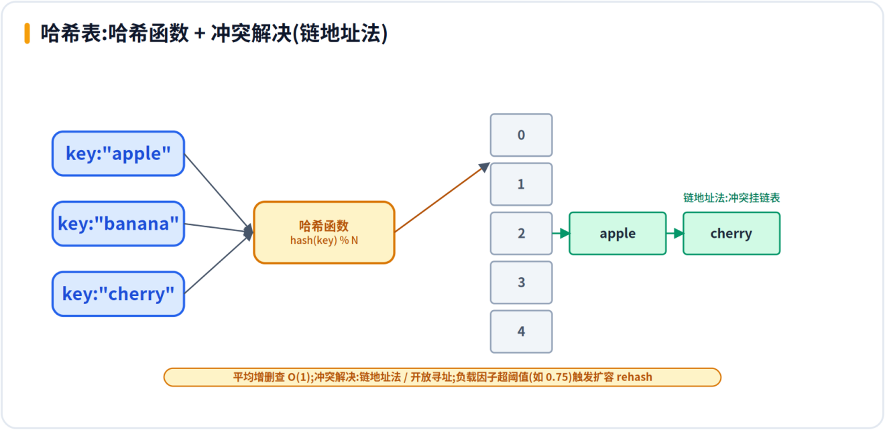

# 第 4 章 · 哈希表

> **一句话讲透**
> 哈希表通过哈希函数把 key 映射到桶(数组下标),实现平均 O(1) 的增、删、查。不同 key 映射到同一位置叫哈希冲突,常用链地址法(桶里挂链表 / 红黑树)或开放寻址(线性、二次探测)解决;当负载因子超过阈值(如 0.75)时扩容并 rehash。

**再往下挖**

- Java HashMap = 数组 + 链表 + 红黑树(链表长度 ≥ 8 且容量 ≥ 64 时转红黑树);最坏 O(n)(大量冲突)。
- 哈希表无序;要按序遍历用 TreeMap(红黑树,O(log n))。作 key 的对象要正确实现 hashCode / equals。

> **放到 vibe coding 里**　“用字典存一下就 O(1) 了”是模型口头禅，但哈希冲突、key 不可哈希、内存翻倍它常不提。你知道代价，才判断得了这次空间换时间值不值。
