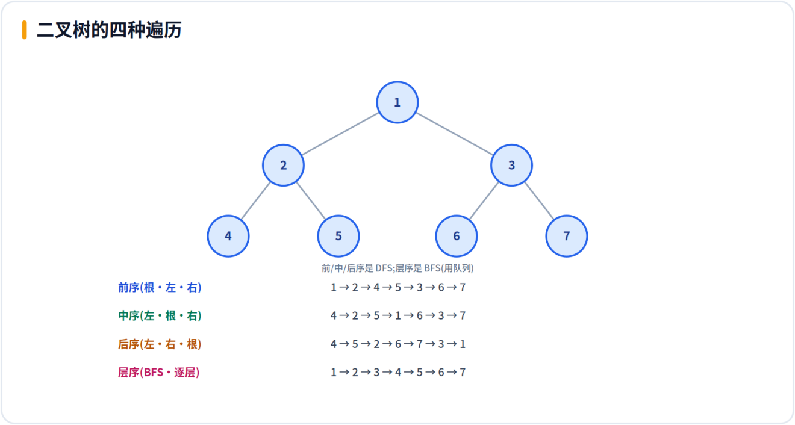

# 第 5 章 · 树

> **一句话讲透**
> 二叉树每个节点最多两个子节点。遍历分前序(根·左·右)、中序(左·根·右)、后序(左·右·根)——都是 DFS,以及层序(BFS,用队列)。二叉搜索树 BST 满足左 < 根 < 右,查找/插入/删除平均 O(log n)、最坏 O(n)(退化成链表);为避免退化用平衡树:AVL(严格平衡)、红黑树(近似平衡,增删更高效,Java/C++ 的有序 map 都用它),都保证 O(log n)。

**再往下挖**

- 中序遍历 BST 得到升序序列;B / B+ 树是多路平衡树,用于数据库与磁盘索引;Trie(字典树)用于字符串前缀检索。
- 高频手撕:前/中/后序的递归与迭代写法、层序遍历、由“前序 + 中序”重建二叉树、判断平衡 / 对称、最近公共祖先 LCA。
