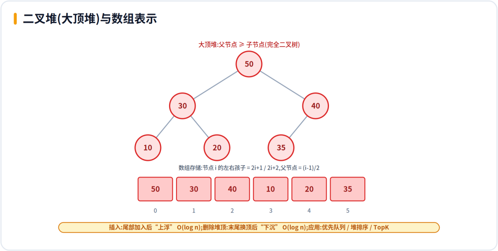

# 第 6 章 · 堆

> **一句话讲透**
> 二叉堆是一棵完全二叉树,通常用数组存储(节点 i 的左右孩子是 2i+1、2i+2,父节点是 (i-1)/2)。大顶堆满足父 ≥ 子,小顶堆父 ≤ 子。插入(尾部加入后“上浮”)和删除堆顶(末尾换到堆顶后“下沉”)都是 O(log n),建堆 O(n)。

**再往下挖**

- 应用:优先队列、堆排序 O(n log n)、TopK(维护大小为 k 的堆)、数据流中位数(大顶堆 + 小顶堆)、合并 K 个有序链表。
 易错点 
求“最大的 K 个”要用小顶堆(堆顶是这 K 个里最小的,新元素比堆顶大才入堆并弹出堆顶);求“最小的 K 个”用大顶堆。别记反。
