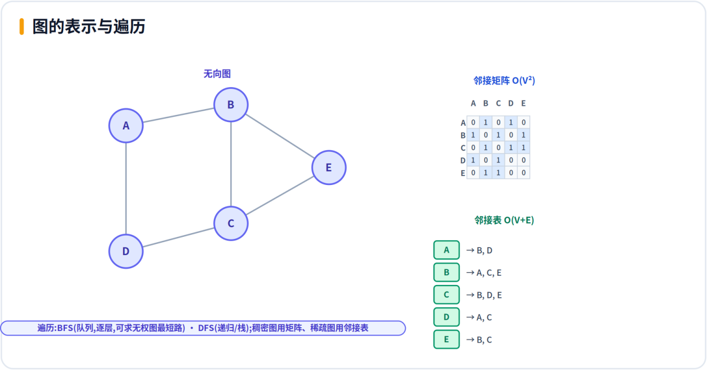

# 第 7 章 · 图

> **一句话讲透**
> 图由顶点和边组成,分有向/无向、带权/无权。两种表示:邻接矩阵(n×n,空间 O(V²),判断两点是否相邻 O(1),适合稠密图)和邻接表(每个顶点存邻居列表,空间 O(V+E),适合稀疏图)。两种遍历:BFS(队列,逐层扩展,可求无权图最短路径)和 DFS(递归或栈)。

**再往下挖**

- 经典算法:最短路——Dijkstra(非负权)、Bellman-Ford(可负权)、Floyd(多源);最小生成树——Prim、Kruskal;拓扑排序(有向无环图);并查集(判连通 / 合并集合)。
 易错点 
BFS 求最短路只适用于无权图(或所有边权相等);带权图要用 Dijkstra 等算法。
