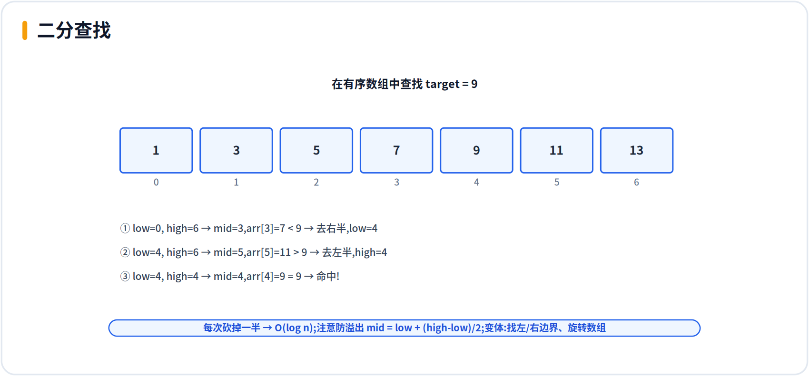

# 第 8 章 · 搜索:二分查找

> **一句话讲透**
> 二分查找在有序数组上每次取中间元素与目标比较,把搜索区间砍掉一半,时间 O(log n)。要点:统一区间约定(如左闭右闭)、防溢出 mid = low + (high - low) / 2。

**再往下挖**

- 变体:查找左 / 右边界(第一个 / 最后一个等于 target)、在旋转有序数组中查找、对“答案”二分(二分答案)。
- 其他查找:线性查找 O(n)、哈希查找 O(1)、树 / 图的 BFS / DFS。
 易错点 
二分的边界(用 <= 还是 <、mid 要不要 ±1、区间是闭还是半开)极易写错;务必固定一套区间约定并据此推导循环条件。
